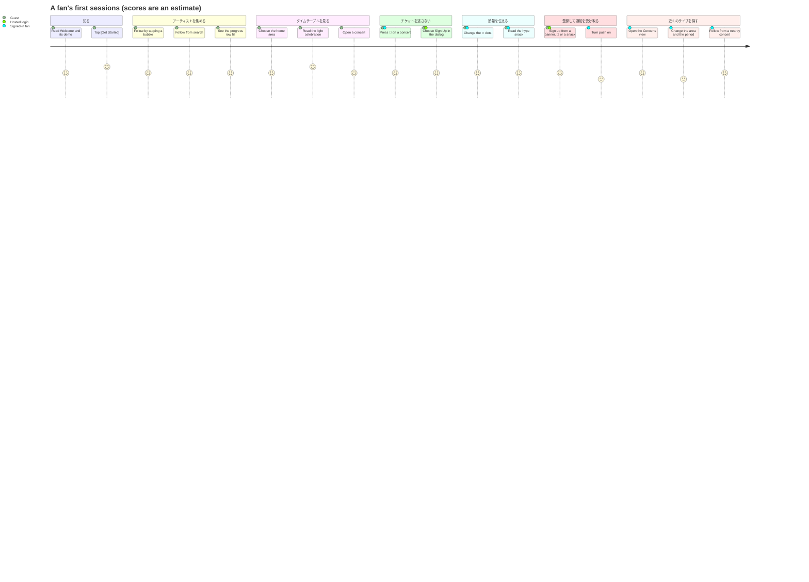
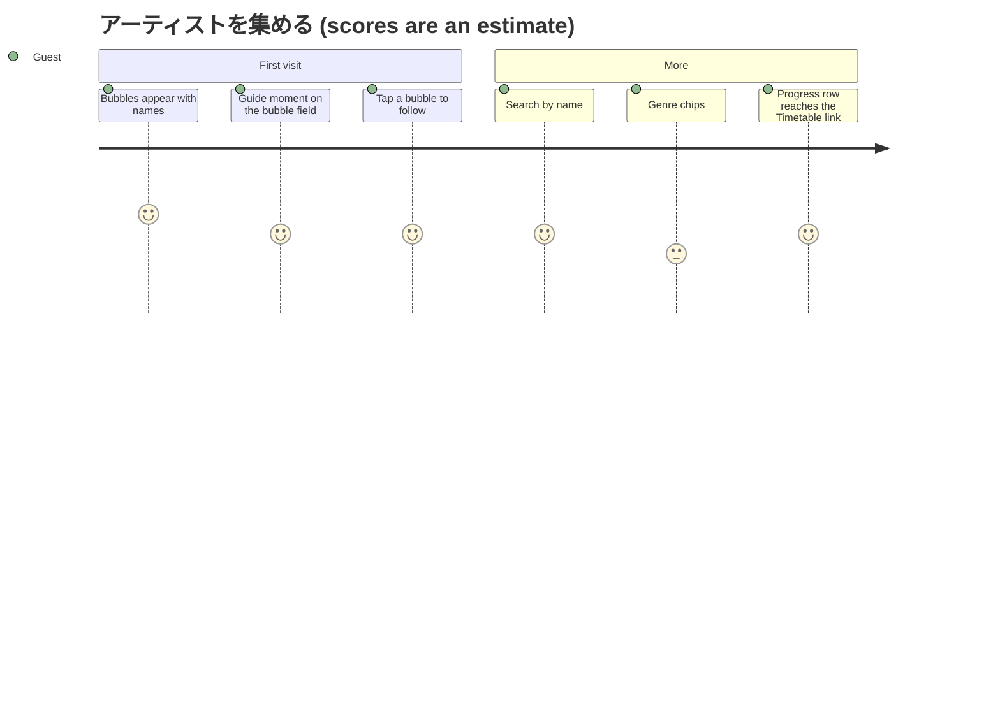
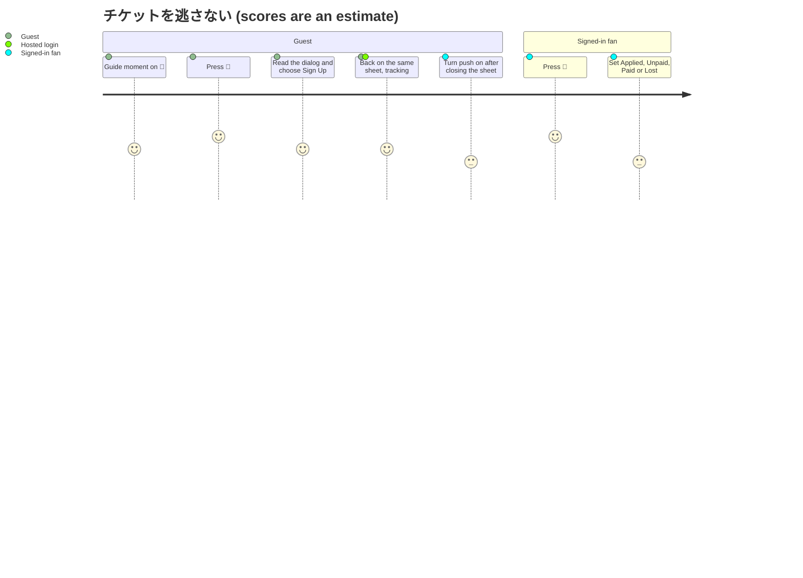

# Fan web: onboarding story map and guide moments

This document maps a fan's first sessions in the fan web app: the steps of
each activity, the surfaces that interrupt them, the guide moments that point
to a feature, and the places where fans stop. It was written for the OpenSpec
change `add-fan-guide-moments` and outlives it, as
`organizer-console-story-map.md` does for the organizer console.

It describes the app as the specs under
`openspec/specs/components/infrastructure/fan/web/` and `openspec/specs/stories/`
define it. App words are quoted in Japanese, exactly as the Japanese app shows
them.

When an onboarding step, an interruption or a guide moment changes, update this
document in the same change.

## Who is involved

| Actor | Role in the stories |
|---|---|
| Guest | A visitor with no account. Follows artists, keeps a home area and hype levels on the device, and sees the Timetable. Has no ticket journey and no push. |
| Signed-in fan | A fan with an account. Everything a guest does, plus the Concerts view, ticket journeys and push. |
| Liverty Music | Finds the followed artists' concerts and pushes new concerts and ticket sale reminders. |
| Hosted login | Zitadel's sign-up and sign-in pages, reached from a 「Sign Up」 or a log-in control. |

## Story map

The scores are an **estimate**, read from the specs and from walking first
sessions through the code, of how easily a fan gets through a step without
help: 5 means the screen says everything needed, 1 means fans do not find it.
They are not measurements; PostHog's `guide.*` events and session recordings
are what confirm them. Steps scored 1 or 2 are under
[Where fans stop](#where-fans-stop).

### Backbone

The seven activities of the first sessions, in the order a new fan meets them.
Scores are after this change.

### 知る (Welcome)

Source: `route/welcome`, `global/coach-mark`.

- Welcome's demo plays a mock push notification, then an interactive timetable.
  Its coach mark points at the first card; it is the only coach mark in the app.
- A card opens the real concert sheet, which on Welcome shows no 🔔 button, no
  push line and no guide moment (route/welcome "Card opens the real detail view").
- [Get Started] starts onboarding on Discovery.

### アーティストを集める (Discovery, artist bubbles)

Source: `route/discovery`, `stories/complete-onboarding`.

- A fan who follows no artist gets the bubble field's guide moment once the
  first name shows: 「気になるアーティストをタップしてフォローしよう！」.
- Each follow that finds concerts shows a snack: the artist has concerts.
- The onboarding progress row under the genre chips becomes the link to the
  Timetable when it is ready.
- A guest sees no swap tile; `/discovery?view=concerts` opens the bubbles for
  a guest.

### タイムテーブルを見る (Timetable)

Source: `route/timetable`, `global/home-area-selector`, `global/celebration-overlay`.

- With no home area, the home-area sheet asks first: 「HOMEエリアを選択」 /
  「住んでるエリアを教えてね！近くのライブを HOME に並べるよ」. A guest is
  asked here and on My Artists only, never on the Concerts view.
- The light celebration: 「タイムテーブル完成！」 with the counts, once.
  Onboarding latches as completed on a meaningful arrival (at least one follow).
- An empty Timetable offers 「アーティストを探す」 (Discovery) and, to a
  signed-in fan only, 「ライブを探す」 (the Concerts view).
- A guest sees the signup banner 「新着ライブを通知で受け取ろう！」 [Sign Up].

### チケットを逃さない (concert sheet)

Source: `global/concert-sheet`, `stories/track-ticket-journey`.

- A fan with no journey at all, on a concert with no status, gets the 🔔 guide
  moment inside the sheet: 「気になるライブは見逃しNG！」.
- A guest's 🔔 opens 「おっと、まだアカウントを持っていないね？」 /
  「通知に必要なアカウントは無料ですぐに作成できるよ！」 with 「あとで」 and
  「Sign Up」. 「Sign Up」 starts sign-up that tracks the concert.
- After that sign-up the Timetable reopens the concert's sheet with no
  celebration; closing the sheet opens the post-signup dialog on
  「あとはプッシュ通知をオンにするだけ！」.
- The out-of-range notice offers to widen the hype level for a concert the
  level does not cover (「Sign Up」 for a guest's push offer).

### 熱量を伝える (My Artists)

Source: `route/my-artists`, `global/page-help`.

- With every follow at the default Nearby, the first row's 🔥 dots light up
  from left to right with 「Hype（熱量）に合わせて 🔥 を変えてみよう！」, after
  the home-area sheet when it is open.
- A hype change shows the hype snack saying where new concerts are pushed;
  for a guest it offers 「Sign Up」.

### 登録して通知を受け取る

Source: `stories/sign-up-or-sign-in`, `global/post-signup-dialog`,
`global/notification-prompt`.

- Sign-up starts only from a control the fan chooses: the Timetable and My
  Artists banners, a Concert page, the 🔔 dialog's 「Sign Up」, the hype snack's
  「Sign Up」, the out-of-range notice's 「Sign Up」 and Settings.
- After a sign-up (not from 🔔, not from a Concert page) the post-signup
  celebration plays: 「ようこそ！もうライブは見逃さない」 /
  「新着ライブは」「Liverty Music にお任せ！」, then the post-signup dialog asks
  for push and the home-screen install, one thing per step.
- Seen guide moments stay seen through sign-up and sign-in.

### 近くのライブを探す (Discovery, the Concerts view)

Source: `route/discovery`, `stories/find-concerts-nearby`.

- A signed-in fan whose onboarding is complete and who follows an artist gets
  the swap tile's guide moment the first time on the bubbles:
  「すぐに行けるライブも見てみよう！」.
- The first time the Concerts view shows its list or empty state, the action
  menu glows: 「遠征するときはココを変更！」; the menu's filter item reads
  「エリアと期間を変える」.
- A concert sheet opened here offers 「Follow」 on the right of the artist name.

## Interruptions

Every surface that appears over or beside a step without the fan asking for it.
A guide moment never shows while one marked **blocks moments** is open.

| Surface | Where | When | Blocks moments |
|---|---|---|---|
| Coach mark | Welcome | The demo timetable becomes interactive | — (Welcome has no moment) |
| Onboarding progress row | Discovery | A fan in onboarding, on the bubbles | No |
| Follow snack | Discovery | A follow finds concerts | No |
| Home-area sheet | Timetable, My Artists; the Concerts view as its area selector | No home area | Yes |
| Light celebration | Timetable | First meaningful arrival in onboarding | Yes |
| Post-signup celebration | Timetable | After a sign-up, not from 🔔 or a Concert page | Yes |
| Post-signup dialog | Timetable | After the celebration, or after closing the sheet of a 🔔 sign-up | Yes |
| Signup prompt banner | Timetable, My Artists | A guest | No |
| PWA install banner | Every tab | A signed-in fan after onboarding | No |
| Hype snack | My Artists | A hype change | No |
| Push offer | Concert sheet, hype snack | Push is off for this browser | No |
| Out-of-range notice | Concert sheet | The hype level does not cover the concert | No |
| 🔔 sign-up dialog | Concert sheet | A guest presses 🔔 | Yes |
| Help sheet | Discovery, Timetable, My Artists | Only from the action menu's help item | Yes |

Help no longer opens on its own; each help section with a moment ends with
「チュートリアル」, which replays it.

## Guide moments

One glow on the control and one line next to it; no dimmed screen, no steps.
Each shows once per device; it counts as seen after 3 seconds on screen or when
the fan uses its target. Rules: `global/guide-moment`.

| Moment id | Screen | Target | Line | Shown when | Used when |
|---|---|---|---|---|---|
| `discovery.follow` | Discovery, bubbles | The bubble field's inner edge | 気になるアーティストをタップしてフォローしよう！ | The first name shows, and the fan follows no artist | The first follow, from a bubble or search |
| `discovery.swap` | Discovery, bubbles | The swap tile | すぐに行けるライブも見てみよう！ | Signed in, onboarding complete, at least one follow, never switched views on this device | The swap tile tap |
| `concerts.filter` | Discovery, Concerts view | The action menu button | 遠征するときはココを変更！ | The list or the empty state shows | The action menu opens |
| `sheet.notify` | Concert sheet (not Welcome) | The 🔔 button | 気になるライブは見逃しNG！ | A concert with no status, and no journey at all | The 🔔 press |
| `myArtists.hype` | My Artists | The first row's 🔥 dots | Hype（熱量）に合わせて 🔥 を変えてみよう！ | At least one follow, all at Nearby, after the home-area sheet | The first hype change |

They are reported as `guide.shown`, `guide.acted` and `guide.dismissed`
(`docs/analytics/event-catalog.md`).

## Where fans stop

Found by walking first sessions through the code (frontend `main` at
0703699e and 1024b07c) and a Playwright run with the backend mocked, before
this change. The fix of each is in `add-fan-guide-moments`.

| Where | What happened | Fix |
|---|---|---|
| Discovery | Nothing said that a bubble tap follows; help opened on its own and read like a manual | The bubble field's moment; help opens only from the menu |
| Discovery | The Concerts view hid behind an icon-only tile | The swap tile's moment |
| Concerts view | The area and the period hid behind the action menu | The filter's moment and the label 「エリアと期間を変える」 |
| Concert sheet | A guest's 🔔 jumped to hosted sign-up with no word of why | The 🔔 sign-up dialog |
| After a 🔔 sign-up | The fan came back to a confetti celebration and a notification step about new concerts, not the concert asked about | No celebration; the push step after the sheet, 「あとはプッシュ通知をオンにするだけ！」 |
| Concerts view, Timetable | A guest was asked for an area twice | No Concerts view for a guest |
| My Artists | The 🔥 dots were not recognised as a control | The hype dots' moment |
| Everywhere | The home area was called ホームエリア, 居住エリア and HOMEエリア | HOMEエリア everywhere |

Still open, to confirm with `guide.*` events and session recordings:

- Turning push on after sign-up (scored 3): how many fans decline the browser
  prompt.
- Changing the Concerts view's area and period (scored 3): whether the
  filter's moment leads to a change.
