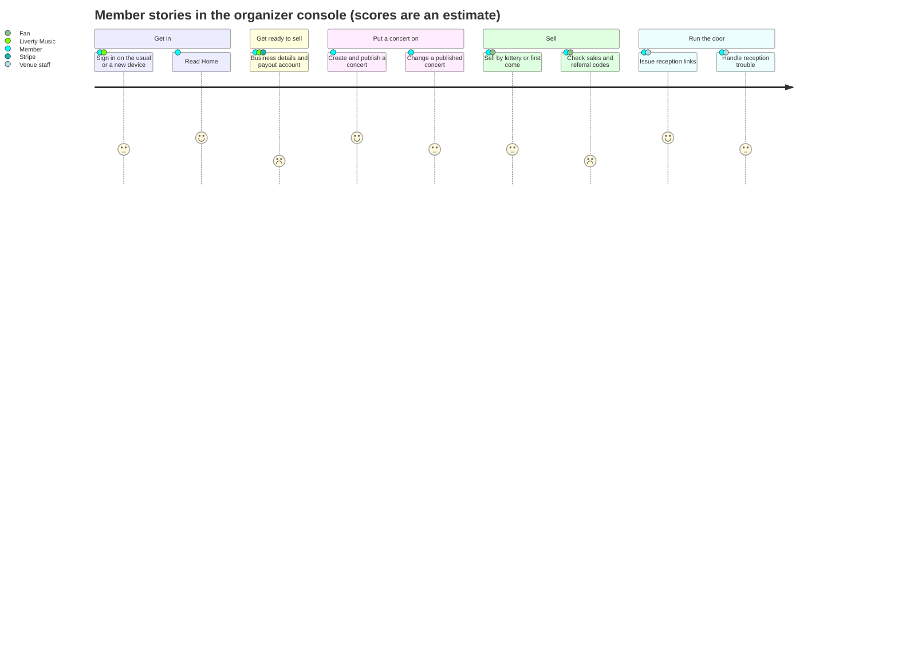
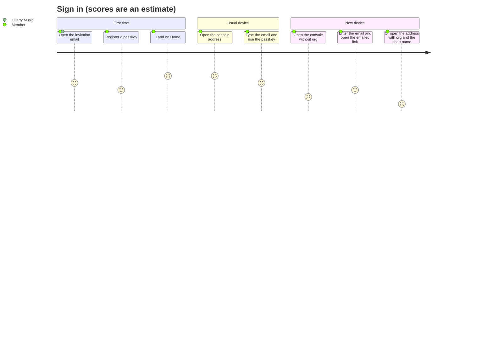
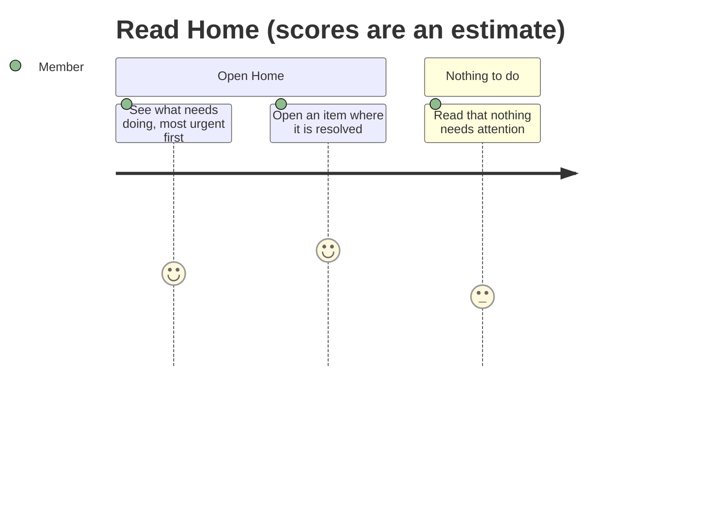
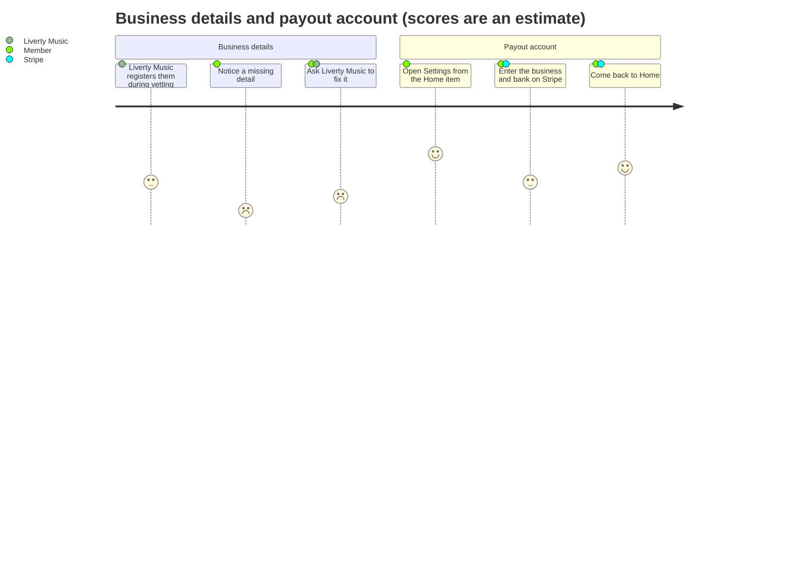
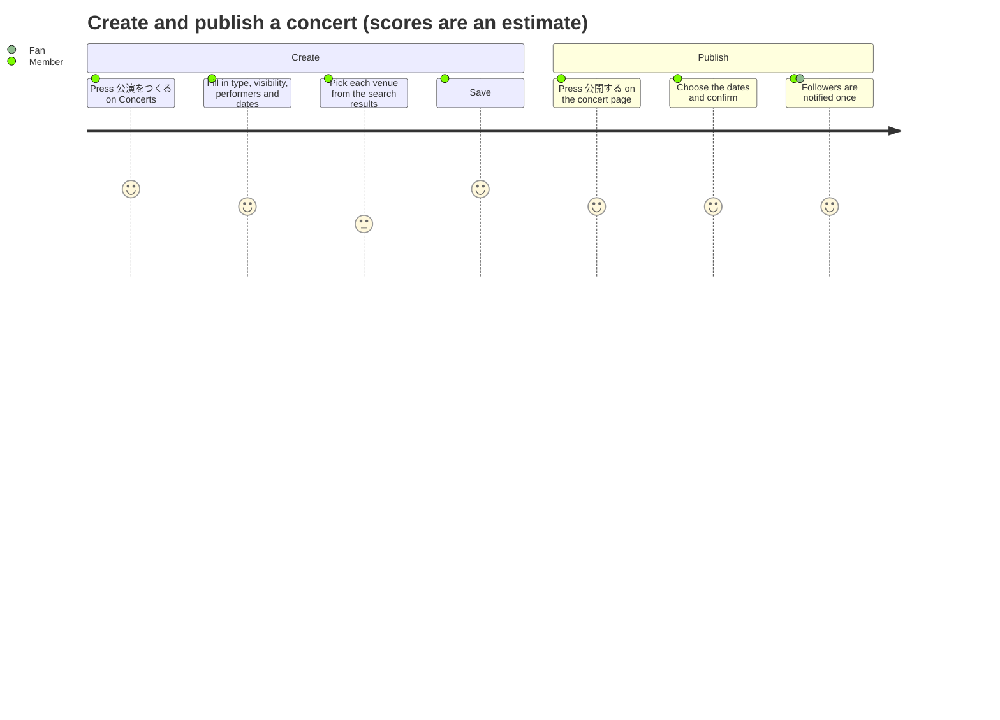
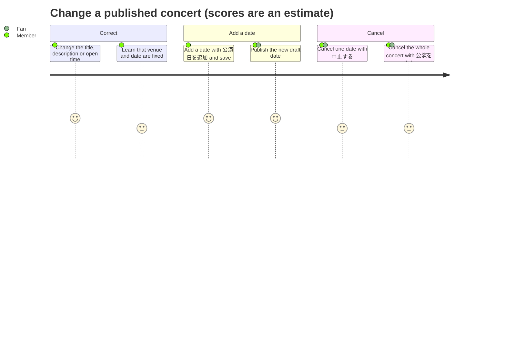
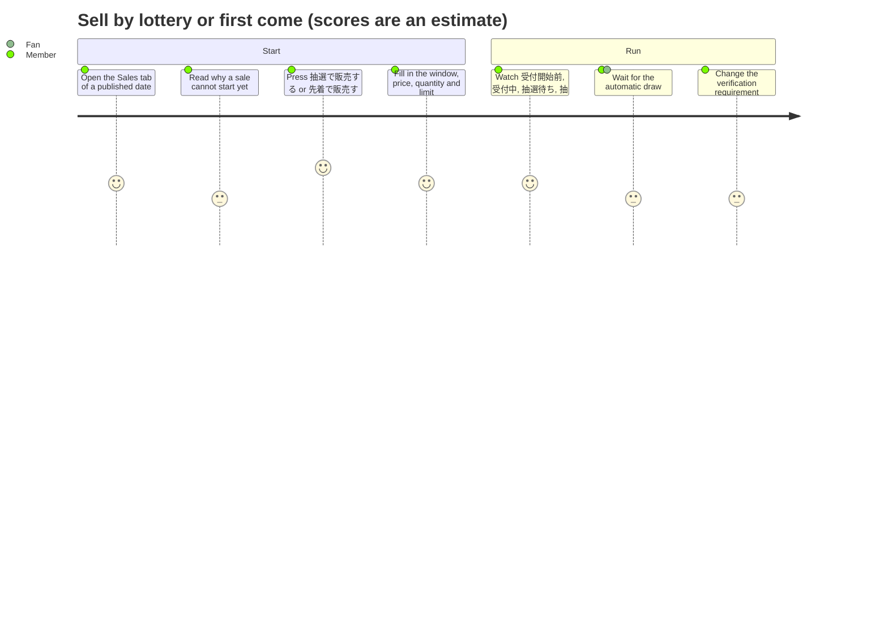
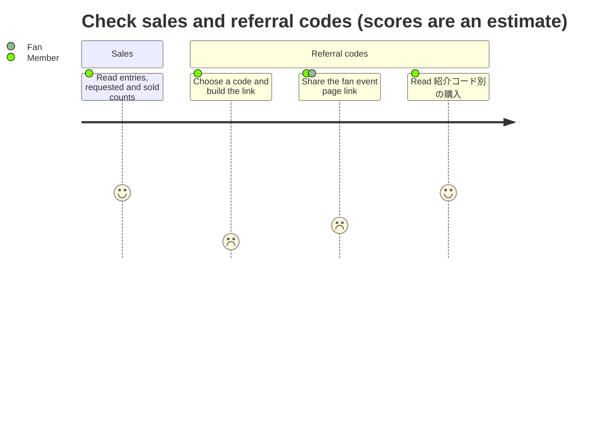
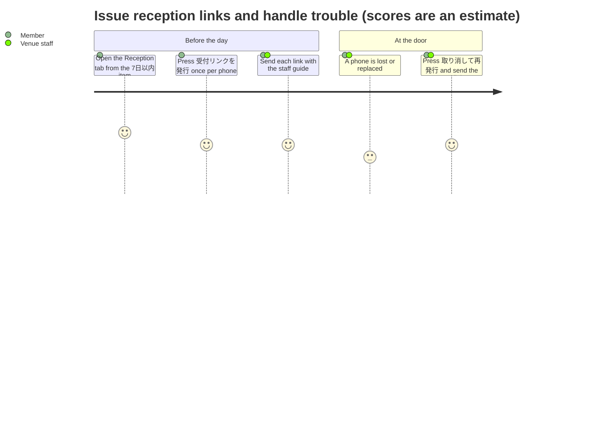
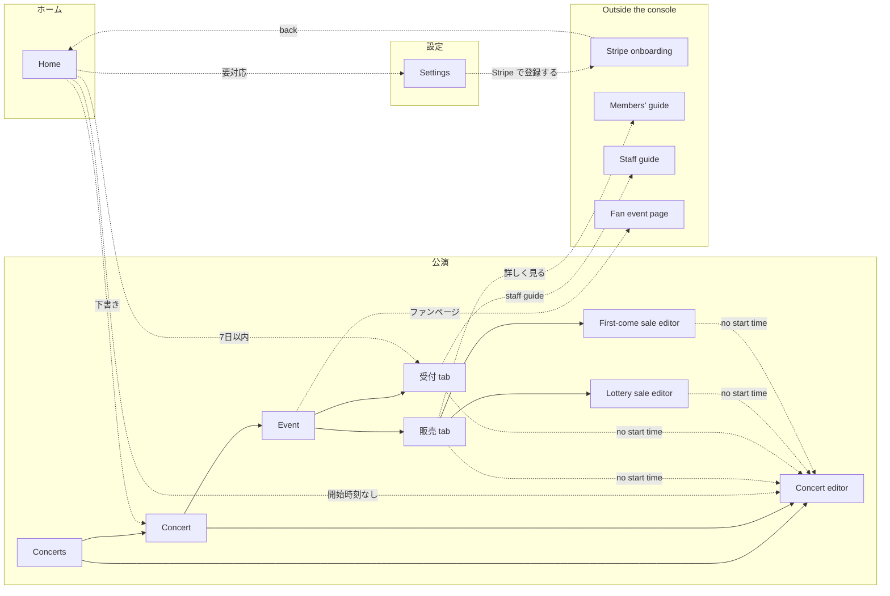

# Organizer console: member story map and information architecture

This document is the source of the members' guide to the organizer console
(`frontend/organizer/guide/guide.html`, served at `/guide.html` on the console's
origin) and of future console UX work. It was written for the OpenSpec change
`organizer-console-guide`, and it outlives that change.

It describes the console as the specs under
`openspec/specs/components/infrastructure/organizer/web/` define it. Console
words are quoted in Japanese, exactly as the Japanese console shows them, because
the guide quotes them the same way.

When the console's words or flow change, update the matching chapter of the guide
and this document in the same change (frontend `AGENTS.md`).

## Who is involved

| Actor | Role in the stories |
|---|---|
| Member | A person of a partner Organizer who signs in to the console with the owner role. The reader of the guide. |
| Liverty Music | Vets the Organizer, creates it with its short name, registers its business details and its represented Artists, and re-invites a member who lost their passkey. |
| Stripe | The payment provider. Hosts the payout account onboarding page. |
| Venue staff | Open a reception link on a phone at the door and scan the fans' entry QR codes. They have their own guide (`reception/public/guide.html`). |
| Fan | Opens the fan event page, enters a lottery or buys first come, and shows the entry QR code at the door. |

## Story map

The scores below are an **estimate**, read from the specs, of how easily a member
gets through a step without a manual: 5 means the screen says everything needed,
1 means a member cannot find the way without asking. They are not measurements.
The steps scored 1 or 2 are listed under [Gaps](#gaps).

### Backbone

One section per activity, one task per member story, in the order a new
Organizer meets them.

### Sign in (guide chapter `sign-in`)

Source: `stories/sign-in-as-organizer`, `global/organizer-shell` ("Without a known
Organization the console asks for the email"), `route/find-organizer`,
`global/hosted-login`.

- The first sign-in starts from the invitation, not from the console.
- On a new device the console does not know the Organizer. It shows
  主催者コンソールにサインイン, asks for the email and sends a sign-in link
  (リンクを送る). The link opens the console for that Organizer.
- The other way in is `https://organizer.liverty-music.app/?org=<short name>`.
  The console never shows the short name, so a member learns it only from
  Liverty Music.
- A lost passkey is recovered by Liverty Music re-inviting the member.

### Read Home (guide chapter `home`)

Source: `route/home`.

Home lists four kinds of items, in this order:

| Heading | Item | Label | Opens |
|---|---|---|---|
| 要対応 | 入金口座の登録が終わっていません | 登録する | Settings at the payout account |
| 7日以内 | `<date> · 受付リンクなし` | 発行する | the event's Reception tab |
| 開始時刻なし | the event | 設定する | the concert editor |
| 下書き | `<concert> · <date>` | 開く | the concert page |

With no item, Home says いま対応が必要なことはありません。 and links to 公演一覧へ.
A new Organizer with no concert sees the same message, with no hint that the
first step is 公演をつくる.

### Business details and payout account (guide chapter `business-and-payout`)

Source: `route/settings`, `route/event` ("The Sales tab explains a missing
prerequisite"), `stories/win-tickets-in-a-lottery` ("The Organizer's payout
readiness never blocks the sale").

- Business details (事業者名, 代表者名, 所在地, 電話番号, 連絡先メールアドレス)
  are the 特定商取引法に基づく表記 shown to fans. Liverty Music registers them;
  the console shows them read only. A missing one reads 未登録, and no sale can
  start until all five are registered.
- Home does not list missing business details. A member meets them first on the
  Sales tab as 事業者情報が未登録です.
- The payout account is set up on Stripe (Stripe で登録する, then
  Stripe で登録を続ける). Fans can buy before it is 有効; only the payout waits.

### Create and publish a concert (guide chapter `publish`)

Source: `route/concerts`, `route/concert-editor`, `route/concert`, `route/event`,
`stories/publish-an-organizer-concert`, `stories/run-an-event-from-the-organizer-console`.

- 公開 (PUBLIC) concerts are listed for fans and followers are notified when they
  are published; 限定公開 (UNLISTED) ones are not listed and notify nobody. The
  choice is fixed once a date is published.
- 公開する on the concert page publishes the chosen draft dates with one
  notification. 公開する on an event page publishes that date alone.
- A published date cannot return to 下書き.
- A sale and a reception link need a published date with a start time (開演).

### Change a published concert (guide chapter `change-published`)

Source: `route/concert-editor` ("A published concert is corrected, not
rewritten"), `route/concert` ("Publish or cancel the concert's dates together"),
`route/event` ("The event header and its actions").

- A published date's venue and date cannot change. To move it, cancel the date
  and add a new one.
- The start time cannot change once tickets for that date are on sale.
- 中止 cannot be undone; fans are told once. A draft date that is cancelled is
  removed.

### Sell by lottery or first come (guide chapter `sell`)

Source: `route/event` (Sales tab), `route/ticket-sale-editor`,
`stories/win-tickets-in-a-lottery`, `stories/buy-tickets-first-come`.

- A lottery window is 1 to 14 days (10 by default) and closes before the show.
  The draw runs automatically shortly after the window closes. Nothing about a
  lottery can change once its window opens (受付開始後は変更できません).
- A first-come sale (一般発売 by default) ends by the show's start time. Its price
  is fixed while tickets are 販売済み or 購入手続き中.
- Sales of one date cannot overlap.

### Check sales and referral codes (guide chapter `sales-and-referral`)

Source: `route/event` ("The Sales tab shows purchases per referral code"),
`stories/attribute-a-purchase-to-a-referral-link`.

- A referral code is not registered anywhere. The member makes one up, adds
  `?ref=<code>` to the fan event page address shown on the event page
  (ファンページ), and shares that address.
- A paid purchase counts under the code when the fan bought within 7 days of
  opening that address, for a date of the same concert, and under the last code
  the fan opened. Other purchases count as 直接（コードなし）. Refunded purchases
  do not count; a lottery entry counts once it won and was charged.

### Issue reception links and handle trouble (guide chapter `reception`)

Source: `route/event` (Reception tab), `route/scanner`, the venue staff guide.

- Each link (受付1, 受付2, …) works only on the first phone that opens it, so issue
  one per phone. A link in use shows 使用中 and no longer shows its address.
- Admission runs from 3 hours before the doors open (or the start, without a door
  time) until 04:00 the next morning.
- A forwarded link says この受付リンクは別の端末で使用中です on the second phone;
  the fix is 取り消して再発行.

## Information architecture

Solid edges are parent and child (the breadcrumb). Dashed edges are cross-links:
Home items, prerequisite links, links to the guides and to external pages.

Every framed screen also has 使い方 in the top bar, which opens the members' guide
at the screen's chapter (not drawn).

### Screen inventory

| Screen | Information | Actions | Guide chapter |
|---|---|---|---|
| Home | Items by kind: 要対応, 7日以内, 開始時刻なし, 下書き | Open an item; 公演一覧へ | `home` |
| Concerts | Concerts of the Artist worked on: 公演名, 日程・会場, 販売状態, 状態 | Open a concert; 公演をつくる | `publish` |
| Concert | Title, type, visibility, cover, performers; dates with state and sale state | 編集; 公開する; 公演を中止 | `publish` |
| Concert editor | 公演名, 説明, 種類, 公開範囲, 出演者, カバー画像; dates with 会場, 日付, 開場, 開演 | 公演日を追加; save; キャンセル | `publish` |
| Event | Date, start time, venue, state; ファンページ address | 公開する; 中止する; 公演を編集; tabs 販売 and 受付 | `sell` |
| 販売 tab | Prerequisite notices; sales with state, window, price, counts; 本人確認; 紹介コード別の購入 | 抽選で販売する; 先着で販売する; 編集; change 本人確認 | `sell` |
| Lottery sale editor | Event; 販売名, 受付期間, 価格, 販売枚数, 1人あたりの上限枚数 | 抽選販売を始める or save; キャンセル | `sell` |
| First-come sale editor | Event; 販売名, 販売期間, price and counts; 販売済み, 購入手続き中 | 先着販売を始める or save; キャンセル | `sell` |
| 受付 tab | Reception window; links 受付1… with 未使用, 使用中, 取り消し済み | 受付リンクを発行; コピー; 共有; 取り消す; 取り消して再発行; staff guide | `reception` |
| Settings | 組織, 所属アーティスト, 事業者情報, 入金口座 with 確認中, 有効, 要対応 | Stripe で登録する or Stripe で登録を続ける | `business-and-payout` |
| Find organizer (signed out) | 主催者コンソールにサインイン | リンクを送る | `sign-in` |

The guide's chapter `change-published` has no screen of its own: it is reached
from the `publish` chapter.

## Gaps

The steps scored 1 or 2 above. Until each
is fixed in the console, the guide explains the current behaviour. They are
proposed for a separate change.

| Gap | Evidence | Proposed fix |
|---|---|---|
| Missing business details are not on Home. A member learns about them only when a sale cannot start. | `route/home` lists payout, scanner, start time and draft items only; `route/event` "Business details incomplete" | A 要対応 item on Home for incomplete business details, opening Settings at 事業者情報. |
| A referral link has to be built by hand. Nothing in the console says that `?ref=` exists. | `route/event` "The Sales tab shows purchases per referral code" says the section is read only and codes are not registered | Build a referral address from a typed code next to the ファンページ address, with copy. |
| The short name for `?org=` is never shown, so a member on a new device can use only the emailed link. | `stories/sign-in-as-organizer` "A new device finds the Organizer by short name or by email"; no screen spec shows the short name | Show the console address with `?org=<short name>` in Settings, with copy. |
| A new Organizer's Home says nothing needs attention, with no first step. | `route/home` "Nothing to do is said plainly" | A first-run item on Home: 公演をつくる when the Organizer has no concert. |
