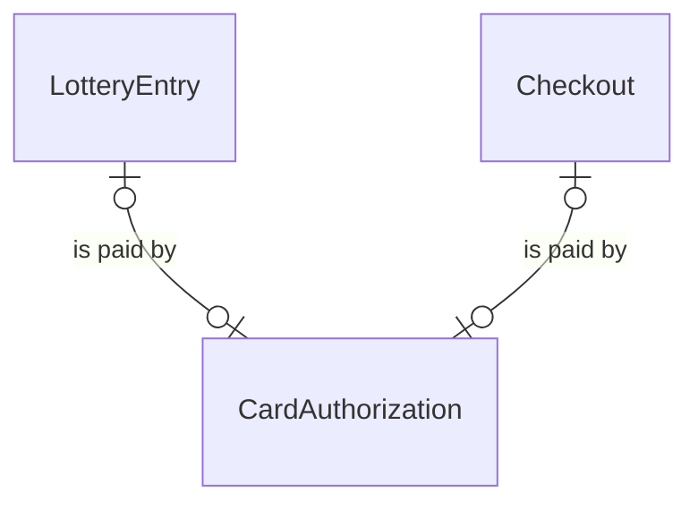
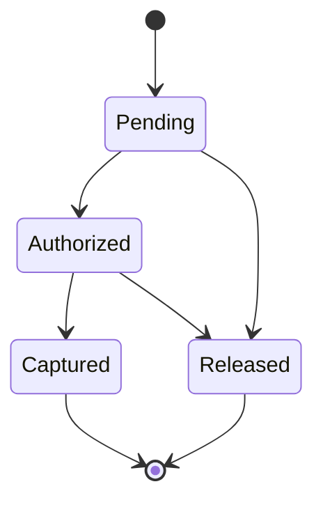

# Spec Delta

## Purpose

A CardAuthorization is the authorization placed on a fan's card for the amount of one purchase, a LotteryEntry or a Checkout: it reserves the amount on the card without charging it, until it is captured (the card is charged) or released (given back without charging). The payment provider holds it and is its only record; a LotteryEntry or a Checkout refers to it by its id.

| attribute | meaning | constraint |
|-----------|---------|------------|
| id | the payment provider's ID for the card authorization | required, assigned by the payment provider on creation; 1-255 characters, opaque |
| amount | the amount authorized on the card, in whole yen | required, greater than 0; fixed at creation |
| card brand | the brand of the card the fan authorized | absent until the fan completes card authentication; unknown when the payment provider does not report it |
| status | lifecycle | Pending, Authorized, Captured or Released |

- Pending: opened, waiting for the fan to complete card authentication.
- Authorized: the fan completed card authentication; the amount is reserved on the card and can be captured.
- Captured: the card was charged the amount.
- Released: given back without charging, by a release or because it lapsed on the card.

## ADDED Requirements

### Requirement: Accepted card brands

A card brand SHALL be accepted for a Checkout whatever it is, American Express included. A card brand SHALL be accepted for a LotteryEntry unless it is American Express; an unknown brand is accepted for both.

#### Scenario: American Express on a lottery entry
- **WHEN** the card brand is American Express and the purchase is a LotteryEntry
- **THEN** the card is not accepted

#### Scenario: American Express on a checkout
- **WHEN** the card brand is American Express and the purchase is a Checkout
- **THEN** the card is accepted

#### Scenario: Other or unknown brand
- **WHEN** the card brand is Visa, Mastercard, JCB, Diners, Discover or unknown
- **THEN** the card is accepted for a LotteryEntry and for a Checkout

### Requirement: A card authorization confirms a purchase only when authorized for its amount

A CardAuthorization SHALL confirm a purchase, a LotteryEntry or a Checkout, only when its status is Authorized, its amount equals the purchase's expected amount, and its card brand is accepted for that purchase.

#### Scenario: Matching card authorization
- **WHEN** an Authorized 16000 yen card authorization on a Visa card is checked against a LotteryEntry expecting 16000 yen
- **THEN** it confirms the entry

#### Scenario: Card authentication not completed
- **WHEN** the card authorization is Pending
- **THEN** it does not confirm the purchase

#### Scenario: Already captured or released
- **WHEN** the card authorization is Captured or Released
- **THEN** it does not confirm the purchase

#### Scenario: Amount differs
- **WHEN** an Authorized card authorization is for 3000 yen and the Checkout expects 6000 yen
- **THEN** it does not confirm the Checkout

#### Scenario: Card not accepted
- **WHEN** an Authorized card authorization for the expected amount is on an American Express card and the purchase is a LotteryEntry
- **THEN** it does not confirm the entry
