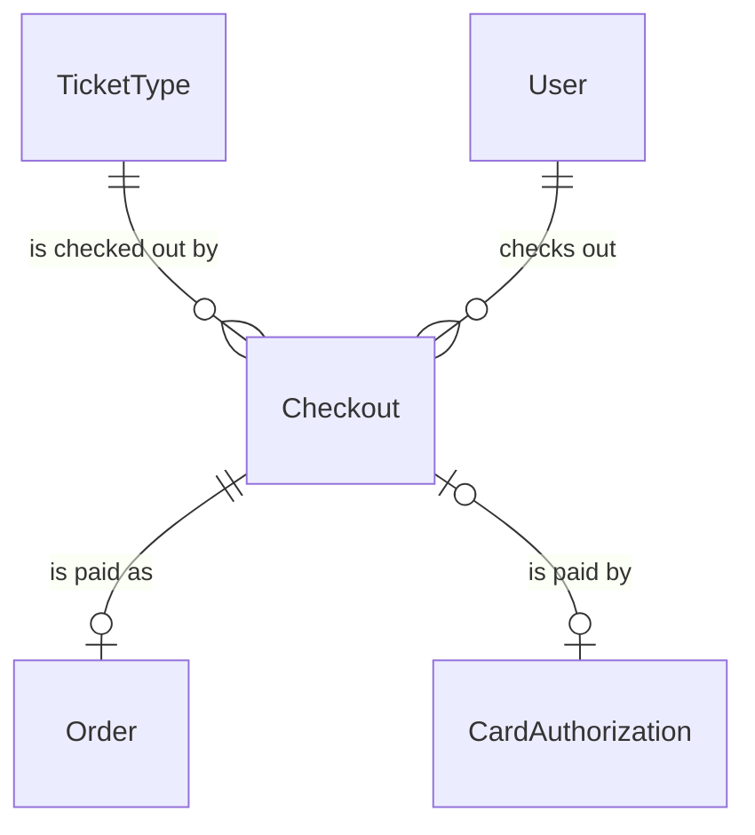
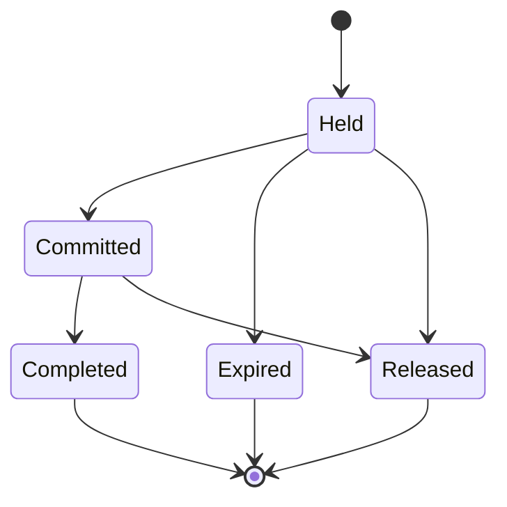

# Spec Delta

## Purpose

A Checkout is one fan's purchase in progress on a TicketType of a FirstCome TicketSale: it holds a number of tickets for 15 minutes while the fan confirms their 本人確認 (identity check) details and authorizes their card. It ends with the tickets committed, charged and issued, or with the hold released and any card authorization given back. The fan's full name and phone number are the User's.

| attribute | meaning | constraint |
|-----------|---------|------------|
| id | the checkout's identity | required, assigned on creation |
| ticket type | the TicketType it checks out from | required; its sale's method is FirstCome |
| user | the fan checking out | required |
| ticket count | tickets held | required; 1 to the ticket type's per-account limit |
| amount | total to pay: the ticket type's price times the ticket count, in yen | required; fixed at creation |
| card authorization | the CardAuthorization opened on the fan's card for the amount | absent until the fan authorizes their card; set once |
| card authorization release time | when the card authorization was given back without charging | absent unless released; set once |
| status | lifecycle | Held, Committed, Completed, Expired or Released |
| hold expiry | when the hold lapses; it is never extended | required; 15 minutes after the checkout starts |
| commit time | when its tickets were committed against the stock | absent until Committed |
| capture time | when the card was charged | absent until charged; set once |

## ADDED Requirements

### Requirement: A new checkout holds for 15 minutes

A new Checkout SHALL start Held, with a hold expiry 15 minutes after its create time and an amount equal to the ticket type's price times its ticket count.

#### Scenario: New checkout
- **WHEN** a fan starts a checkout for 2 tickets of a TicketType priced 3000 yen at 18:00
- **THEN** the Checkout is Held, its amount is 6000 yen and its hold expires at 18:15

### Requirement: Holding

A Checkout SHALL be holding at a time when it is Held and the time is before its hold expiry. Only holding Checkouts count in a TicketType's held count, and only a holding Checkout can be committed.

#### Scenario: Within the hold
- **WHEN** a Held Checkout expiring at 18:15 is checked at 18:14
- **THEN** it is holding

#### Scenario: Hold lapsed
- **WHEN** a Held Checkout expiring at 18:15 is checked at 18:15
- **THEN** it is not holding

### Requirement: A charged checkout is never released

A Checkout with a capture time SHALL NOT become Released or Expired.

#### Scenario: Charged checkout
- **WHEN** a Committed Checkout has a capture time
- **THEN** it can only become Completed
