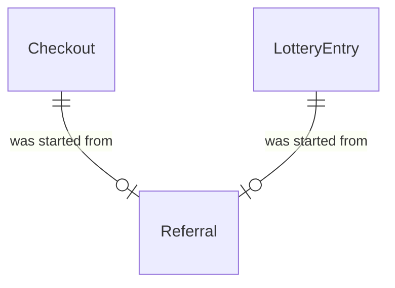

# Spec Delta

## Purpose

A Referral records that one Checkout or one LotteryEntry was started from a link that carried a referral code, so that the Organizer can count the purchases each link brought. The code is free-form: it is not registered in advance, grants no access and pays no reward.

| attribute | meaning | constraint |
|-----------|---------|------------|
| id | the referral's identity | required, assigned on creation |
| source | the purchase in progress that was started with the code: a Checkout or a LotteryEntry | required, exactly one; at most one Referral per source |
| code | the ReferralCode the source was started with | required |
| create time | when the source was first started with a code | required; set once |

The value ReferralCode is the code from a link: 1 to 32 characters, each a lowercase ASCII letter (a–z), a digit (0–9) or a hyphen.

## ADDED Requirements

### Requirement: Referral code format

A ReferralCode SHALL be 1 to 32 characters long and consist only of lowercase ASCII letters, digits and hyphens. Uppercase letters are not part of a ReferralCode: the fan app lowercases a link's code before it keeps it, so `Member-A` and `member-a` in links are the same code.

#### Scenario: Code from a link
- **WHEN** the code is `member-a`
- **THEN** it is a valid ReferralCode

#### Scenario: Empty or too long
- **WHEN** the code is empty or 33 characters long
- **THEN** it is not a valid ReferralCode

#### Scenario: Other characters
- **WHEN** the code is `member_a`, `メンバーA`, `a b` or `Member-A`
- **THEN** it is not a valid ReferralCode

#### Scenario: One code whatever the case in links
- **WHEN** one fan arrives through `?ref=Member-A` and another through `?ref=member-a`, and both buy
- **THEN** both Referrals have the code `member-a`

### Requirement: Exactly one source

A Referral SHALL name exactly one source, a Checkout or a LotteryEntry. A Referral that names both, or neither, SHALL be invalid.

#### Scenario: Referral of a checkout
- **WHEN** a Referral names a Checkout and no LotteryEntry
- **THEN** its source is valid

#### Scenario: Two sources
- **WHEN** a Referral names both a Checkout and a LotteryEntry
- **THEN** the Referral is invalid

### Requirement: The code changes only before the source is confirmed

A Referral's code SHALL be changeable only while its source is open: a Checkout whose status is Held, or a LotteryEntry whose state is Draft. Once the Checkout is Committed, Completed, Expired or Released, or the LotteryEntry is Entered, Won, Lost or Withdrawn, the Referral SHALL never change.

#### Scenario: Held checkout
- **WHEN** the Referral's source is a Held Checkout
- **THEN** its code is changeable

#### Scenario: Draft entry
- **WHEN** the Referral's source is a Draft LotteryEntry
- **THEN** its code is changeable

#### Scenario: Confirmed source
- **WHEN** the Referral's source is a Committed Checkout or an Entered LotteryEntry
- **THEN** its code is not changeable

### Requirement: A Referral lives with its source

A Referral SHALL exist only while its source exists: when a Checkout or a LotteryEntry is removed, its Referral SHALL be removed with it, and a Checkout or LotteryEntry that is kept keeps its Referral.

#### Scenario: Abandoned checkout removed with its concert
- **WHEN** a Released Checkout that has a Referral is removed together with its event
- **THEN** its Referral no longer exists

#### Scenario: Lottery entry kept after its user is deleted
- **WHEN** a User whose Entered LotteryEntry has a Referral is deleted
- **THEN** the LotteryEntry and its Referral remain
