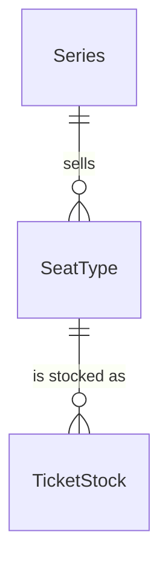

# Spec Delta

## Purpose

A SeatType is one kind of ticket (席種) a Series sells, such as S席, A席 or オールスタンディング: its name and the price of one ticket. It does not assign seats. Every event of the Series that sells it does so through a TicketStock, and its name and price never change once it is created.

| attribute | meaning | constraint |
|-----------|---------|------------|
| id | the seat type's identity | required, assigned on creation |
| series | the Series that sells it | required; never changes |
| name | the label fans and members see, for example S席 | required, 1-50 characters, unique within the Series; never changes |
| price | price of one ticket, 税込 (tax-inclusive), in whole yen; the face value (券面価格) of its tickets | required, 1 to 1,000,000; never changes |

## ADDED Requirements

### Requirement: Name and price

A SeatType's name SHALL be 1 to 50 characters and its price SHALL be 1 to 1,000,000 yen. Neither SHALL change after the SeatType is created; a different price is a different SeatType.

#### Scenario: Valid seat type
- **WHEN** a SeatType is named S席 and priced 8000 yen
- **THEN** it is valid

#### Scenario: Empty name
- **WHEN** a SeatType has an empty name
- **THEN** it is invalid

#### Scenario: Price out of range
- **WHEN** the price is 0 yen or 1,000,001 yen
- **THEN** the SeatType is invalid

### Requirement: Amount for a ticket count

The amount for a ticket count SHALL be the price multiplied by the count, in yen.

#### Scenario: Two tickets
- **WHEN** the price is 8000 yen and the count is 2
- **THEN** the amount is 16000 yen
