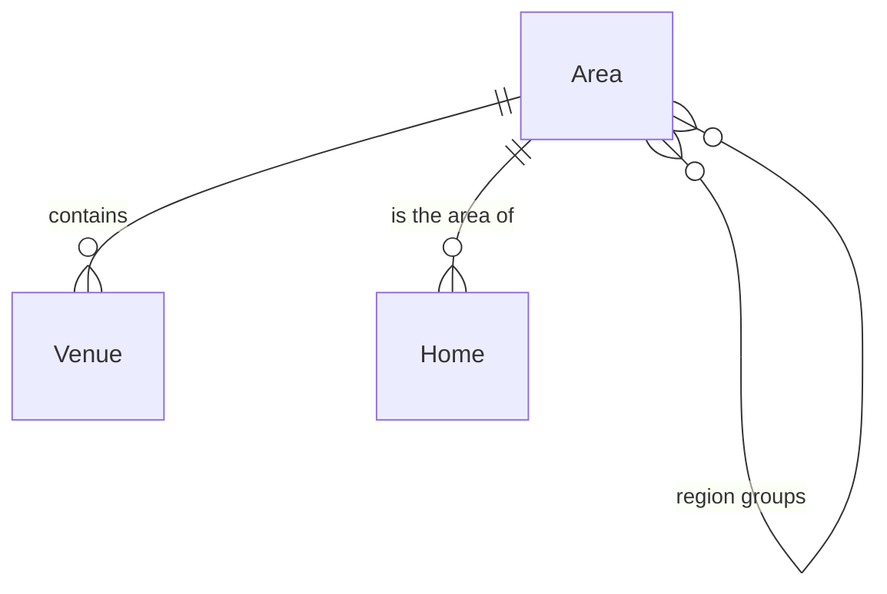

## Purpose

An Area is a named part of the world that Venues, Homes and reference areas name by its code, so that two places in the same prefecture, state or territory always carry the same code. It is one of three kinds: a subdivision from the published ISO 3166-2 list, a country or territory that has no subdivision of its own (Hong Kong, Macau), or a region that groups first-level Areas of a country (Japan's eight 地方, such as 関東). Lower-level and withdrawn subdivisions are kept only so that their codes lead to a first-level Area.

| attribute | meaning | constraint |
|-----------|---------|------------|
| code | the Area's identity | required; no two Areas share it; a subdivision's ISO 3166-2 code (`JP-13`), a country's ISO 3166-1 alpha-2 code (`HK`), or for a region the country code, a hyphen and 4 or more uppercase letters (`JP-KANTO`) |
| kind | what the Area is | required; subdivision, country or region |
| country code | the country or territory the Area belongs to | required; ISO 3166-1 alpha-2; equal to the first two letters of the code |
| parent | the subdivision this one lies in, for a lower-level subdivision | optional; absent for a first-level subdivision, a country and a region; an Area of the same country |
| replacement | the Area that took over a withdrawn code | optional; absent while the code is current; never a region; may belong to another country (`CN-HK` is replaced by `HK`) |
| English name | the Area's name in English | required; non-empty |
| Japanese name | the Area's name in Japanese | optional; absent when the published data has no Japanese name |
| reference point | the Coordinates NEARBY distances are measured from; not necessarily the geographic centre | optional; absent when none is known |
| reference point source | how the reference point was obtained: the former prefecture table, a published map dataset's label point for the Area, the mean of the label points of its lower-level Areas, or set by hand | present exactly when the reference point is |
| time zone | the IANA time zone of the whole Area | optional; set only when the whole Area lies in one zone; one of its country's time zones |
| regions | the regions the Area is grouped into | zero or more; only a first-level Area belongs to a region |

Each country also has a set of time zones, the zones in which some part of the country lies:

| time zone attribute | meaning | constraint |
|---------------------|---------|------------|
| name | the zone's IANA name (`Asia/Seoul`) | required; no two zones share it |
| English name | the zone's name in English: its exemplar city (`Seoul`), except `Asia/Tokyo`, which is named `Japan` | required |
| Japanese name | the zone's name in Japanese: its exemplar city (`ソウル`), except `Asia/Tokyo`, which is named `日本` | optional |
| countries | the countries in which the zone is used | one or more; a zone used in several countries counts for each |

## ADDED Requirements

### Requirement: A first-level Area

An Area SHALL be first-level when it is not a region and has neither a parent nor a replacement. A region, an Area with a parent and an Area with a replacement SHALL NOT be first-level. Only a first-level Area is stored as the admin area of a Venue or as a Home.

#### Scenario: Prefecture

- **WHEN** the Area is `JP-13` (Tokyo), a subdivision with no parent and no replacement
- **THEN** it is first-level

#### Scenario: Territory without subdivisions

- **WHEN** the Area is `HK` (Hong Kong), a country with no parent and no replacement
- **THEN** it is first-level

#### Scenario: Lower-level subdivision

- **WHEN** the Area is `FR-33` (Gironde), whose parent is `FR-NAQ`
- **THEN** it is not first-level

#### Scenario: Withdrawn code

- **WHEN** the Area is `FR-75`, whose replacement is `FR-IDF`
- **THEN** it is not first-level

#### Scenario: Region

- **WHEN** the Area is the region `JP-KANTO`
- **THEN** it is not first-level

### Requirement: An Area's code matches its kind and country

An Area's code SHALL be two uppercase letters, a hyphen and 1 to 3 uppercase letters or digits for a subdivision; exactly two uppercase letters for a country; and two uppercase letters, a hyphen and 4 or more uppercase letters for a region. The first two letters of every code SHALL equal the Area's country code. Any other combination SHALL be invalid, so a region's code never equals a subdivision's.

#### Scenario: Subdivision code

- **WHEN** a subdivision has code `US-CA` and country code `US`
- **THEN** it is valid

#### Scenario: Country code as an Area

- **WHEN** a country Area has code `MO` and country code `MO`
- **THEN** it is valid

#### Scenario: Region code too short

- **WHEN** a region has code `JP-KAN`
- **THEN** it is invalid

#### Scenario: Code of another country

- **WHEN** a subdivision has code `KR-11` and country code `JP`
- **THEN** it is invalid

### Requirement: A region groups first-level Areas

A region SHALL group only first-level Areas. A region SHALL have no parent, and grouping an Area into a region SHALL NOT make the region the Area's parent.

#### Scenario: Prefecture in its region

- **WHEN** the region `JP-KANTO` groups `JP-13`
- **THEN** `JP-13` lists `JP-KANTO` among its regions and is still first-level, with no parent

#### Scenario: Lower-level Area in a region

- **WHEN** a region would group `FR-33`, which is not first-level
- **THEN** the grouping is invalid

### Requirement: An Area's time zone is one of its country's

An Area's time zone, when present, SHALL be one of the time zones of the Area's country, and SHALL be present only when the whole Area lies in that one zone. An Area of a country with exactly one time zone SHALL have that zone.

#### Scenario: Country with one zone

- **WHEN** the Area is `JP-13` and Japan's only time zone is `Asia/Tokyo`
- **THEN** the Area's time zone is `Asia/Tokyo`

#### Scenario: State wholly in one zone

- **WHEN** the Area is `US-CA`, which lies wholly in `America/Los_Angeles`
- **THEN** the Area's time zone is `America/Los_Angeles`

#### Scenario: State across two zones

- **WHEN** the Area is `US-TX`, parts of which are in `America/Chicago` and parts in `America/Denver`
- **THEN** the Area has no time zone

#### Scenario: Zone of another country

- **WHEN** an Area of `KR` would have the time zone `Asia/Tokyo`
- **THEN** the time zone is invalid

### Requirement: A reference point records how it was obtained

An Area's reference point and its reference point source SHALL be present together or absent together. An Area without a reference point SHALL still be a valid Area.

#### Scenario: Prefecture from the former table

- **WHEN** the Area `JP-40` has a reference point taken from the former prefecture table
- **THEN** its reference point source is the former prefecture table

#### Scenario: Point without a source

- **WHEN** an Area has a reference point but no reference point source
- **THEN** the Area is invalid

#### Scenario: No point known

- **WHEN** an Area has neither a reference point nor a reference point source
- **THEN** the Area is valid and has no reference point

### Requirement: Display name in the viewer's language

The name of an Area or of a time zone in a language SHALL be its Japanese name when the language is `ja` and it has a Japanese name, and its English name otherwise. A time zone's names SHALL be those of its exemplar city, except that `Asia/Tokyo` SHALL be named 日本 in Japanese and Japan in English.

#### Scenario: Japanese name present

- **WHEN** the Area `JP-13` is named for language `ja`
- **THEN** the name is 東京都

#### Scenario: No Japanese name

- **WHEN** an Area without a Japanese name is named for language `ja`
- **THEN** the name is its English name

#### Scenario: English viewer

- **WHEN** the time zone `Asia/Seoul` is named for language `en`
- **THEN** the name is Seoul

#### Scenario: Japan's zone

- **WHEN** the time zone `Asia/Tokyo` is named for language `ja` or `en`
- **THEN** the name is 日本 or Japan, not the name of its exemplar city
