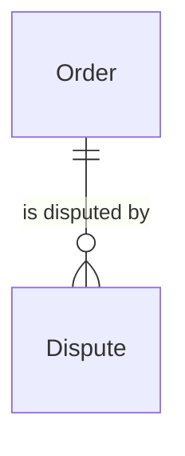
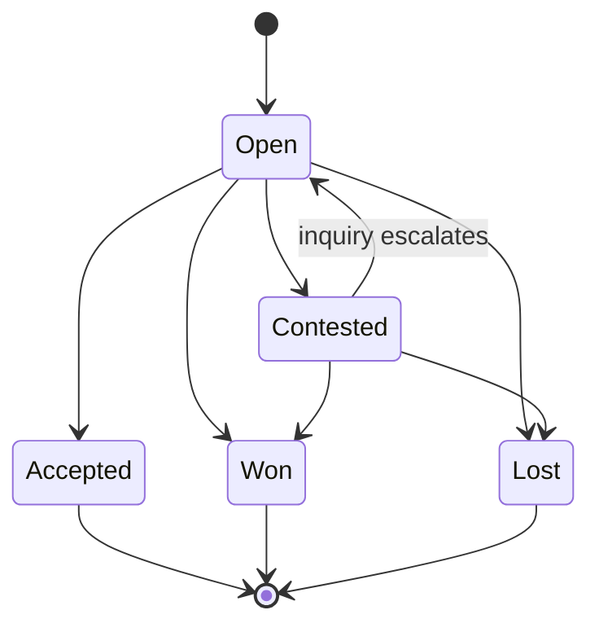

# Spec Delta

## Purpose

A Dispute is a cardholder's claim, filed through their card issuer, against the captured payment of an Order. It is either an inquiry, a request for information on which no money has been taken back yet, or a チャージバック (chargeback), on which the disputed money is held by the payment provider until the outcome. It ends Won, when the money stays with or returns to the platform, Lost, when the issuer rules for the cardholder, or Accepted, when the platform concedes it. A Lost or Accepted Dispute is settled once its money outcome has been applied to the Order and its Settlement. One payment can carry more than one Dispute, and each is answered and settled on its own.

| attribute | meaning | constraint |
|-----------|---------|------------|
| id | the dispute's identity | required, assigned on creation |
| order | the Order whose payment is disputed | required |
| provider dispute ID | the payment provider's ID for the dispute | required, 1-255 characters, opaque, unique |
| inquiry | whether the issuer has only asked for information, with no money taken back | required; can only change from true to false, when the inquiry escalates to a chargeback |
| reason | what the cardholder claims: Fraud (they did not authorize the payment), NotReceived, NotAsDescribed, Unrecognized, CreditNotProcessed (a refund they expected), Duplicate, Compliance (a card-network rule the issuer says was broken), or Other | required |
| amount | the disputed amount, in whole yen | required, greater than 0; may differ from the Order's amount |
| status | lifecycle | Open, Contested, Accepted, Won or Lost |
| evidence due time | the last moment the payment provider accepts evidence | absent when the payment provider accepts no evidence for the dispute; replaced when an inquiry escalates |
| evidence submit time | when the platform's evidence was submitted | absent until Contested |
| open time | when the card issuer opened the dispute | required |
| close time | when the dispute was accepted or its outcome recorded | absent while Open or Contested |
| settle time | when the money outcome of a Lost or Accepted Dispute was applied | absent until then; never set on a Won Dispute |
| provider payout reversal IDs | the payment provider's IDs for the claw-backs of the Organizer's share made for this Dispute alone, for a partial Dispute after the payout | empty unless such a claw-back was made |

## ADDED Requirements

### Requirement: Open until an outcome

A Dispute SHALL be open while it is Open or Contested, and closed once it is Accepted, Won or Lost. Accepted, Won and Lost SHALL be terminal. A Contested inquiry that escalates to a chargeback SHALL become Open again, because the chargeback needs its own answer.

#### Scenario: Contested dispute is open
- **WHEN** a Dispute is Contested
- **THEN** it is open

#### Scenario: Accepted dispute is closed
- **WHEN** a Dispute is Accepted
- **THEN** it is closed and has no transition to another status

### Requirement: Unsettled outcome

A Dispute SHALL be unsettled when it is Lost or Accepted and has no settle time: the cardholder kept or got back money whose effect on the Order and its Settlement has not been applied. An Order with an open or unsettled Dispute SHALL be treated as disputed: its Settlement is not released, its Tickets are not listed or allocated for resale, and its 中止 (cancellation) refund is not made.

#### Scenario: Lost and not yet applied
- **WHEN** a Dispute is Lost and has no settle time
- **THEN** it is unsettled and its Order is disputed

#### Scenario: Lost and applied
- **WHEN** a Dispute is Lost and has a settle time
- **THEN** it is not unsettled

### Requirement: Response to a dispute

Given whether the Order's own refund was made (recorded on the Order, or made at the payment provider and not yet recorded), the publish state of the Order's Event, whether the Event's cancellation limit (24 hours after its start) has passed, whether any Ticket of the Event was admitted, and whether the cardholder verified the payment, a Dispute SHALL be answered by the first of these rules that applies. The cardholder verified the payment when the card issuer authenticated them for it (3D Secure) or the payment was made with a device wallet that authenticated them with a cryptogram; an authentication attempt the issuer only acknowledged does not count, because no one authenticated the cardholder.

1. Accept it when it has no evidence due time: the payment provider accepts no evidence, so it cannot be contested.
2. Contest it when the Order's own refund was made: the money the fan is owed was already returned, and the refund is the evidence.
3. Accept it when its Event is CANCELLED: a 中止 entitles the fan to the money.
4. Review it when the Event's cancellation limit has passed with no Ticket of the Event admitted, whatever the reason: whether the concert took place at all is a fact the platform's records do not settle.
5. For the reason Fraud, contest it when the cardholder verified the payment and accept it when they did not: only the verification shows that the cardholder authorized the payment.
6. Review it for the reasons Duplicate, NotAsDescribed and Compliance: whether the fan was charged twice, got something other than what was sold, or a network rule was broken is a fact the records do not settle.
7. Contest it for every other reason: the cardholder authorized the payment, the Tickets were delivered to their account, and the sale allows no returns except 中止 (返品特約, the no-returns term).

A Dispute under review is decided by an admin; without a decision by 48 hours before the evidence due time, it is contested. Whether a Ticket of this Order was admitted SHALL NOT change the answer: a fan who did not come is not entitled to a refund under the sale.

#### Scenario: Cannot be contested
- **WHEN** a chargeback has no evidence due time
- **THEN** it is accepted

#### Scenario: Already refunded for a cancellation
- **WHEN** a Dispute with the reason NotReceived is on a Refunded Order
- **THEN** it is contested

#### Scenario: Refund made but not yet recorded
- **WHEN** a Dispute opens on a Paid Order of a CANCELLED Event whose own refund the payment provider already made
- **THEN** it is contested

#### Scenario: Cancelled event not yet refunded
- **WHEN** a Dispute with the reason NotReceived is on a Paid Order whose Event is CANCELLED and whose own refund was not made
- **THEN** it is accepted

#### Scenario: Nobody entered the concert
- **WHEN** a Dispute with the reason NotReceived is on a Paid Order of a PUBLISHED Event whose cancellation limit has passed with no Ticket of the Event admitted
- **THEN** it is reviewed by an admin

#### Scenario: Verified fraud claim on a concert nobody entered
- **WHEN** a Dispute with the reason Fraud on a verified payment is on a Paid Order of a PUBLISHED Event whose cancellation limit has passed with no Ticket of the Event admitted
- **THEN** it is reviewed by an admin

#### Scenario: Fraud claim on a verified payment
- **WHEN** a Dispute with the reason Fraud is on a Paid Order of a PUBLISHED Event whose cardholder passed the card issuer's authentication
- **THEN** it is contested

#### Scenario: Fraud claim on a wallet payment
- **WHEN** a Dispute with the reason Fraud is on a Paid Order of a PUBLISHED Event paid with a device wallet that authenticated the cardholder
- **THEN** it is contested

#### Scenario: Attempt acknowledged without authentication
- **WHEN** a Dispute with the reason Fraud is on a Paid Order whose card issuer only acknowledged an authentication attempt
- **THEN** it is accepted

#### Scenario: Fraud claim without verification
- **WHEN** a Dispute with the reason Fraud is on a Paid Order of a PUBLISHED Event whose cardholder did not verify the payment
- **THEN** it is accepted

#### Scenario: Duplicate claim
- **WHEN** a Dispute with the reason Duplicate is on a Paid Order of a PUBLISHED Event
- **THEN** it is reviewed by an admin

#### Scenario: Not received before the event
- **WHEN** a Dispute with the reason NotReceived is on a Paid Order whose PUBLISHED Event is next week and whose Tickets are Issued
- **THEN** it is contested

#### Scenario: No-show after the event
- **WHEN** a Dispute with the reason CreditNotProcessed is on a Paid Order whose PUBLISHED Event's cancellation limit has passed, other fans' Tickets were admitted, and none of this Order's Tickets was
- **THEN** it is contested

### Requirement: Whole or partial dispute

The fan's remaining claim on an Order SHALL be the price of its Tickets that were not resold (the Order's amount divided by its number of Tickets, times the Tickets not Voided by a resale) less the amounts of its settled partial Disputes. A resold Ticket was paid back to the fan through the resale, and a settled partial Dispute already returned its amount, so neither is the fan's to claim again. A Dispute SHALL cover the whole Order when its amount is at least the fan's remaining claim, and be partial otherwise.

#### Scenario: Whole order disputed
- **WHEN** a Dispute of 10000 yen is on an Order of 10000 yen for 2 Tickets, none resold
- **THEN** it covers the whole Order

#### Scenario: Rest of a partly resold order
- **WHEN** a Dispute of 5000 yen is on an Order of 10000 yen for 2 Tickets, one of which was resold
- **THEN** it covers the whole Order

#### Scenario: Part of an order disputed
- **WHEN** a Dispute of 5000 yen is on an Order of 10000 yen for 2 Tickets, none resold
- **THEN** it is partial

#### Scenario: Rest after a settled partial dispute
- **WHEN** a Dispute of 5000 yen is on an Order of 10000 yen for 2 Tickets, none resold, that already has a settled partial Dispute of 5000 yen
- **THEN** it covers the whole Order

### Requirement: Organizer's share of a partial dispute

The Organizer's remaining share SHALL be the Settlement's split amounts less the claw-backs already made for partial Disputes after the payout. The Organizer's share of a partial Dispute SHALL be its amount times the Organizer's remaining share over the fan's remaining claim, rounded down to the yen, so rounding favours the Organizer and the platform bears the rest.

#### Scenario: Half of an order lost
- **WHEN** a partial Dispute of 5000 yen is on an Order of 10000 yen for 2 Tickets whose Settlement has a split of 9500 yen
- **THEN** the Organizer's share is 4750 yen

#### Scenario: After a resale
- **WHEN** a partial Dispute of 2500 yen is on an Order of 10000 yen for 2 Tickets, one resold, whose Settlement's split fell to 4750 yen
- **THEN** the Organizer's share is 2375 yen

#### Scenario: Second partial dispute
- **WHEN** a partial Dispute of 2500 yen is on an Order of 10000 yen for 2 Tickets whose split fell to 4750 yen when an earlier partial Dispute of 5000 yen was settled
- **THEN** the Organizer's share is 2375 yen

### Requirement: Amount and provider dispute ID

A Dispute's amount SHALL be greater than 0 and its provider dispute ID SHALL be 1 to 255 characters.

#### Scenario: Zero amount
- **WHEN** a Dispute has the amount 0
- **THEN** it is invalid
