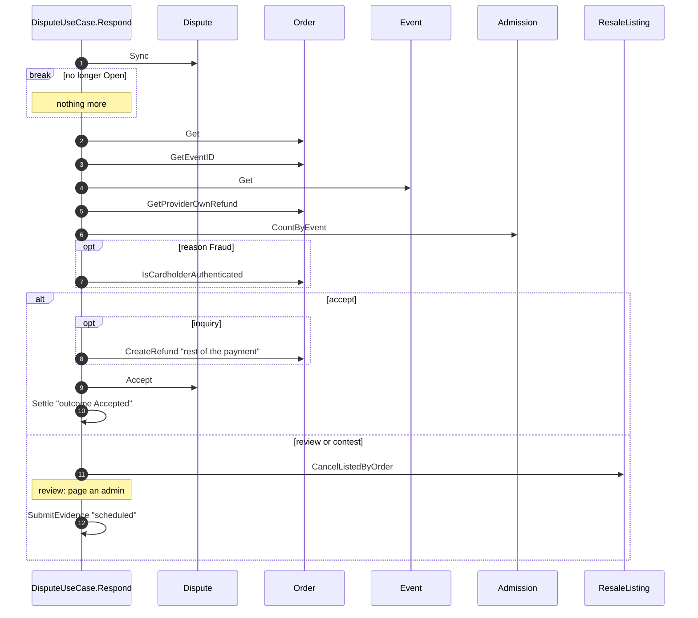

# Spec Delta

## Purpose

DisputeUseCase.Respond answers a dispute the card issuer opened against an Order's payment, or the escalation of an inquiry into a chargeback, on its merits: it accepts one the cardholder is entitled to win, asks an admin about one the records cannot settle, and for one it contests it stops the Order's Tickets from being resold and schedules the evidence.

## ADDED Requirements

### Requirement: The provider's current state first

Respond SHALL take an Order and a provider dispute ID and record the dispute as the payment provider reports it now with Dispute.Sync, so a notice delivered late, twice or before the one it follows is answered from the latest state. When the Dispute is then not Open, Respond SHALL do nothing more. A Respond started for a notice that the provider took the money back SHALL answer only when its Dispute.Sync recorded an escalation of a stored inquiry; otherwise the dispute was a chargeback from the start, or its escalation was already seen, and the Respond for its opening answers it, so each stage of a dispute is answered once.

#### Scenario: Notice for a dispute already answered
- **WHEN** Respond runs for a provider dispute whose Dispute the provider still reports under review
- **THEN** nothing changes

#### Scenario: Contested inquiry escalates
- **WHEN** Respond runs for the escalation of a Contested inquiry into a chargeback due in 14 days
- **THEN** the Dispute is Open again with the new evidence due time and is answered again

#### Scenario: Escalation notice first
- **WHEN** the escalation notice of an inquiry is handled before the notice that opened it
- **THEN** Respond records the chargeback from the provider's current state and answers it once

#### Scenario: Ordinary chargeback
- **WHEN** a chargeback that was never an inquiry is reported both as opened and as money taken back
- **THEN** it is answered once, by the Respond for its opening

### Requirement: Answered on its merits

Respond SHALL read the Order with Order.Get, its Event with Order.GetEventID and Event.Get, the Order's own refund at the payment provider with Order.GetProviderOwnRefund (so a 中止 refund made but not yet recorded counts as made), whether anyone entered the Event with Admission.CountByEvent, and, for the reason Fraud, whether the cardholder verified the payment with Order.IsCardholderAuthenticated, and answer the Dispute as the Dispute's response rule decides:

- **Accept**: for an inquiry, first refund the disputed amount, at most the fan's remaining claim, with Order.CreateRefund as the Order's own refund, skipping the refund when nothing is left to refund; then call Dispute.Accept, then DisputeUseCase.Settle with the outcome Accepted. When Order.CreateRefund or Dispute.Accept fails with FailedPrecondition because the inquiry escalated meanwhile, Respond SHALL sync the Dispute and answer it again.
- **Review**: page an admin with the Dispute, without ending Respond, then do as for a contest; the admin answers it with the payment provider.
- **Contest**: cancel the Order's Listed resale listings with ResaleListing.CancelListedByOrder, leave the Order's Tickets Issued and its Settlement as it is, and schedule DisputeUseCase.SubmitEvidence, once per evidence due time, for the earlier of the Event's cancellation limit (24 hours after its start, when no Admission or cancellation can come any more) and 48 hours before the evidence due time, or for now when that time has passed.

#### Scenario: Fraud claim without verification before the event
- **WHEN** a Fraud chargeback opens on a Paid Order of next week's PUBLISHED Event whose cardholder did not verify the payment
- **THEN** the Dispute is Accepted and DisputeUseCase.Settle runs for it

#### Scenario: Inquiry accepted
- **WHEN** a Fraud inquiry opens on a 10000 yen Paid Order whose cardholder did not verify the payment
- **THEN** 10000 yen is refunded to the fan's card, the Dispute is Accepted and DisputeUseCase.Settle runs for it

#### Scenario: Partial inquiry accepted
- **WHEN** a Fraud inquiry of 5000 yen opens on a 10000 yen Paid Order whose cardholder did not verify the payment
- **THEN** 5000 yen is refunded to the fan's card and the Dispute is Accepted

#### Scenario: Inquiry on a fully resold order
- **WHEN** a Fraud inquiry opens on an Order every Ticket of which was resold
- **THEN** no refund is made and the Dispute is Accepted

#### Scenario: Inquiry escalated before its refund
- **WHEN** Order.CreateRefund fails with FailedPrecondition because the inquiry became a chargeback
- **THEN** Respond syncs the Dispute and accepts the chargeback instead

#### Scenario: Not received before the event
- **WHEN** a NotReceived chargeback opens on a Paid Order of a PUBLISHED Event in 5 days, with the evidence due in 14 days
- **THEN** the Order's Tickets stay Issued, its Listed listings are Cancelled, and DisputeUseCase.SubmitEvidence is scheduled for 24 hours after the Event's start

#### Scenario: Deadline before the event
- **WHEN** a NotReceived chargeback opens on a Paid Order of an Event in 30 days, with the evidence due in 14 days
- **THEN** DisputeUseCase.SubmitEvidence is scheduled for 48 hours before the evidence due time

#### Scenario: Duplicate claim
- **WHEN** a Duplicate chargeback opens on a Paid Order of a PUBLISHED Event
- **THEN** an admin is paged and DisputeUseCase.SubmitEvidence is scheduled as for a contest

#### Scenario: Cancelled event
- **WHEN** a chargeback opens on a Paid Order whose Event is CANCELLED and whose own refund was not made
- **THEN** the Dispute is Accepted and DisputeUseCase.Settle runs for it

### Requirement: Failures are retried, then reported

A call that fails with Unavailable or ResourceExhausted SHALL be retried until the evidence due time, or for 1 hour when that time is absent or less than 1 hour away. Any other failure SHALL end Respond with that error, and the Dispute keeps the status it reached.

#### Scenario: Payment provider down while accepting
- **WHEN** Dispute.Accept fails with Unavailable and succeeds an hour later
- **THEN** the Dispute is Accepted once and DisputeUseCase.Settle runs once
