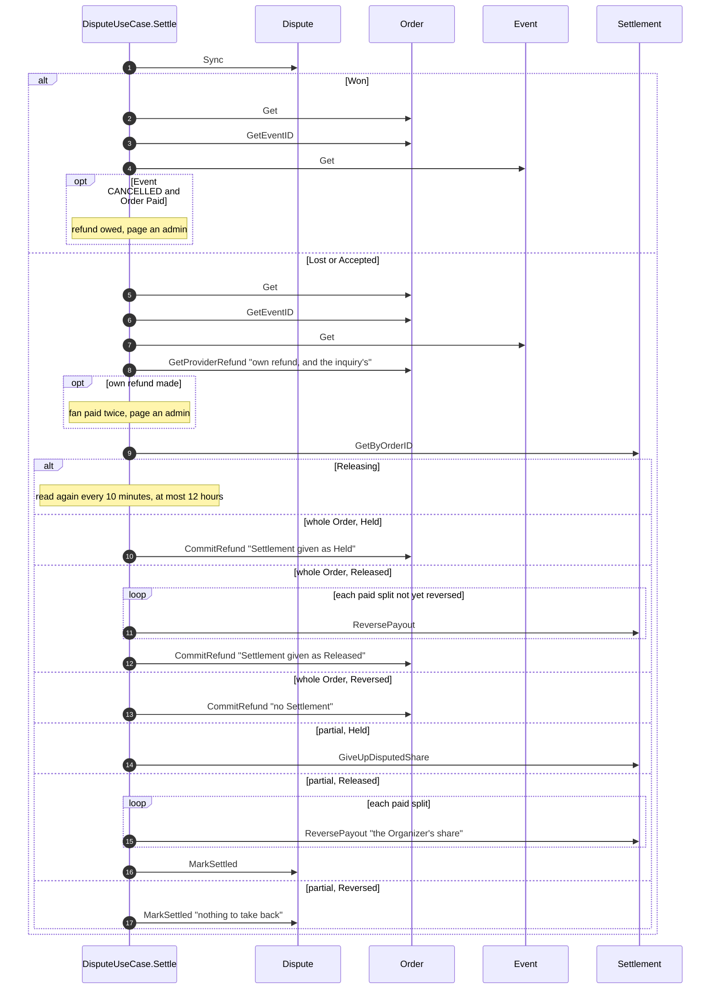

# Spec Delta

## Purpose

DisputeUseCase.Settle applies the outcome of a Dispute: a Won one changes nothing else, unless a refund for a 中止 (cancellation) became owed meanwhile; a Lost or Accepted one claws back the Organizer's share and, when it covers the whole Order, voids the Order's Tickets and records the Order Refunded with the reason Dispute.

## ADDED Requirements

### Requirement: Outcome recorded from the provider

Settle SHALL take an Order, a provider dispute ID and an outcome: Won, Lost, or Accepted when Respond or SubmitEvidence accepted it. It SHALL run at most once per provider dispute and outcome, Lost and Accepted counting as one, and end within 14 days. It SHALL sync the Dispute with Dispute.Sync, which records the provider's outcome. When the Dispute is Accepted and the outcome given is Won, as for an inquiry that closed after its refund, Settle SHALL change nothing else. When Dispute.Sync fails with FailedPrecondition because a Lost Dispute is reported Won, Settle SHALL end with that error, so an admin is paged, and move no money.

#### Scenario: Contested dispute won
- **WHEN** Settle runs with Won for a Contested Dispute of a PUBLISHED Event
- **THEN** the Dispute is Won and the Order, its Tickets and its Settlement are unchanged

#### Scenario: Accepted inquiry closed
- **WHEN** Settle runs with Won for an Accepted inquiry that the provider closed after its refund
- **THEN** nothing changes

#### Scenario: Late win
- **WHEN** Settle runs with Won for a Lost Dispute
- **THEN** it fails with FailedPrecondition and no money moves

### Requirement: A won dispute leaves the money, unless a cancellation refund is owed

For a Won Dispute, Settle SHALL read the Order with Order.Get and its Event with Order.GetEventID and Event.Get. When the Order is Paid and the Event is CANCELLED, the fan is owed a 中止 refund that could not be made while the payment was disputed: Settle SHALL end with FailedPrecondition, so an admin is paged to refund it, and move no money itself.

#### Scenario: Cancelled while contested
- **WHEN** Settle runs with Won for a Dispute whose Paid Order's Event was CANCELLED after the evidence was submitted
- **THEN** Settle fails with FailedPrecondition, no money moves and the Order stays Paid

### Requirement: Lost or accepted settles the Organizer's share

For a Lost or Accepted Dispute, Settle SHALL read the Order with Order.Get, its Event with Order.GetEventID and Event.Get, the Order's own refund and, for an accepted inquiry, the Dispute's refund with Order.GetProviderRefund, and its Settlement with Settlement.GetByOrderID. A Releasing Settlement SHALL be read again every 10 minutes until its release ends, at most 12 hours. For a Dispute that covers the whole Order, Settle SHALL record the refund with Order.CommitRefund, with the reason Dispute, the amount and provider refund ID of the accepted inquiry's refund or 0 and none for a chargeback, and the Dispute marked settled:

- **Held**: with the Settlement given as Held, so it becomes Reversed and is never paid out.
- **Released**: claw back what is left of each paid split, its amount less the claw-backs already made for partial Disputes, with Settlement.ReversePayout for the Order's refund, then record with the Settlement given as Released and the provider payout reversal IDs.
- **Reversed**: record without a Settlement.

For a partial Dispute, the Order and its Tickets stay as they are and only the Organizer's share is taken back: from a Held Settlement with Settlement.GiveUpDisputedShare, which also marks the Dispute settled; from a Released one with Settlement.ReversePayout for the Dispute and the share, spread over the paid splits, followed by Dispute.MarkSettled with the reversal IDs; from a Reversed one, which has nothing left to take back, with Dispute.MarkSettled alone. When the compare-and-set of Order.CommitRefund or Settlement.GiveUpDisputedShare fails with FailedPrecondition because the Settlement's status changed, Settle SHALL read it again and settle from its new status. When the Order's own refund had been made, the fan got the money twice: Settle SHALL still settle the Organizer's share and then end with FailedPrecondition, so an admin is paged. When a partial Dispute is settled while the Order's Event is CANCELLED and the Order is still Paid, the rest of the 中止 refund is owed: Settle SHALL end with FailedPrecondition, so an admin refunds it.

#### Scenario: Lost before the payout
- **WHEN** Settle runs with Lost for a whole-order chargeback whose Settlement is Held
- **THEN** the Settlement is Reversed, the Order's Issued Tickets are Voided, the Order is Refunded with the reason Dispute and the amount 0, and the Dispute is settled

#### Scenario: Lost after the payout
- **WHEN** Settle runs with Lost for a whole-order Dispute whose Settlement is Released with a 9500 yen split
- **THEN** 9500 yen is clawed back from the Organizer, the Settlement is Reversed and the Order is Refunded

#### Scenario: Inquiry accepted
- **WHEN** Settle runs with Accepted for a whole-order inquiry whose 10000 yen refund Respond made, on an Order whose Settlement is Held
- **THEN** the Settlement is Reversed and the Order is Refunded with the reason Dispute, the amount 10000 yen and that refund's provider refund ID

#### Scenario: Release under way
- **WHEN** Settle runs with Accepted while the Order's Settlement is Releasing, and the release then makes it Released
- **THEN** the paid split is clawed back and the Order is Refunded

#### Scenario: Released between the read and the record
- **WHEN** Settle read the Settlement as Held and Order.CommitRefund fails with FailedPrecondition because a release claimed it
- **THEN** Settle reads it again, waits for the release, claws back the paid split and records the refund

#### Scenario: Partial dispute lost before the payout
- **WHEN** Settle runs with Lost for a Dispute of 5000 yen on an Order of 10000 yen whose Held Settlement has a split of 9500 yen
- **THEN** the split becomes 4750 yen, the Order stays Paid with its Tickets Issued, and the Dispute is settled

#### Scenario: Partial dispute lost after the payout
- **WHEN** Settle runs with Lost for a Dispute of 5000 yen on an Order of 10000 yen whose Released Settlement paid 9500 yen
- **THEN** 4750 yen is clawed back for the Dispute, the Order stays Paid and the Dispute is settled with that reversal

#### Scenario: Partial dispute after a cancellation refund
- **WHEN** Settle runs with Lost for a Dispute of 5000 yen on a 10000 yen Order refunded for a 中止, whose Settlement is Reversed
- **THEN** the Dispute is settled with no claw-back and Settle fails with FailedPrecondition so an admin is paged

#### Scenario: Partial dispute on a cancelled concert
- **WHEN** Settle runs with Accepted for a Dispute of 5000 yen on a Paid 10000 yen Order whose Event is CANCELLED
- **THEN** the Organizer's share is taken back, the Dispute is settled, and Settle fails with FailedPrecondition so an admin refunds the rest

#### Scenario: Whole dispute after a partial claw-back
- **WHEN** Settle runs with Lost for a whole-order Dispute on an Order whose 9500 yen payout already had 4750 yen clawed back for a partial Dispute
- **THEN** the remaining 4750 yen is clawed back and the Order is Refunded

#### Scenario: Lost after a cancellation refund
- **WHEN** Settle runs with Lost for a contested Dispute on an Order already refunded for a 中止
- **THEN** nothing more is clawed back and Settle fails with FailedPrecondition so an admin is paged

#### Scenario: Second lost dispute
- **WHEN** Settle runs with Lost for a second whole-order Dispute on an Order already Refunded with the reason Dispute
- **THEN** nothing more is clawed back, the first refund is kept and the second Dispute is settled
