# Spec Delta

## Purpose

SettlementUseCase.Release pays out one claimed Settlement: it pays each split to the Organizer's payout account and records the release, so a Settlement is paid at most once and every payout made is recorded or left for an admin to reconcile.

```mermaid
sequenceDiagram
autonumber
participant UC as SettlementUseCase.Release
participant Order
participant Settlement
participant PayoutAccount
Note over UC: started for one release claim, ends within 12 hours
UC->>Order: Get
UC->>Settlement: GetByOrderID
UC->>PayoutAccount: GetByOrganizerID
UC->>Order: GetProviderChargeID
loop each split, recorded once paid
  UC->>Settlement: CreatePayout
end
alt every split paid
  UC->>Settlement: MarkReleased "under the release claim"
else refused before any payout
  UC->>Settlement: Unclaim
else outcome of a payout unknown
  Note over UC: end with Internal, Settlement stays Releasing
end
```

## ADDED Requirements

### Requirement: One release per claim

Release SHALL take a Settlement's Order and a release claim (Settlement.Claim), and run at most once per release claim. It SHALL read the Order with Order.Get, its Settlement with Settlement.GetByOrderID and the Organizer's payout account with PayoutAccount.GetByOrganizerID. When the Settlement is no longer Releasing under that release claim, Release SHALL end without paying anything. A Settlement claimed again after it was handed back gets a new release claim and so a new Release.

#### Scenario: Claimed again after a hand-back
- **WHEN** a Settlement was handed back to Held by an earlier Release and is claimed again
- **THEN** a new Release runs for the new release claim

### Requirement: Pay each split once and record the release

Release SHALL resolve the Order's charge with Order.GetProviderChargeID, pay each split with Settlement.CreatePayout in the Order's currency, and record the release with Settlement.MarkReleased under its release claim, passing each split's provider payout ID. A Release that is interrupted and resumed SHALL use the provider payout IDs of the splits it already paid and pay no split twice. A call that fails with Unavailable SHALL be retried until 12 hours after Release started.

#### Scenario: Settlement released
- **WHEN** Release runs for a claimed Settlement with one split of 9500 yen
- **THEN** 9500 yen is paid to the Organizer's payout account and the Settlement is Released with that payout's provider payout ID

#### Scenario: Interrupted after paying
- **WHEN** Release paid the split and stopped before recording the release, and is resumed
- **THEN** the split is not paid again and the Settlement is Released with the first payout's provider payout ID

#### Scenario: Interrupted after recording
- **WHEN** Release recorded the release and stopped before it learned so, and is resumed
- **THEN** Settlement.MarkReleased succeeds again and Release ends without error

#### Scenario: Payments unreachable for a while
- **WHEN** Settlement.CreatePayout fails with Unavailable and succeeds 10 minutes later
- **THEN** the split is paid once and the Settlement is Released

### Requirement: Hand back only what was surely not paid

When Order.GetProviderChargeID, or the first Settlement.CreatePayout, is refused (FailedPrecondition, InvalidArgument or PermissionDenied) before any split was paid, the refusal proves nothing was paid: Release SHALL return the Settlement to Held with Settlement.Unclaim and end with that error. When a payout's outcome is unknown (Internal), when a payout fails after another split was paid, or when the 12 hours pass, Release SHALL end with the error and leave the Settlement Releasing, so no later release pays it before an admin has checked what the payment provider did.

#### Scenario: Payout account refuses the payout
- **WHEN** the only split's Settlement.CreatePayout fails with FailedPrecondition
- **THEN** the Settlement is Held again and Release fails with FailedPrecondition

#### Scenario: Outcome unknown
- **WHEN** the only split's Settlement.CreatePayout fails with Internal
- **THEN** the Settlement stays Releasing and Release fails with Internal
