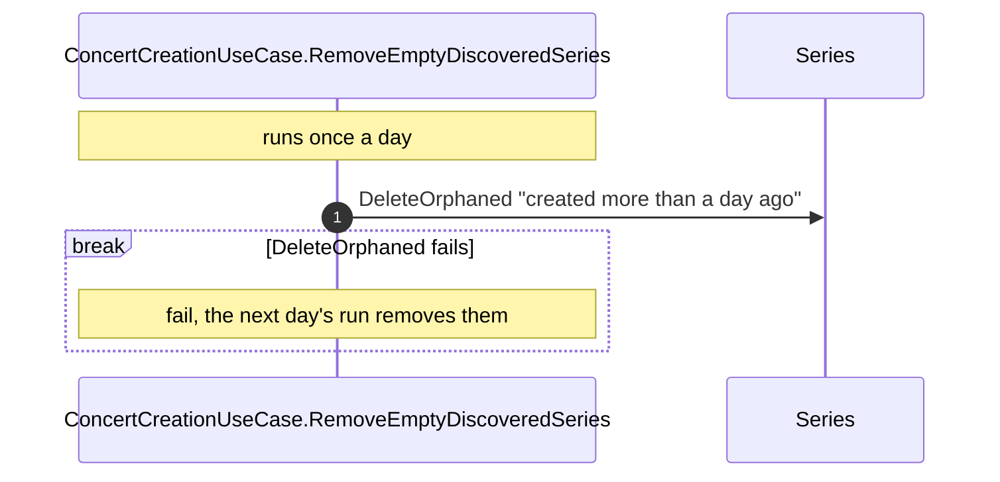

## Purpose

ConcertCreationUseCase.RemoveEmptyDiscoveredSeries removes, once a day, every discovered Series that is at least a day old and has no Event, no ConcertCandidate and no TicketSale: a Series discovery created whose events were all rejected, merged away or never stored.

## ADDED Requirements

### Requirement: Empty discovered Series are removed daily

Once a day, RemoveEmptyDiscoveredSeries SHALL remove every discovered Series created more than a day before the run that has no Event, no ConcertCandidate and no TicketSale (Series.DeleteOrphaned). When the removal fails, the run SHALL fail, and the next day's run SHALL remove them.

#### Scenario: Series emptied by a rejection
- **WHEN** the only ConcertCandidate of a discovered Series created two days ago was rejected
- **THEN** the day's run removes that Series

#### Scenario: Series of a merged event
- **WHEN** a Merge removed the only Event of a discovered Series created two days ago that has no TicketSale
- **THEN** the day's run removes that Series

#### Scenario: Removal fails
- **WHEN** DeleteOrphaned fails with Unavailable
- **THEN** the run fails and the next day's run removes the Series
