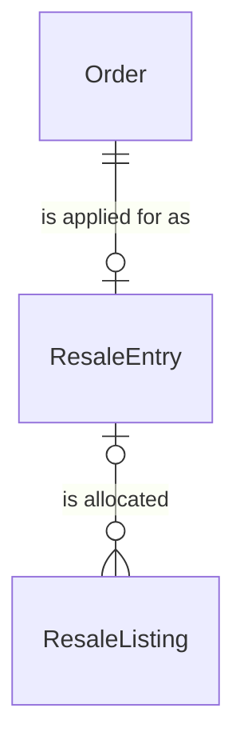
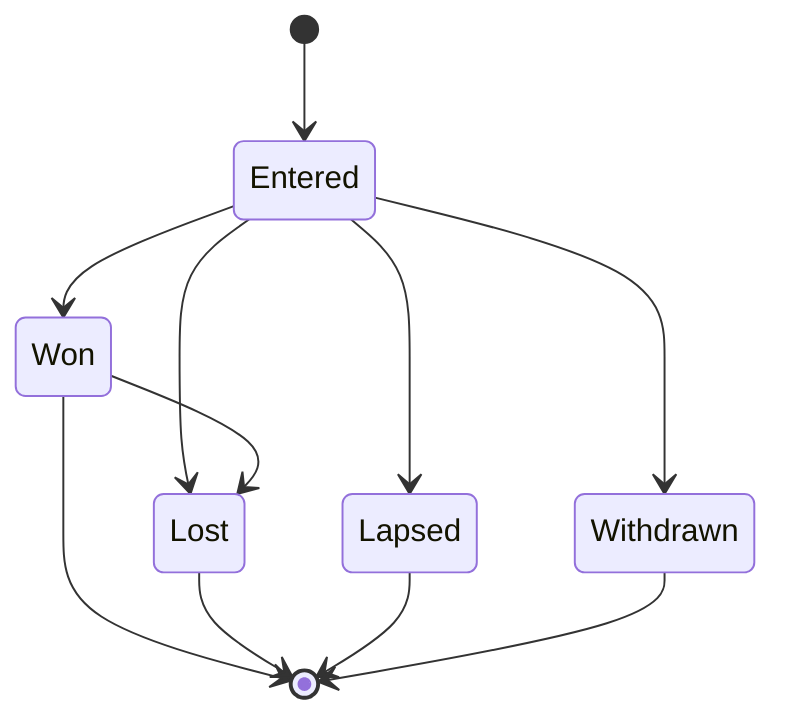

# Spec Delta

## Purpose

A ResaleEntry is one fan account's application, through its Order, for official resale (公式リセール) tickets of one sold-out TicketStock: a companion group of tickets allocated all-or-nothing by a daily draw, paid by the card authorization placed on the fan's card for the Order's amount when the fan applies. It belongs to no TicketSale: its supply is the stock's ResaleListings. The fan, the TicketStock, the ticket count, the card authorization and the referral code are the Order's.

| attribute | meaning | constraint |
|-----------|---------|------------|
| id | the entry's identity | required, assigned on creation |
| order | the Order it applies for | required; one ResaleEntry per Order |
| state | lifecycle | Entered, Won, Lost, Lapsed or Withdrawn |
| create time | when the fan applied | required |
| draw time | the draw that ended it: the draw it won, lost or lapsed at | absent while Entered and on a Withdrawn entry |
| withdraw time | when the fan withdrew it | absent unless Withdrawn |
| ended email send time | when the email telling the fan that the entry lapsed or lost was sent | absent until sent; set once |

## ADDED Requirements

### Requirement: A new entry is Entered

A ResaleEntry SHALL be created Entered, without a draw time, for a Pending Order that has its card authorization.

#### Scenario: New entry
- **WHEN** a ResaleEntry is created
- **THEN** its state is Entered, its Order is Pending with its card authorization and it has no draw time

### Requirement: Draw times of an event

An event's resale draws SHALL run at 12:00 Japan time on every day before the event's day, and once on the event's day at the event's resale deadline, which is the last draw of the event.

#### Scenario: Day before the event
- **WHEN** an event starts at 19:00 on 10 November
- **THEN** a draw runs at 12:00 on 9 November and it is not the last draw

#### Scenario: Evening show
- **WHEN** an event starts at 19:00 on 10 November, so its resale deadline is 12:00
- **THEN** the last draw runs at 12:00 on 10 November

#### Scenario: Matinee
- **WHEN** an event starts at 14:00 on 10 November, so its resale deadline is 11:00
- **THEN** the last draw runs at 11:00 on 10 November and no draw runs at 12:00 that day

### Requirement: Taking part in a draw

An Entered ResaleEntry SHALL take part in a draw when its Order's card authorization expires at least 24 hours after the draw time, so a Won entry can still be charged for 24 hours after the draw. An Entered entry whose card authorization expires earlier SHALL lapse at that draw.

#### Scenario: Card authorization valid for weeks
- **WHEN** an entry's card authorization expires on 30 November and a draw runs at 12:00 on 10 November
- **THEN** the entry takes part in the draw

#### Scenario: Card authorization about to expire
- **WHEN** an entry's card authorization expires at 09:00 on 11 November and a draw runs at 12:00 on 10 November
- **THEN** the entry lapses at that draw

### Requirement: All or nothing

A draw SHALL allocate to a ResaleEntry exactly as many listings as its Order's ticket count, or none. An entry SHALL win only when that many listings are still free when its turn in the draw comes.

#### Scenario: Group of two, one listing left
- **WHEN** an entry for 2 tickets comes up in a draw with 1 free listing left
- **THEN** it gets no listing and stays Entered for the next draw unless this is the last draw

#### Scenario: Group of two, two listings left
- **WHEN** an entry for 2 tickets comes up with 3 free listings left
- **THEN** it wins 2 listings and 1 stays free

### Requirement: A won entry that cannot be charged

A Won ResaleEntry whose Order cannot be charged SHALL become Lost, and the listings allocated to it SHALL be free for the next draw.

#### Scenario: Card declined at capture
- **WHEN** a Won entry's card authorization can no longer be charged
- **THEN** the entry is Lost, its Order is Void and its listings are free again

### Requirement: Withdrawable only while Entered

A ResaleEntry SHALL be withdrawable by its fan only while it is Entered. A Withdrawn entry SHALL take part in no later draw, and its Order SHALL be Void.

#### Scenario: Waiting for the draw
- **WHEN** an entry is Entered
- **THEN** it is withdrawable

#### Scenario: Already won
- **WHEN** an entry is Won
- **THEN** it is not withdrawable
