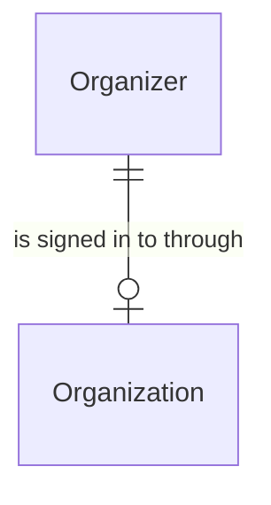

# Spec Delta

## Purpose

An Organization is a sign-in unit at the identity provider: it holds identities - the accounts people sign in with - and the sign-in policy they sign in under. There is one product organization holding the fans' identities, one admin organization holding the platform admins' identities, and one Organization per Organizer, named by the Organizer's short name, holding the identities of the people who run that Organizer. An Organization is not a business: the business is the Organizer, which refers to its Organization by its provider organizer ID. The identity provider is the only record of an Organization; Liverty Music stores no row of its own for it.

| attribute | meaning | constraint |
|-----------|---------|------------|
| id | the identity provider's ID for the Organization | required; assigned by the identity provider when the Organization is created |
| name | the Organization's name at the identity provider | required; an Organizer's Organization is named by the Organizer's short name |
| identities | the accounts that sign in through the Organization, each with a user name and an email | a user name is unique across all Organizations; an email names at most one identity in one Organization |

## ADDED Requirements

### Requirement: A person signs in to an Organization with their email

A person SHALL sign in to an Organization by typing the email of their identity there. Within one Organization, at most one identity SHALL have a given email, compared without regard to letter case. The same email SHALL be allowed for one identity in each of several Organizations - the product organization and any number of Organizers' Organizations - and these identities are separate accounts with separate credentials and separate user names.

#### Scenario: Fan email in an Organizer's Organization

- **WHEN** a fan account with the email `band@example.com` exists in the product organization and an identity with the email `band@example.com` is added to the Organization of the Organizer `xx-records`
- **THEN** both identities exist, the second with the user name `band@example.com (xx-records)`, and each signs in with its own passkey after typing `band@example.com`

#### Scenario: Same email in two Organizers

- **WHEN** `band@example.com` is the email of an identity in one Organizer's Organization and is added to another Organizer's Organization
- **THEN** both identities exist

#### Scenario: Same email twice in one Organization

- **WHEN** an identity with `Band@Example.com` is added to an Organization in which `band@example.com` already names an identity
- **THEN** the second identity is not created
