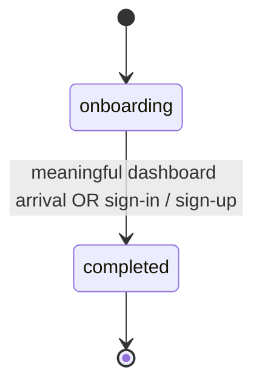

## ADDED Requirements

### Requirement: Onboarding is one latched state

The fan web app SHALL model onboarding as a single persisted yes/no state, not an ordered step machine. A brand-new visitor SHALL start in `onboarding`, the state SHALL persist on the device across sessions (an absent value means `onboarding`), and it SHALL move exactly once, irreversibly, to `completed`, except via an explicit fresh-onboarding reset. There SHALL be no onboarding steps and no forced navigation: every route is reachable at any time (soft gate), and a guest with no follows is guided by an in-page empty-state CTA, not a redirect.

| State        | Description                                   |
|--------------|-----------------------------------------------|
| `onboarding` | First-run experience (default for a new user) |
| `completed`  | Onboarding finished (terminal; one-way)       |

#### Scenario: Brand-new user defaults to onboarding

- **WHEN** a user opens the app for the first time on a device with no stored onboarding state
- **THEN** the fan SHALL be in onboarding

#### Scenario: Completion latches on first meaningful dashboard arrival

- **WHEN** a fan in onboarding reaches the dashboard
- **AND** the timetable is real (a home area is set and the concert data has loaded)
- **AND** the fan follows at least one artist
- **THEN** onboarding SHALL become completed
- **AND** the latch SHALL be evaluated after the light-celebration decision (so that decision still sees the fan in onboarding), honoring the deferral while the home area is not yet chosen

#### Scenario: Completion latches after choosing the home area on arrival

- **WHEN** a fan in onboarding who follows at least one artist reaches the dashboard without a home area
- **AND** the fan chooses a home area in the home-area sheet
- **AND** the timetable then loads, including when it loads from concert data already fetched earlier in the same session
- **THEN** onboarding SHALL become completed exactly once

#### Scenario: Latch is independent of whether the celebration is shown

- **WHEN** a fan in onboarding reaches a meaningful first dashboard (home area set, data loaded, at least one followed artist)
- **AND** the light celebration is suppressed (it was already shown in an earlier session, or the timetable holds no concert)
- **THEN** onboarding SHALL still become completed
- **AND** the latch SHALL NOT be gated on the celebration overlay actually rendering

#### Scenario: No latch for a zero-follow dashboard arrival

- **WHEN** a fan in onboarding with zero followed artists lands on the dashboard (e.g. via deep link, served the empty-state CTA)
- **THEN** onboarding SHALL NOT become completed
- **AND** the fan SHALL stay in onboarding so the Discovery progress row and the page-help auto-open still apply until the fan follows an artist or signs in

#### Scenario: Completion latches on sign-in or sign-up

- **WHEN** a user completes a successful sign-up or sign-in through the auth callback
- **THEN** onboarding SHALL become completed
- **AND** completing it again when it is already completed SHALL change nothing

#### Scenario: Completion is one-way

- **WHEN** onboarding is already completed
- **AND** the user revisits the dashboard or any onboarding-relevant surface
- **THEN** onboarding SHALL stay completed

### Requirement: The analytics notice is visible before any interaction

Because analytics runs default-on under an opt-out model, the purpose-of-use notice required by 個人情報保護法 (APPI, Act on the Protection of Personal Information) and the information that 外部送信規律 (the external-transmission rule of the Telecommunications Business Act) requires to be notified or published SHALL be reachable from the first screen a visitor sees. The Welcome screen SHALL state in plain words that usage is analysed to improve the app and that names and email addresses are not used for it, and SHALL link to the analytics opt-out in Settings and to a details page that names the recipient, the data sent and the purpose and links the privacy policy (per `route/welcome`). The notice SHALL NOT block progression, SHALL NOT require acknowledgement and SHALL NOT change the default-on analytics state.

#### Scenario: Visitor sees the notice on the first screen

- **WHEN** a visitor opens the Welcome screen
- **THEN** the analytics notice and its two links SHALL be visible next to the Get Started button without any other action

#### Scenario: Notice does not gate analytics or onboarding

- **WHEN** the visitor taps Get Started without opening either link
- **THEN** onboarding SHALL proceed to Discovery
- **AND** analytics SHALL remain enabled

#### Scenario: Opt-out remains reachable later

- **WHEN** a fan who passed the Welcome screen later wants to stop analytics
- **THEN** the fan SHALL be able to reach the analytics opt-out from the Settings screen without re-onboarding

## REMOVED Requirements

### Requirement: Frontend search status polling for onboarding

**Reason**: The fan web app no longer starts concert searches or polls their status. A first follow starts the search on the server (`stories/follow-an-artist`), and Discovery only looks up concerts already in the catalog.
**Migration**: None. The progress shown during onboarding is the Discovery progress row (`route/discovery`).

### Requirement: Final onboarding step is a non-blocking analytics transparency notice

**Reason**: Onboarding has no steps, and no screen ever led to the notice, so no fan saw it.
**Migration**: Replaced by "The analytics notice is visible before any interaction", shown on the Welcome screen.

### Requirement: Onboarding service routes based on completion status

**Reason**: Onboarding is a soft gate with no redirects (see "Onboarding is a one-way latched boolean"); the `onboarding/discover` route does not exist.
**Migration**: None. A guest with no follows is guided by the Dashboard empty-state CTA.

### Requirement: Single-Flag Onboarding State

**Reason**: Merged with "Onboarding is a one-way latched boolean" into "Onboarding is one latched state", which also latches on sign-in, covers choosing the home area on arrival, and drops the one-time migration of the old step value that has been removed from the app.
**Migration**: See "Onboarding is one latched state".

### Requirement: Onboarding is a one-way latched boolean

**Reason**: Merged into "Onboarding is one latched state" (see above).
**Migration**: See "Onboarding is one latched state".
