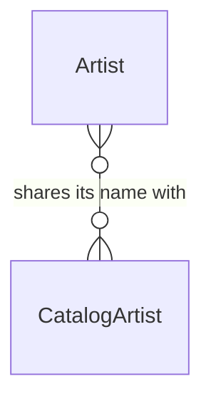

## Purpose

A CatalogArtist is an artist as the music catalog records it, not a registered Artist: an admin compares CatalogArtists that share a name to decide which one a registered Artist is.

| attribute | meaning | constraint |
|-----------|---------|------------|
| mbid | the artist's identifier in the music catalog | required; a UUID of 36 characters |
| name | the artist's name in the catalog | required; at least 1 character |
| country | the country the catalog associates with the artist | optional; an ISO 3166-1 alpha-2 code; absent when the catalog records none |
| begin | when the artist's activity began, as precise as the catalog records it (year, year and month, or date) | optional |
| end | when the artist's activity ended, as precise as the catalog records it | optional; absent while the catalog records no end |
| disambiguation | the catalog's short note that tells the artist apart from others of the same name | optional; absent when the catalog has none |
| official_site_url | the artist's official homepage, chosen from the catalog's links as Artist.SelectOfficialSite chooses | optional; absent when the catalog has no active official-homepage link |

## ADDED Requirements

### Requirement: A CatalogArtist is well-formed
A CatalogArtist SHALL have an MBID that is a UUID of 36 characters and a name of at least 1 character.

#### Scenario: Malformed MBID
- **WHEN** a catalog artist's MBID is not 36 characters long
- **THEN** it is invalid

#### Scenario: Empty name
- **WHEN** a catalog artist's name is empty
- **THEN** it is invalid
