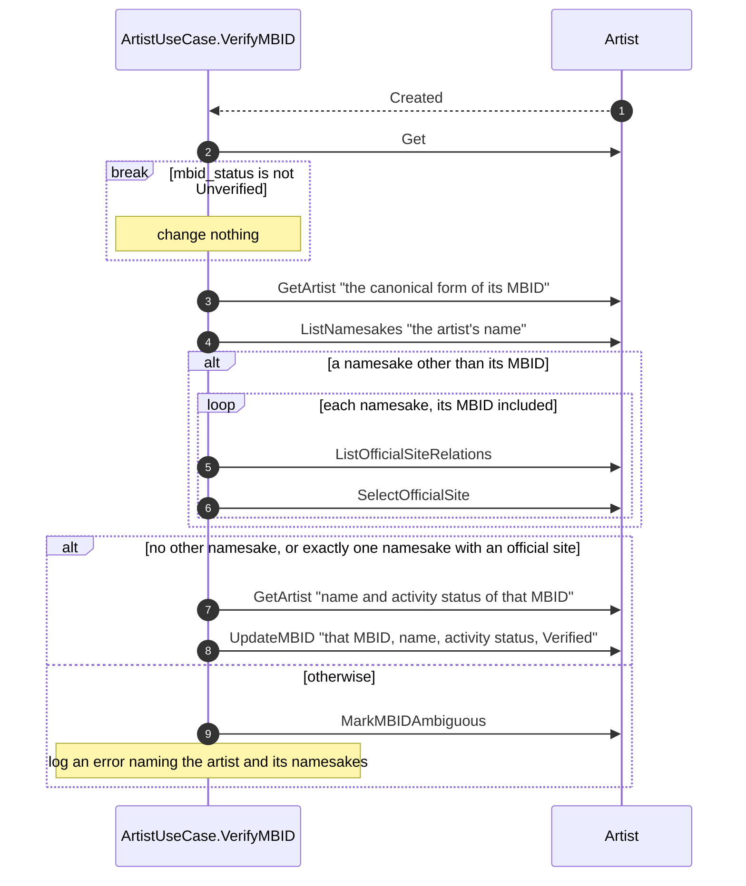

## Purpose

ArtistUseCase.VerifyMBID checks that an Unverified artist's MBID names that artist and not a namesake in the music catalog: it marks the artist Verified, corrects it to the namesake that is clearly the artist, or marks it Ambiguous and alerts the owner so an admin decides.

## ADDED Requirements

### Requirement: VerifyMBID decides the artist's MBID from its namesakes
ArtistUseCase.VerifyMBID SHALL take an artist id, get the artist with Artist.Get and, when its mbid_status is not Unverified, change nothing and succeed. Otherwise it SHALL first read the artist's mbid with Artist.GetArtist to learn its canonical form, the MBID the music catalog returns for it (a merged MBID is answered with the surviving artist; when the read fails with NotFound, the catalog does not know the mbid and the mbid is its own canonical form). The artist's mbid and its canonical form count as one candidate, the artist's own. It SHALL then look the artist's name up with Artist.ListNamesakes and decide:
- when no namesake has an MBID other than the artist's own, its canonical form is verified;
- otherwise it SHALL read the official homepage of the artist's own canonical form and of every other namesake with Artist.ListOfficialSiteRelations and Artist.SelectOfficialSite; an MBID the catalog does not know (NotFound) counts as having no official homepage; when exactly one of them has an official homepage, that one's MBID is verified (it may be the artist's own canonical form);
- otherwise the MBID is ambiguous.
For a verified MBID it SHALL take the catalog's name and activity status from Artist.GetArtist for it (the first read, when it is the artist's own) and then store the MBID Artist.GetArtist returned, that name (when not empty; otherwise the current name) and that status with one Artist.UpdateMBID, which marks the artist Verified; nothing is stored before every catalog read has succeeded. An ambiguous MBID SHALL be recorded with Artist.MarkMBIDAmbiguous, leaving the artist's mbid, and an error SHALL be logged naming the artist's id, its name and the namesakes' MBIDs, so the owner is alerted.

#### Scenario: Merged MBID
- **WHEN** an Unverified artist's mbid M was merged in the catalog into X, and the catalog's only artist of its name is X
- **THEN** the artist becomes Verified with mbid X, and no official homepage is read

#### Scenario: Merged MBID with a namesake
- **WHEN** an Unverified artist's mbid M was merged into X, the catalog lists X and a namesake Y for its name, and only X has an official homepage
- **THEN** the artist becomes Verified with mbid X: M and X count as one candidate, so one candidate has an official homepage

#### Scenario: No namesake
- **WHEN** an Unverified artist's name has no catalog artist other than its own mbid
- **THEN** the artist becomes Verified with its mbid, and the catalog's name and activity status are adopted

#### Scenario: Its own MBID is the only one with an official site
- **WHEN** the catalog has two artists of the name and only the artist's own mbid has an official homepage
- **THEN** the artist becomes Verified with its own mbid

#### Scenario: A namesake is the only one with an official site
- **WHEN** the artist's mbid names a UK band without an official homepage and the only other artist of the name, a Japanese band, has one
- **THEN** the artist's mbid becomes the Japanese band's MBID, it becomes Verified, its listening_mbid is unchanged, and the Japanese band's name and activity status are adopted

#### Scenario: No namesake has an official site
- **WHEN** the catalog has three artists of the name and none has an official homepage
- **THEN** the artist becomes Ambiguous with its mbid unchanged, and an error naming the artist and the three MBIDs is logged

#### Scenario: Its own MBID unknown to the catalog
- **WHEN** the artist's name has a namesake with an official homepage, and Artist.ListOfficialSiteRelations fails with NotFound for the artist's own mbid
- **THEN** the artist's mbid becomes the namesake's MBID and it becomes Verified

#### Scenario: Several have an official site
- **WHEN** two of the artists of the name have an official homepage
- **THEN** the artist becomes Ambiguous and an error is logged

#### Scenario: Already verified
- **WHEN** VerifyMBID is called for an artist whose mbid_status is Verified or Ambiguous
- **THEN** it looks nothing up and changes nothing

### Requirement: VerifyMBID reports failures
ArtistUseCase.VerifyMBID SHALL fail with NotFound when no artist has the id, and with the error of Artist.ListNamesakes, Artist.ListOfficialSiteRelations, Artist.GetArtist or Artist.UpdateMBID, leaving the artist Unverified and unchanged, so a retry or the next daily run verifies it again, except in these cases: Artist.GetArtist failing with NotFound for the first read of the artist's mbid is not a failure (the mbid is its own canonical form); and two cases make the MBID ambiguous: the catalog does not know the MBID to verify (Artist.GetArtist fails with NotFound for it), or Artist.UpdateMBID fails with AlreadyExists because another artist holds it. The error logged then also names that MBID and the reason.

#### Scenario: Catalog unavailable
- **WHEN** Artist.ListNamesakes fails with Unavailable
- **THEN** VerifyMBID fails with Unavailable and the artist stays Unverified

#### Scenario: MBID the catalog has never known
- **WHEN** an Unverified artist has an MBID the catalog does not know, and the catalog has no artist of its name
- **THEN** the artist becomes Ambiguous and an error naming the artist and the MBID is logged

#### Scenario: Catalog unavailable when reading the name
- **WHEN** the MBID is decided and Artist.GetArtist then fails with Unavailable
- **THEN** VerifyMBID fails with Unavailable, nothing is stored, and the artist stays Unverified for the retry

#### Scenario: Unknown artist
- **WHEN** no artist has the id
- **THEN** VerifyMBID fails with NotFound

#### Scenario: Corrected MBID already registered
- **WHEN** the namesake to verify is the mbid or listening_mbid of another artist
- **THEN** Artist.UpdateMBID fails with AlreadyExists, VerifyMBID marks the artist Ambiguous and succeeds, and the error logged names the artist, the MBID and that another artist holds it

### Requirement: VerifyMBID runs when an artist is registered and daily for unverified artists
When an artist is announced as created (Artist.Created), VerifyMBID SHALL run for it; when the run fails, it SHALL be retried up to 3 more times. An ambiguous result is not a failure and is not retried. Once a day at 05:00 Japan time, before the daily refresh of ArtistUseCase.Refresh, VerifyMBID SHALL run, one artist at a time, for every artist that Artist.ListByMBIDStatus returns as Unverified, oldest first; the run SHALL stop after 3 consecutive failed artists and when it is asked to shut down, and an artist that failed stays Unverified for the next day.

#### Scenario: Artist announced
- **WHEN** an artist is announced as created with mbid_status Unverified
- **THEN** VerifyMBID runs for it

#### Scenario: Artist announced already verified
- **WHEN** an artist an admin registered with ArtistUseCase.Create, with mbid_status Verified, is announced as created
- **THEN** VerifyMBID runs for it and changes nothing

#### Scenario: Announcement retries exhausted
- **WHEN** VerifyMBID failed for an announced artist on every retry
- **THEN** the artist stays Unverified and the next daily run verifies it

#### Scenario: Consecutive failures in the daily run
- **WHEN** the catalog is unreachable for 3 Unverified artists in a row
- **THEN** the daily run stops verifying and those artists stay Unverified
