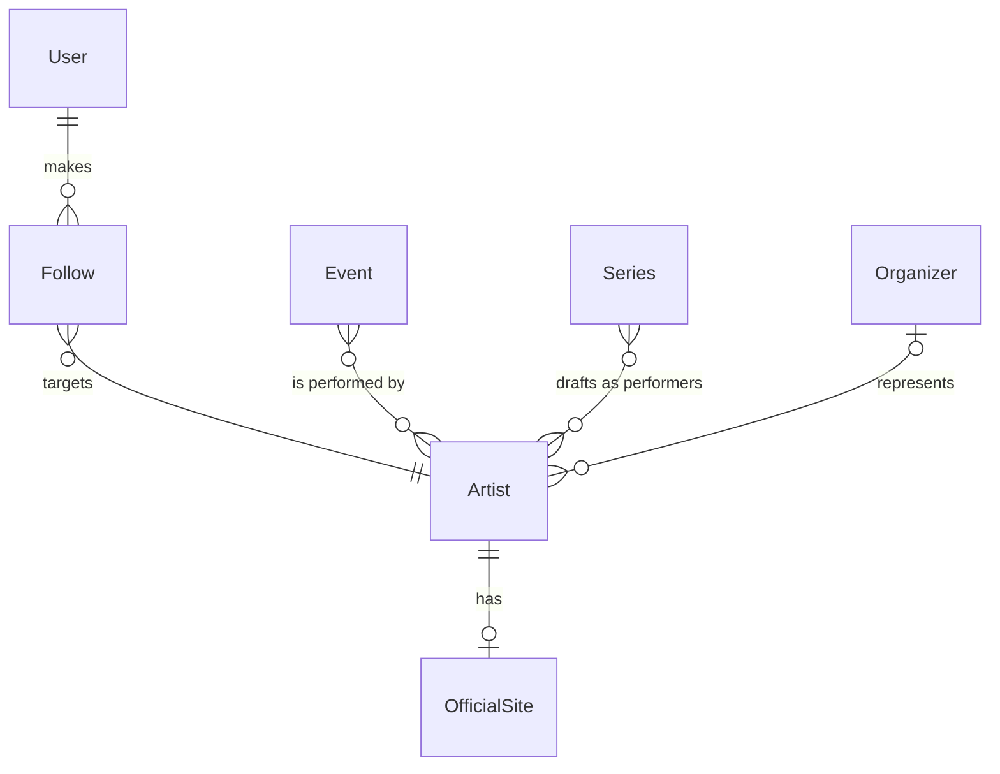

# Artist

## Purpose

An Artist is a musical performer or group that fans follow for concert news. It is registered once per music-catalog identity (MBID) and carries community-curated images of itself.

| attribute | meaning | constraint |
|-----------|---------|------------|
| id | the artist's identity in Liverty Music | required; a UUID, fresh for every new artist |
| name | display name of the performer or group | required; at least 1 character |
| mbid | the artist's identifier in the music catalog | required; a UUID of 36 characters; one artist per MBID |
| fanart | the artist's community-curated images, grouped by kind: artist_thumb (square portrait), artist_background (wide backdrop), music_banner (wide banner) | optional; absent when the images were never checked or the last check found none; each kind holds zero or more images |
| fanart image | one image of a kind: its catalog id, URL, like count and language | URL required; like count 0 or more |
| fanart_sync_time | when the artist's images were last checked | optional; absent means never checked |
| official_site_check_time | when the artist's official site was last checked in the music catalog, whatever the check found | optional; absent means never checked |
| organizer | the Organizer that represents the artist | optional; at most one |

## Requirements

### Requirement: Artist identity and name are well-formed
An Artist SHALL have an MBID that is a UUID of 36 characters and a name of at least 1 character.

#### Scenario: Missing MBID
- **WHEN** an artist has no MBID
- **THEN** the artist is invalid

#### Scenario: Malformed MBID
- **WHEN** an artist's MBID is not a UUID of 36 characters
- **THEN** the artist is invalid

#### Scenario: Empty name
- **WHEN** an artist's name is empty
- **THEN** the artist is invalid

### Requirement: A new artist starts without images
A new Artist SHALL get a fresh unique id and SHALL start with no fanart, no fanart_sync_time and no official_site_check_time.

#### Scenario: New artist
- **WHEN** an artist is created from a name and an MBID
- **THEN** it has a fresh id, that name and MBID, no fanart, no fanart_sync_time and no official_site_check_time

#### Scenario: Two new artists
- **WHEN** two artists are created from the same name and MBID
- **THEN** their ids differ

### Requirement: The best image of a kind is the most liked
For each image kind, the best image SHALL be the image with the highest like count; when several images share the highest count, the one listed first SHALL be the best; a kind with no images SHALL have no best image. Wherever an artist is presented to a client, each image kind SHALL show only its best image.

#### Scenario: Different like counts
- **WHEN** a kind has images with like counts 3, 7 and 1
- **THEN** the image with 7 likes is the best

#### Scenario: Equal like counts
- **WHEN** two images of a kind have the same highest like count
- **THEN** the one listed first is the best

#### Scenario: No images of a kind
- **WHEN** a kind has no images
- **THEN** the kind has no best image and the artist shows no image of that kind
