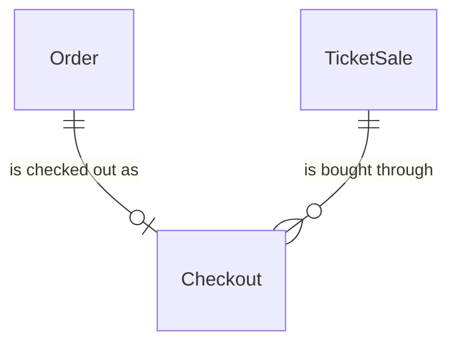
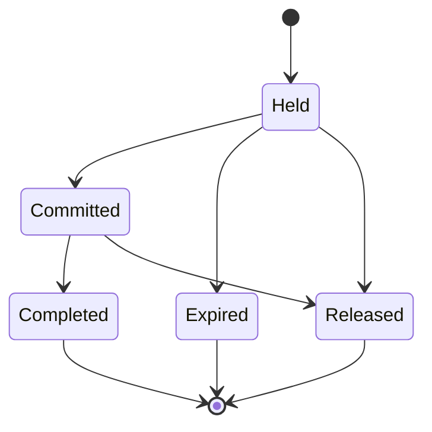

# components/entity/checkout Specification

## Purpose

A Checkout is how one fan's Order is bought first come, first served: during a FirstCome TicketSale it holds the Order's tickets of its TicketStock for 15 minutes while the fan confirms their 本人確認 (identity check) details and authorizes their card. It ends with the tickets committed, charged and issued, or with the hold released and any card authorization given back. The fan, the TicketStock, the ticket count, the card authorization and the referral code are the Order's.

| attribute | meaning | constraint |
|-----------|---------|------------|
| id | the checkout's identity | required, assigned on creation |
| order | the Order it buys | required; one Checkout per Order |
| sale | the FirstCome TicketSale it buys from | required; a sale that names the event of the Order's TicketStock |
| status | lifecycle | Held, Committed, Completed, Expired or Released |
| hold expiry | when the hold lapses; it is never extended | required; 15 minutes after the checkout starts |
| commit time | when its tickets were committed against the stock | absent until Committed |
| capture time | when the card was charged | absent until charged; set once |

## Requirements

### Requirement: A new checkout holds for 15 minutes

A new Checkout SHALL start Held, with a hold expiry 15 minutes after its create time and an amount equal to the ticket type's price times its ticket count. A resale Checkout's hold expiry SHALL instead be the earlier of 15 minutes after its create time and the resale deadline of its TicketType's event, so that no resale hold lasts into admission.

#### Scenario: New checkout
- **WHEN** a fan starts a checkout for 2 tickets of a TicketType priced 3000 yen at 18:00
- **THEN** the Checkout is Held, its amount is 6000 yen and its hold expires at 18:15

#### Scenario: Resale checkout long before the deadline
- **WHEN** a fan starts a resale checkout for 1 ticket priced 5000 yen at 12:00 and the resale deadline is 15:00
- **THEN** the Checkout is Held, its amount is 5000 yen and its hold expires at 12:15

#### Scenario: Resale checkout just before the deadline
- **WHEN** a fan starts a resale checkout at 14:50 and the resale deadline is 15:00
- **THEN** its hold expires at 15:00

### Requirement: Holding

A Checkout SHALL be holding at a time when it is Held and the time is before its hold expiry. Only holding Checkouts count in a TicketType's held count, and only a holding Checkout can be committed.

#### Scenario: Within the hold
- **WHEN** a Held Checkout expiring at 18:15 is checked at 18:14
- **THEN** it is holding

#### Scenario: Hold lapsed
- **WHEN** a Held Checkout expiring at 18:15 is checked at 18:15
- **THEN** it is not holding

### Requirement: A charged checkout is never released

A Checkout with a capture time SHALL NOT become Released or Expired.

#### Scenario: Charged checkout
- **WHEN** a Committed Checkout has a capture time
- **THEN** it can only become Completed

### Requirement: A resale checkout holds listings

A Checkout SHALL be a resale Checkout when it holds ResaleListings instead of its TicketType's stock. A resale Checkout SHALL hold exactly as many listings as its ticket count, all of its TicketType, and none whose user is the Checkout's user. A Checkout that holds stock SHALL hold no listing.

#### Scenario: Two listings of two fans
- **WHEN** a resale Checkout for 2 tickets holds one listing of each of two other fans
- **THEN** it is valid

#### Scenario: The fan's own listing
- **WHEN** a resale Checkout holds a listing whose user is the Checkout's user
- **THEN** it is invalid
