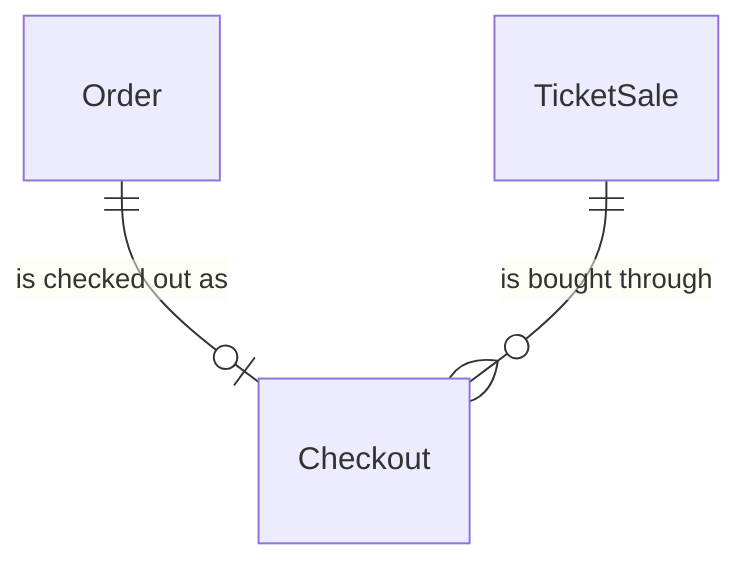
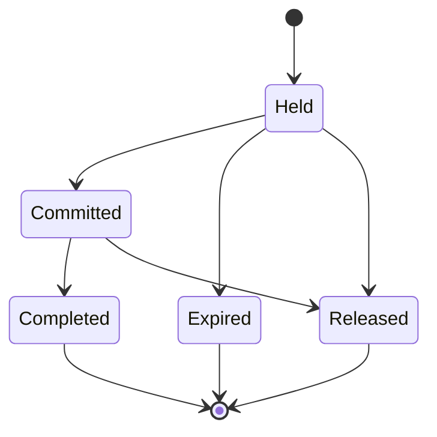

# components/entity/checkout Specification

## Purpose

A Checkout is how one fan's Order is bought first come, first served: during a FirstCome TicketSale it holds the Order's tickets of its TicketStock for 15 minutes while the fan confirms their 本人確認 (identity check) details and authorizes their card. It ends with the tickets committed, charged and issued, or with the hold released and any card authorization given back. The fan, the TicketStock, the ticket count, the card authorization and the referral code are the Order's.

| attribute | meaning | constraint |
|-----------|---------|------------|
| id | the checkout's identity | required, assigned on creation |
| order | the Order it buys | required; one Checkout per Order |
| sale | the FirstCome TicketSale it buys from | required; a sale that names the event of the Order's TicketStock |
| card authorization release time | when the Order's card authorization was given back without charging | absent unless released; set once |
| status | lifecycle | Held, Committed, Completed, Expired or Released |
| hold expiry | when the hold lapses; it is never extended | required; 15 minutes after the checkout starts |
| commit time | when its tickets were committed against the stock | absent until Committed |
| capture time | when the card was charged | absent until charged; set once |

## Requirements

### Requirement: Holding

A Checkout SHALL be holding at a time when it is Held and the time is before its hold expiry. Only holding Checkouts count in a TicketStock's held count, and only a holding Checkout can be committed.

#### Scenario: Within the hold
- **WHEN** a Held Checkout expiring at 18:15 is checked at 18:14
- **THEN** it is holding

#### Scenario: Hold lapsed
- **WHEN** a Held Checkout expiring at 18:15 is checked at 18:15
- **THEN** it is not holding

### Requirement: A charged checkout is never released

A Checkout with a capture time SHALL NOT become Released or Expired.

#### Scenario: Charged checkout
- **WHEN** a Committed Checkout has a capture time
- **THEN** it can only become Completed

### Requirement: A checkout holds for 15 minutes

A new Checkout SHALL start Held, with a hold expiry 15 minutes after its create time.

#### Scenario: New checkout
- **WHEN** a fan starts a checkout at 18:00
- **THEN** the Checkout is Held and its hold expires at 18:15

### Requirement: Sale of a checkout

A Checkout SHALL belong to a FirstCome TicketSale that names the event of its Order's TicketStock. It holds that TicketStock's tickets and nothing else.

#### Scenario: First-come sale of the event
- **WHEN** a Checkout belongs to a FirstCome sale that names the event of its Order's TicketStock
- **THEN** it is valid

#### Scenario: Lottery sale
- **WHEN** a Checkout belongs to a Lottery sale
- **THEN** it is invalid

#### Scenario: No sale
- **WHEN** a Checkout belongs to no TicketSale
- **THEN** it is invalid
