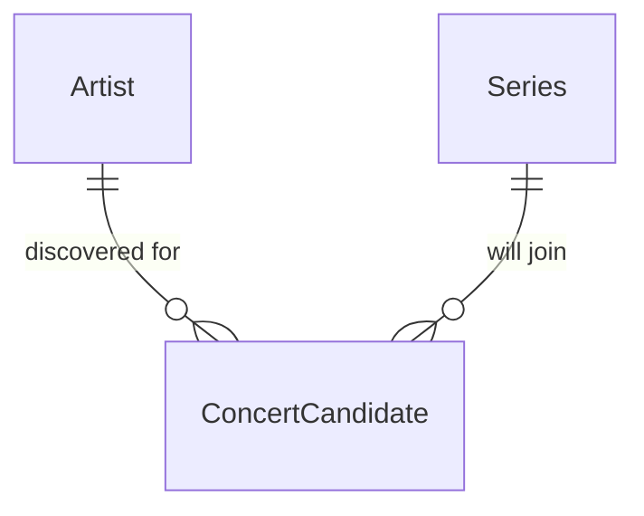

# Concert Candidate

## Purpose

A ConcertCandidate is a discovered performance held for admin review instead of being published: its venue could not be resolved (for example because its admin area or time zone is unknown), or it collides with an Event already in the catalog. It is not a Concert and is never shown to fans; it exists only until an admin approves or rejects it.

| attribute | meaning | constraint |
|-----------|---------|------------|
| id | concert candidate identifier | required |
| artist | the Artist it was discovered for | required |
| series | the Series it will join on approval | required |
| title | the Series title as discovered, for review display | required |
| local date | calendar date at the venue | required |
| start time | performance start | optional, a time of day at the venue; absent means unknown |
| open time | doors open | optional, a time of day at the venue; absent means unknown |
| listed venue name | venue text as discovered, normalized | required |
| admin area | admin area as discovered, as a subdivision code | optional; resolved to a first-level Area when the candidate is approved |
| time zone | the venue's IANA time zone as discovered | optional; absent without an admin area |
| source page | where it was found | optional |
| resolved place id | map place identity of the resolved venue | optional; absent when the venue was not resolved |
| find time | when it was first staged | required |

## Requirements

### Requirement: A concert candidate is not a concert

A ConcertCandidate SHALL NOT appear in any fan-facing concert list or in the admin catalog list of Concerts.

#### Scenario: Concert candidate on a followed artist
- **WHEN** a ConcertCandidate exists for an Artist a fan follows
- **THEN** it is not among that fan's concerts

### Requirement: A concert candidate keeps only the resolved place id from the map catalog

A ConcertCandidate SHALL carry, of what the map catalog returned for its venue, only the resolved place id, and only when its venue was resolved to a place; it SHALL carry no venue name, coordinates or admin area read from the map catalog. Its admin area, when present, SHALL be the subdivision code as discovered, which is resolved to a first-level Area only when the candidate is approved (a candidate staged earlier may carry a lower-level or unknown code such as FR-33 or JP-99), and its time zone, when present, SHALL be an IANA time zone name as discovered; a ConcertCandidate without an admin area SHALL have no time zone.

#### Scenario: Unresolved venue
- **WHEN** a ConcertCandidate was staged because its venue could not be resolved
- **THEN** it carries no resolved place id

#### Scenario: Resolved venue
- **WHEN** a ConcertCandidate was staged for a collision after its venue was resolved to place P, which the map catalog names "Zepp Haneda (TOKYO)"
- **THEN** it carries the resolved place id P and no venue name or coordinates from the map catalog

#### Scenario: Discovered area and time zone
- **WHEN** a ConcertCandidate is staged for an event discovered in JP-13 with the time zone Asia/Tokyo
- **THEN** it carries the admin area JP-13 and the time zone Asia/Tokyo

#### Scenario: Area kept as discovered
- **WHEN** a ConcertCandidate was staged with the admin area FR-33
- **THEN** it keeps FR-33 until it is approved

#### Scenario: Time zone without an area
- **WHEN** a ConcertCandidate has the time zone Asia/Tokyo and no admin area
- **THEN** it is invalid
