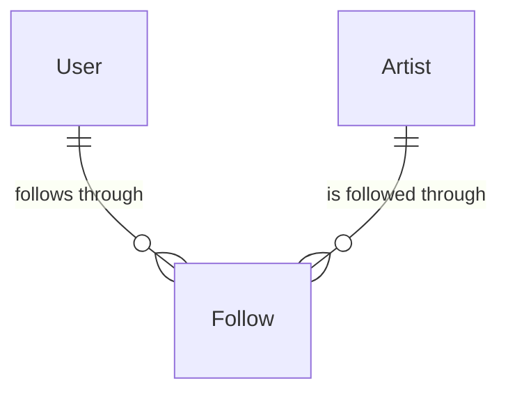

# Follow

## Purpose

A Follow records that a fan wants to be kept informed about one artist, together with the fan's hype level for that artist: how far the fan will travel for its concerts. The hype level decides which newly added concerts of the artist reach the fan by push.

| attribute | meaning | constraint |
|-----------|---------|------------|
| user_id | the fan who follows | required |
| artist_id | the followed artist | required; at most one Follow per fan and artist |
| hype | the fan's hype level for this artist | required; one of Watch, Home, Nearby, Away (least to most enthusiastic); a new Follow starts at Nearby |
| hype set by | who set the hype level: the starting level (default), the fan (fan), or the app from the fan's own actions (inference) | required; one of default, fan, inference; a new Follow starts at default |

Hype levels: **Watch** (the artist's concerts appear on the fan's dashboard, no push), **Home** (push for concerts in the fan's home area), **Nearby** (push for concerts in the home area or near it), **Away** (push for every concert). Any hype level may be changed to any other by the fan. The app may only raise a hype level the fan did not set.

Events announced about it:

| event | announced by | carries |
|-------|--------------|---------|
| Follow.Created | Follow.Follow | the Follow at hype Nearby |
| Follow.HypeChanged | Follow.RaiseHype, Follow.SetHype | the Follow with its new hype and hype set by |
| Follow.Removed | Follow.Unfollow | the Follow as it was |

## Requirements

### Requirement: Hype level is one of four values

A hype level SHALL be one of Watch, Home, Nearby or Away. Any other value, including an empty one, SHALL be invalid.

#### Scenario: Known hype level

- **WHEN** the hype level is Watch, Home, Nearby or Away
- **THEN** it is valid

#### Scenario: Unknown or empty hype level

- **WHEN** the hype level is "unknown" or empty
- **THEN** it is invalid

### Requirement: A new Follow starts at Nearby

A new Follow SHALL start with hype level Nearby, set by default.

#### Scenario: Fan follows an artist

- **WHEN** a Follow is created for a fan and an artist
- **THEN** its hype level is Nearby and its hype set by is default

### Requirement: Concerts matched by the hype level

Given a set of concerts and the fan's home, a Follow's hype level SHALL match the subset of those concerts it promises to push, judged by each concert's Proximity to the fan's home: Watch matches none; Home matches the concerts whose proximity is Home, and none when the fan has no home area; Nearby matches the concerts whose proximity is Home or Nearby, and none when the fan has no home; Away matches every concert. The subset keeps the given order and contains only concerts from the given set.

#### Scenario: Watch matches nothing

- **WHEN** the hype level is Watch
- **THEN** no concert is matched, whatever the fan's home and the concerts

#### Scenario: Home matches only concerts in the home area

- **WHEN** the hype level is Home, the fan's home area is JP-13, and the concerts are one in JP-13 and one in JP-40
- **THEN** only the JP-13 concert is matched

#### Scenario: Home without a home area

- **WHEN** the hype level is Home and the fan has no home area
- **THEN** no concert is matched

#### Scenario: Nearby matches home-area and nearby concerts

- **WHEN** the hype level is Nearby and the concerts are one in the fan's home area, one whose proximity is Nearby and one whose proximity is Away
- **THEN** the home-area concert and the nearby concert are matched

#### Scenario: Nearby with only distant concerts

- **WHEN** the hype level is Nearby and every concert's proximity is Away
- **THEN** no concert is matched

#### Scenario: Nearby without a home

- **WHEN** the hype level is Nearby and the fan has no home
- **THEN** no concert is matched

#### Scenario: Away matches everything

- **WHEN** the hype level is Away
- **THEN** every given concert is matched, whatever the fan's home

### Requirement: The lowest hype level that matches a concert

Given a concert and the fan's home, the lowest hype level that matches the concert SHALL be the lowest of Watch, Home, Nearby and Away whose matched concerts include it: Home for a concert in the home area, Nearby for one whose proximity is Nearby, and Away for one known to be farther than the nearby range. When the concert is outside the home area and its distance from the home cannot be measured, because the venue's location or the home's center is unknown, there SHALL be no lowest matching level: nothing shows how far the fan travels for it.

#### Scenario: Concert in the home area

- **WHEN** the fan's home area is JP-13 and the concert is in JP-13
- **THEN** the lowest matching hype level is Home

#### Scenario: Nearby concert

- **WHEN** the concert's proximity to the fan's home is Nearby
- **THEN** the lowest matching hype level is Nearby

#### Scenario: Distant concert

- **WHEN** the concert is outside the fan's home area and its venue is more than 200 km from the center of the fan's home area
- **THEN** the lowest matching hype level is Away

#### Scenario: Venue location unknown

- **WHEN** the fan's home area is JP-13 and the concert's venue has neither a known area nor a known location
- **THEN** there is no lowest matching hype level

### Requirement: The app may raise only a hype level the fan did not set

A Follow's hype level SHALL be raisable by the app to a given level only when its hype set by is default or inference and the given level is above its current level in the order Watch, Home, Nearby, Away. A hype level the fan set SHALL never be raisable by the app, and no level is raisable to a lower or equal level.

#### Scenario: Default level below the given level

- **WHEN** the Follow is at Nearby set by default and the given level is Away
- **THEN** the Follow is raisable to Away

#### Scenario: Level the fan set

- **WHEN** the Follow is at Home set by the fan and the given level is Away
- **THEN** the Follow is not raisable

#### Scenario: Given level not higher

- **WHEN** the Follow is at Nearby set by default and the given level is Home
- **THEN** the Follow is not raisable
