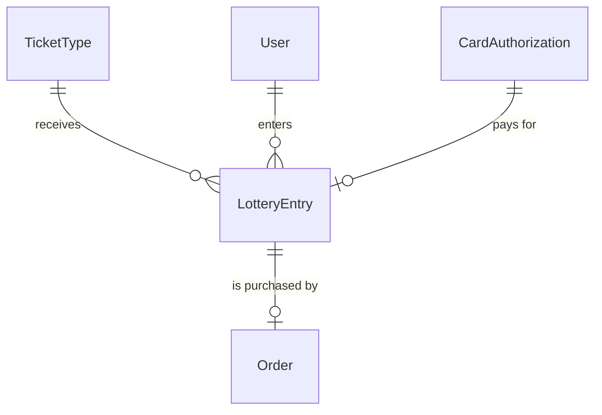
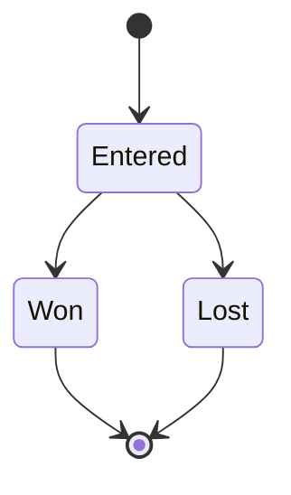

# components/entity/lottery-entry Specification

## Purpose
A LotteryEntry is one fan account's confirmed entry into the lottery for one TicketType: a request for a companion group of tickets allocated all-or-nothing, paid by the CardAuthorization placed on the fan's card for the amount until the draw. It is made when the fan confirms after authorizing their card, and takes part in the draw from then on. The fan's 本人確認 (identity check) details are the User's full name and phone number.

| attribute | meaning | constraint |
|-----------|---------|------------|
| id | the entry's identity | required, assigned on creation |
| ticket type | the TicketType entered | required; its sale's method is Lottery |
| user | the fan account that entered | required |
| ticket count | size of the companion group, allocated all-or-nothing | required, 1 to the ticket type's per-account limit |
| card authorization | the CardAuthorization on the fan's card for the entry's amount | required; set at creation |
| referral code | the ReferralCode of the link the fan came from | optional; set at creation, never changed |
| state | lifecycle | Entered, Won or Lost |
| draw position | the entry's position in its ticket type's random draw order | absent before the draw; set only by the draw |

## Requirements

### Requirement: Ticket count fits the ticket type

The ticket count SHALL be at least 1 and at most the ticket type's per-account limit.

#### Scenario: Count within the limit
- **WHEN** the ticket type allows 4 tickets per account and the ticket count is 2
- **THEN** the count is valid

#### Scenario: Zero tickets
- **WHEN** the ticket count is 0
- **THEN** the count is invalid

#### Scenario: Count over the limit
- **WHEN** the ticket type allows 4 tickets per account and the ticket count is 5
- **THEN** the count is invalid

### Requirement: A new entry is Entered

A LotteryEntry SHALL be created in state Entered, with its card authorization and without a draw position.

#### Scenario: New entry
- **WHEN** a LotteryEntry is created
- **THEN** its state is Entered, it has its card authorization and it has no draw position
