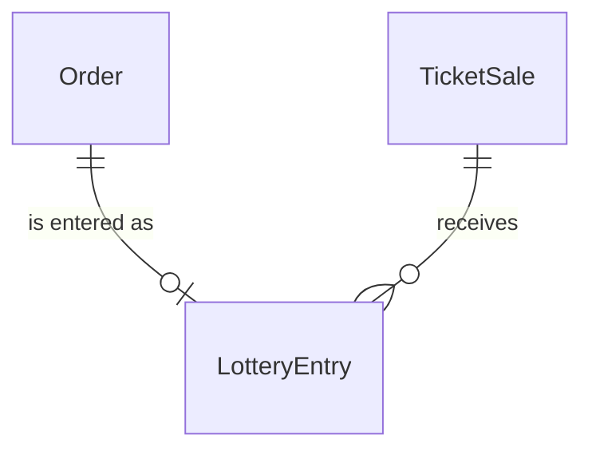
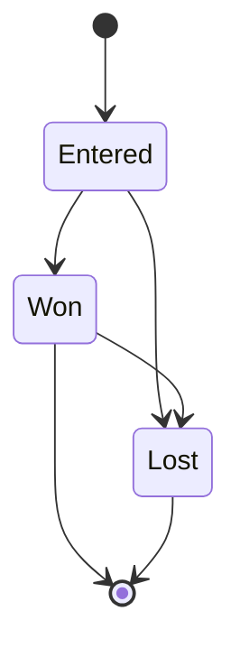

# components/entity/lottery-entry Specification

## Purpose

A LotteryEntry is how one fan's Order takes part in a Lottery TicketSale: a request for a companion group of tickets of the Order's TicketStock, allocated all-or-nothing, paid by the card authorization placed on the fan's card for the Order's amount until the draw. It is made when the fan confirms after authorizing their card, and takes part in the draw from then on. A fan enters a sale at most once for each event it names. The fan's 本人確認 (identity check) details are the User's full name and phone number.

| attribute | meaning | constraint |
|-----------|---------|------------|
| id | the entry's identity | required, assigned on creation |
| order | the Order it enters | required; one LotteryEntry per Order |
| sale | the Lottery TicketSale entered | required; one entry per sale, event and user |
| state | lifecycle | Entered, Won or Lost |
| draw position | the entry's position in its sale's random draw order for its TicketStock | absent before the draw; set only by the draw |
| loss email send time | when the email telling the fan the entry lost was sent | absent until sent; set once |

## Requirements

### Requirement: Ticket count fits the ticket type

The ticket count SHALL be at least 1 and at most the ticket type's per-account limit.

#### Scenario: Count within the limit
- **WHEN** the ticket type allows 4 tickets per account and the ticket count is 2
- **THEN** the count is valid

#### Scenario: Zero tickets
- **WHEN** the ticket count is 0
- **THEN** the count is invalid

#### Scenario: Count over the limit
- **WHEN** the ticket type allows 4 tickets per account and the ticket count is 5
- **THEN** the count is invalid

### Requirement: A new entry is Entered

A LotteryEntry SHALL be created in state Entered, with its card authorization and without a draw position.

#### Scenario: New entry
- **WHEN** a LotteryEntry is created
- **THEN** its state is Entered, it has its card authorization and it has no draw position
