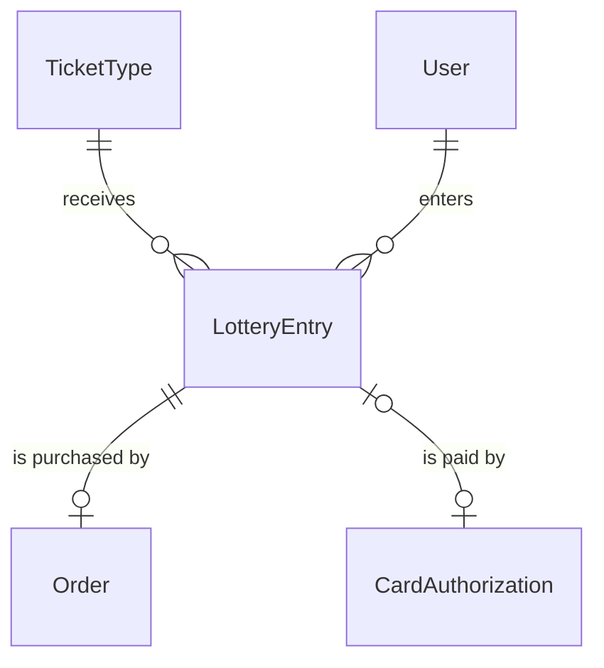
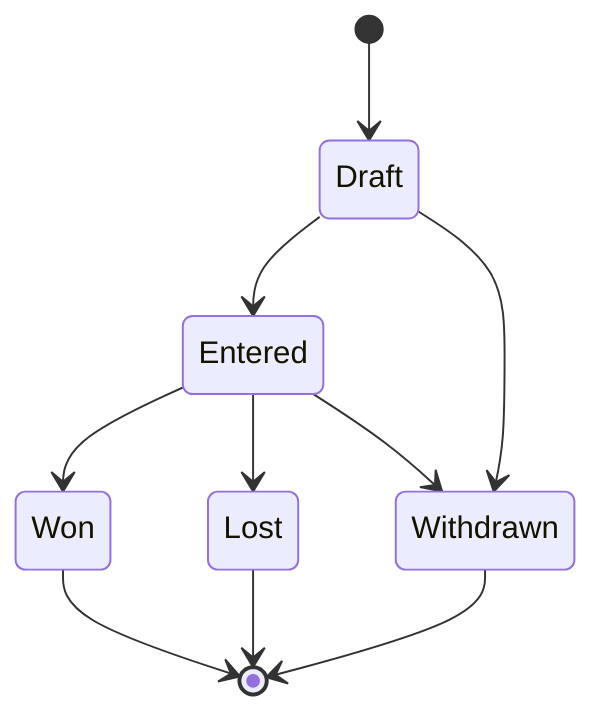

# components/entity/lottery-entry Specification

## Purpose
A LotteryEntry is one fan account's entry into the lottery for one TicketType: a request for a companion group of tickets allocated all-or-nothing, and the card authorization placed on the fan's card for the amount until the draw. A fan builds the entry as a Draft, authorizes their card for it, and confirms it; only a confirmed (Entered) entry takes part in the draw. The fan's 本人確認 (identity check) details are the User's full name and phone number.

| attribute | meaning | constraint |
|-----------|---------|------------|
| id | the entry's identity | required, assigned on creation |
| ticket type | the TicketType entered | required; its sale's method is Lottery |
| user | the fan account that entered | required |
| ticket count | size of the companion group, allocated all-or-nothing | required, 1 to the ticket type's per-account limit |
| card authorization | the CardAuthorization opened on the fan's card for the entry's amount | absent on a Draft until the fan authorizes their card; required from Entered on |
| state | lifecycle | Draft, Entered, Won, Lost or Withdrawn |
| draw position | the entry's position in its ticket type's random draw order | absent before the draw; set only by the draw |

## Requirements

### Requirement: A new entry starts as a Draft

A LotteryEntry SHALL start in state Draft, with no card authorization and no draw position.

#### Scenario: New entry
- **WHEN** a LotteryEntry is created
- **THEN** its state is Draft and it has no card authorization and no draw position

### Requirement: Confirmable only as a Draft with a card authorization

An entry SHALL be confirmable, that is able to become Entered, only while its state is Draft and it has a card authorization; whether that card authorization confirms it is the CardAuthorization's rule, for the TicketType's price times the ticket count.

#### Scenario: Draft with a card authorization
- **WHEN** the entry is a Draft with a card authorization
- **THEN** it is confirmable

#### Scenario: Draft without a card authorization
- **WHEN** the entry is a Draft with no card authorization
- **THEN** it is not confirmable

#### Scenario: Already entered
- **WHEN** the entry is Entered, Won, Lost or Withdrawn
- **THEN** it is not confirmable

### Requirement: Ticket count fits the ticket type

The ticket count SHALL be at least 1 and at most the ticket type's per-account limit.

#### Scenario: Count within the limit
- **WHEN** the ticket type allows 4 tickets per account and the ticket count is 2
- **THEN** the count is valid

#### Scenario: Zero tickets
- **WHEN** the ticket count is 0
- **THEN** the count is invalid

#### Scenario: Count over the limit
- **WHEN** the ticket type allows 4 tickets per account and the ticket count is 5
- **THEN** the count is invalid

### Requirement: Active entries

An entry SHALL be active unless its state is Withdrawn; Draft, Won and Lost entries stay active.

#### Scenario: Withdrawn entry is not active
- **WHEN** the state is Withdrawn
- **THEN** the entry is not active

#### Scenario: Draft or drawn entry is active
- **WHEN** the state is Draft, Won or Lost
- **THEN** the entry is active

### Requirement: Withdrawable only before the draw

An entry SHALL be withdrawable only while its state is Draft or Entered, that is before the draw has run for it.

#### Scenario: Draft or entered entry
- **WHEN** the state is Draft or Entered
- **THEN** the entry is withdrawable

#### Scenario: Drawn or withdrawn entry
- **WHEN** the state is Won, Lost or Withdrawn
- **THEN** the entry is not withdrawable
