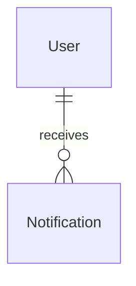

# Notification

## Purpose

A Notification is the durable record of one message sent to one fan, such as new concerts of a followed artist, a ticket-sale reminder or a ticket sale announcement. It records what the message is about, so its title, body and link can be rendered whenever the fan sees it, and whether the fan has read it. The message is rendered from the current state of the records it is about; it is not stored.

| attribute | meaning | constraint |
|-----------|---------|------------|
| id | the notification's identity, also carried inside the pushed message so the fan's response can be traced back to it | required; assigned when recorded |
| user_id | the fan it is for | required |
| type | what produced it | required; one of new_concerts, sales_reminder, ticket_sale_announcement, lottery_win, resale_win, lottery_loss, resale_entry_lapsed, resale_entry_lost, concert_cancelled, order_refunded |
| subject | the records the message is about: an artist and concerts, a TicketSale with a reminder stage and the fan's linked event, an Order, a LotteryEntry or a ResaleEntry, by type | required |
| create_time | when the notification was recorded | required |
| read_time | when the fan read it | optional; absent until read; an unread notification has none |

## Requirements

### Requirement: The subject names exactly what the type is about

A Notification's subject SHALL name the records its type is about, and nothing else:

| type | subject |
|---|---|
| new_concerts | the artist and the concerts matched for the fan |
| ticket_sale_announcement | the TicketSale and the fan's linked event |
| sales_reminder | the TicketSale, the reminder stage and the fan's linked event |
| lottery_win | the Order |
| resale_win | the Order |
| lottery_loss | the LotteryEntry |
| resale_entry_lapsed, resale_entry_lost | the ResaleEntry |
| concert_cancelled | the Order |
| order_refunded | the Order |

A Notification whose subject lacks a record its type needs SHALL be invalid.

#### Scenario: Reminder without a stage
- **WHEN** a sales_reminder Notification names a TicketSale and a linked event but no stage
- **THEN** the Notification is invalid

#### Scenario: New concerts subject
- **WHEN** a new_concerts Notification names an artist and two concerts
- **THEN** the Notification is valid

### Requirement: The message is rendered from the subject's records in the fan's language

A Notification's message SHALL be rendered from the current state of the records its subject names, in the fan's preferred language: Japanese for `ja`, and English for any other language. Its title SHALL read `[<artist>] <headline>` and its body SHALL read `<detail>`, then a line break, then the tour title. The artist is the subject's artist for new_concerts; for every other type it is the performer of the subject's concert that the fan follows at the highest hype level (Away, then Nearby, then Home, then Watch), the earliest in display order among equals, and the first performer in display order when the fan follows none. The tour title is the title of the Series of the subject's concert; for new_concerts, of the earliest matched concert. The headline and detail SHALL be:

| case | ja headline | ja detail | en headline | en detail |
|---|---|---|---|---|
| new_concerts | 新着ライブ発表!! | 新しいライブが{n}件見つかりました | New Concerts | {n} new concert(s) found |
| announcement, FirstCome | 先着販売のお知らせ | {start}から先着販売スタート!! | First-Come Ticket Sale | Ticket sale (first come) starts {start}! |
| announcement, Lottery | 抽選受付のお知らせ | {start}から抽選申し込みスタート!! | Ticket Lottery | Ticket lottery entry starts {start}! |
| reminder `APPLY_OPEN`, FirstCome | まもなく先着販売開始 | {start}から先着販売スタート!! | First-Come Sale Starting Soon | Ticket sale (first come) starts {start}! |
| reminder `APPLY_OPEN`, Lottery | 抽選受付スタート | 抽選申し込みがスタートしました!! 締切は{end} | Ticket Lottery Open | Ticket lottery entry is open! Closes {end}. |
| reminder `APPLY_CLOSE_24H` | 抽選締切が近づいています | 抽選申し込みの締切は{end}!! | Ticket Lottery Closing Soon | Ticket lottery entry closes {end}! |
| lottery_win | 抽選に当選しました | {date}の{venue}公演のチケット抽選に当選しました!!タップしてチケットを表示 | You Won the Ticket Lottery | You won the ticket lottery for {venue} on {date}! Tap to see your tickets. |
| resale_win | 公式リセールに当選しました | {date}の{venue}公演の公式リセールに当選しました!!タップしてチケットを表示 | You Won the Official Resale | You won the official resale for {venue} on {date}! Tap to see your tickets. |
| lottery_loss, not drawn | 抽選結果のお知らせ | {date}の{venue}公演のチケット抽選が落選となりました。 | Ticket Lottery Result | Your lottery entry for {venue} on {date} was not drawn. |
| lottery_loss, card could not be charged | 当選を取り消しました | カードで決済できなかったため、{date}の{venue}公演の当選を取り消しました。 | Lottery Win Cancelled | Your win for {venue} on {date} was cancelled because your card could not be charged. |
| resale_entry_lapsed | 公式リセールの期限切れ | カードの与信の有効期限が来たため申し込みが終了しました。 | Official Resale Entry Expired | Your entry ended because the card authorization expired. |
| resale_entry_lost, no ticket left | 公式リセールの抽選結果 | チケットの割り当てはありませんでした。 | Official Resale Result | No ticket was allocated to your entry. |
| resale_entry_lost, concert cancelled | 公式リセールの終了 | 公演中止のため申し込みが終了しました。 | Official Resale Ended | Your entry ended because the concert was cancelled. |
| resale_entry_lost, card could not be charged or payment not completed before the show | リセール当選の取り消し | 決済を完了できなかったため、{date}の{venue}公演の当選を取り消しました。請求はありません。 | Resale Win Cancelled | Your win for {venue} on {date} was cancelled because the payment could not be completed. You were not charged. |
| resale_entry_lost, listing cancelled | リセール当選の取り消し | お申し込みに割り当てたチケットを販売できなくなったため、{date}の{venue}公演の当選を取り消しました。お支払いいただいた金額はカードに返金します。 | Resale Win Cancelled | Your win for {venue} on {date} was cancelled because the ticket could no longer be sold. The amount charged is refunded to your card. |
| concert_cancelled | 公演中止のお知らせ | {date}の{venue}公演は中止となりました。チケット代金はカードに返金されます。 | Concert Cancelled | The concert at {venue} on {date} has been cancelled. Your tickets will be refunded to your card. |
| order_refunded | 返金が完了しました | {date}の{venue}公演のチケット代金{amount}円をカードに返金しました。 | Refund Complete | JPY {amount} for the concert at {venue} on {date} has been refunded to your card. |

`{n}` is the number of matched concerts; the English detail reads "1 new concert found" for one. `{start}` and `{end}` are the TicketSale's start and end times in the fan's time zone, falling back to Asia/Tokyo, as month/day(weekday) hour:minute in Japanese (`10/22(木) 23:59`) and month day (weekday) hour:minute in English (`Oct 22 (Thu) 23:59`). `{date}` is the concert's date as month/day in Japanese (`11/3`) and month day in English (`Nov 3`). `{venue}` is the concert's venue name. `{amount}` is the Order's refund amount. While resale of the event is open, a resale_entry_lapsed detail SHALL end with 再度、リセール申し込みをお願いします。 in Japanese and Please apply again. in English, and a resale_entry_lost detail for a card that could not be charged SHALL end with 別のカードで再度お申し込みいただけます。 in Japanese and You can apply again with another card. in English.

#### Scenario: Lottery loss in Japanese
- **WHEN** a lottery_loss Notification is rendered for a `ja` fan whose entry for the 11/20 concert at ぴあアリーナMM of the tour 前世 2026 by ヨルシカ was not drawn
- **THEN** the title is [ヨルシカ] 抽選結果のお知らせ and the body is 11/20のぴあアリーナMM公演のチケット抽選が落選となりました。 followed by a line break and 前世 2026

#### Scenario: Co-headlined concert
- **WHEN** a concert_cancelled Notification is rendered for a concert of artists A and B, in that display order, and the fan follows A at Home and B at Away
- **THEN** the title starts with [B]

#### Scenario: Performers not followed
- **WHEN** a lottery_win Notification is rendered for a concert of artists A and B and the fan follows neither
- **THEN** the title starts with [A]

#### Scenario: Language other than Japanese
- **WHEN** a Notification is rendered for a fan whose preferred language is `fr`
- **THEN** it is rendered in English

#### Scenario: Lapsed after resale closed
- **WHEN** a resale_entry_lapsed Notification is rendered after the event's resale deadline
- **THEN** its detail does not invite the fan to apply again

### Requirement: The link and the grouping tag follow the type

A Notification's link SHALL be: for new_concerts, `/events/<id>` of the earliest matched concert when its Series is first-party and `/concerts/<id>` otherwise; for ticket_sale_announcement and sales_reminder, the concert page of the fan's linked event; for lottery_win and resale_win, the Tickets screen; for lottery_loss and concert_cancelled, the event's page; for resale_entry_lapsed and resale_entry_lost, the resale entry screen; for order_refunded, the Order. Its grouping tag SHALL be one per artist for new_concerts, one per TicketSale for ticket_sale_announcement, one per TicketSale and stage for sales_reminder, and one per type and subject otherwise, so a later message with the same tag replaces the earlier one on a device. The link and the tag do not depend on the language.

#### Scenario: Two reminder stages
- **WHEN** a TicketSale's `APPLY_OPEN` and `APPLY_CLOSE_24H` reminders are rendered for one fan
- **THEN** their tags differ

#### Scenario: Same artist again
- **WHEN** two new_concerts Notifications are rendered for the same artist
- **THEN** their tags are the same
