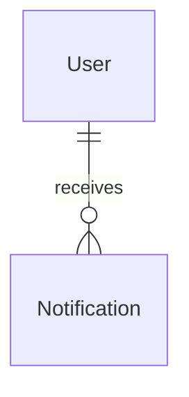

# Notification

## Purpose

A Notification is the durable record of one message sent to one fan, such as new concerts of a followed artist, a ticket-sale reminder or a ticket sale announcement. It records what the message is about, so its title, body and link can be rendered whenever the fan sees it, and whether the fan has read it. The message is rendered from the current state of the records it is about; it is not stored.

| attribute | meaning | constraint |
|-----------|---------|------------|
| id | the notification's identity, also carried inside the pushed message so the fan's response can be traced back to it | required; assigned when recorded |
| user_id | the fan it is for | required |
| type | what produced it | required; one of new_concerts, sales_reminder, ticket_sale_announcement, lottery_win, lottery_loss, resale_entry_lapsed, resale_entry_lost, concert_cancelled, order_refunded |
| subject | the records the message is about: an artist and concerts, a TicketSale with a reminder stage and the fan's linked event, an Order, a LotteryEntry or a ResaleEntry, by type | required |
| create_time | when the notification was recorded | required |
| read_time | when the fan read it | optional; absent until read; an unread notification has none |

## Requirements

### Requirement: A new Notification starts Queued

A new Notification SHALL start with delivery status Queued, with no deliver time, no failure reason, and no read or dismiss time.

#### Scenario: Notification recorded

- **WHEN** a Notification is created
- **THEN** its delivery status is Queued and it has no deliver, read or dismiss time

### Requirement: The delivery outcome is consistent

A Delivered Notification SHALL have a deliver time and no failure reason. A Failed Notification SHALL have a failure reason and no deliver time.

#### Scenario: Delivered

- **WHEN** a Notification is Delivered
- **THEN** it has a deliver time and no failure reason

#### Scenario: Failed

- **WHEN** a Notification is Failed
- **THEN** it has a failure reason and no deliver time

### Requirement: Read and dismissed do not depend on delivery

A Notification SHALL be readable and dismissable whatever its delivery status.

#### Scenario: A failed notification is read

- **WHEN** a Failed Notification is marked read
- **THEN** it has a read time and stays Failed
