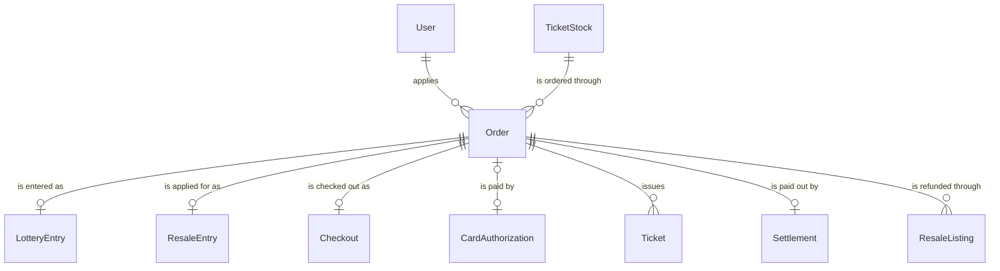
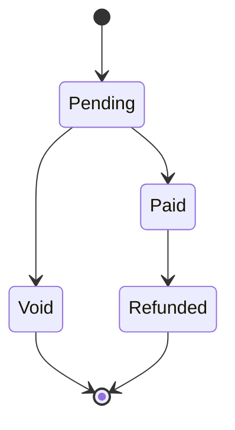

# Order

## Purpose

An Order is one fan account's application for tickets of one TicketStock and, once its payment is captured, the purchase record: the ticket count, the referral code, the card authorization, the payment provider's ID for the captured payment, the amount and its own status. It is created Pending when the fan applies through a LotteryEntry, a Checkout or a ResaleEntry, becomes Paid when the payment is captured and its Tickets are issued, or Void when it will never be paid. Void Orders hold no tickets. One Order covers all tickets of its application.

| attribute | meaning | constraint |
|-----------|---------|------------|
| id | the order's identity | required, assigned on creation |
| user | the account that applied for the tickets | required |
| ticket stock | the TicketStock the tickets are of | required |
| ticket count | tickets applied for, a companion group | required; 1 to the per-account limit of the stock's event |
| referral code | the ReferralCode of the link the fan came from | optional; set at creation, never changed |
| card authorization | the CardAuthorization on the fan's card for the amount | absent until the fan authorizes their card; set once |
| payment provider | which of the platform's payment providers holds the payment | required |
| provider payment ID | the payment provider's ID for the captured payment | absent until Paid; 1-255 characters, opaque |
| provider payment method ID | the payment provider's ID for the payment method used | optional, at most 255 characters, opaque |
| card brand | card brand shown to the user | optional, at most 40 characters |
| card last four | last four card digits shown to the user | optional, exactly 4 digits or empty |
| status | lifecycle | Pending, Paid, Refunded or Void |
| amount | total to pay: the seat type's price times the ticket count, in the currency's smallest unit (whole yen) | required, greater than 0; fixed at creation |
| currency | ISO 4217 currency of the amount | required, 3 uppercase letters |
| pay time | when the payment was captured and the Order became Paid | absent until Paid |
| provider refund ID | the payment provider's ID for the refund issued to the user | empty unless refunded for a cancellation |
| confirmation send time | when the purchase confirmation email was sent to the user | empty until sent; set once |

## Requirements

### Requirement: No card data is stored

An Order SHALL hold only the payment provider's IDs for the payment and the display facets card brand and card last four; it SHALL NOT hold the card number, security code or expiry. Card last four SHALL be exactly 4 digits or empty.

#### Scenario: Display facets only

- **WHEN** an Order is created from a card payment
- **THEN** it records the card brand and the last four digits, and no card number, security code or expiry

#### Scenario: Malformed last four

- **WHEN** card last four is "12a4" or "123"
- **THEN** the Order is invalid

### Requirement: Amount and currency

The amount SHALL be greater than 0 and the currency SHALL be a 3-letter uppercase ISO 4217 code.

#### Scenario: Non-positive amount

- **WHEN** the amount is 0
- **THEN** the Order is invalid

#### Scenario: Yen order

- **WHEN** the amount is 16000 and the currency is JPY
- **THEN** the amount and currency are valid

### Requirement: Refundable only while Paid

An Order SHALL be refundable only while its status is Paid.

#### Scenario: Paid order

- **WHEN** the status is Paid
- **THEN** the Order is refundable

#### Scenario: Refunded order

- **WHEN** the status is Refunded
- **THEN** the Order is not refundable

### Requirement: An Order has exactly one source

An Order SHALL be applied for through exactly one source: one LotteryEntry or one Checkout that names it. An Order that both a LotteryEntry and a Checkout name, or that neither names, SHALL be invalid.

#### Scenario: Order from a checkout

- **WHEN** a Checkout names an Order and no LotteryEntry does
- **THEN** its source is valid

#### Scenario: Order from a won lottery entry

- **WHEN** a LotteryEntry names an Order and no Checkout does
- **THEN** its source is valid

#### Scenario: Two sources

- **WHEN** a LotteryEntry and a Checkout name the same Order
- **THEN** the Order is invalid

### Requirement: A new Order is Pending

An Order SHALL be created Pending when a fan applies for tickets, before any payment, with its amount fixed at its seat type's amount for its ticket count. A Pending Order SHALL have no provider payment ID and no pay time.

#### Scenario: New order
- **WHEN** a fan applies for 2 tickets of a TicketStock whose seat type is priced 8000 yen
- **THEN** the Order is Pending, its amount is 16000 yen and it has no provider payment ID, pay time or provider refund ID

### Requirement: Ticket count fits the event

An Order's ticket count SHALL be at least 1 and at most the per-account limit of its TicketStock's event.

#### Scenario: Count within the limit
- **WHEN** the event's per-account limit is 4 and the ticket count is 2
- **THEN** the count is valid

#### Scenario: Zero tickets
- **WHEN** the ticket count is 0
- **THEN** the count is invalid

#### Scenario: Count over the limit
- **WHEN** the event's per-account limit is 4 and the ticket count is 5
- **THEN** the count is invalid

### Requirement: Paid only with a captured payment

An Order SHALL be Paid only with its card authorization, its provider payment ID and its pay time.

#### Scenario: Paid order
- **WHEN** an Order has a card authorization, a provider payment ID and a pay time
- **THEN** it can be Paid

#### Scenario: Paid without a payment
- **WHEN** an Order has no provider payment ID
- **THEN** it cannot be Paid

### Requirement: Void only from Pending

An Order SHALL become Void only from Pending, when its source ends without it ever being paid.

#### Scenario: Pending order
- **WHEN** the status is Pending
- **THEN** the Order can become Void

#### Scenario: Paid order
- **WHEN** the status is Paid
- **THEN** the Order cannot become Void
