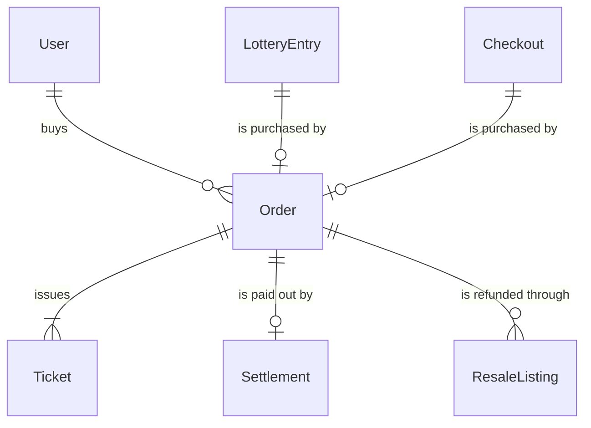
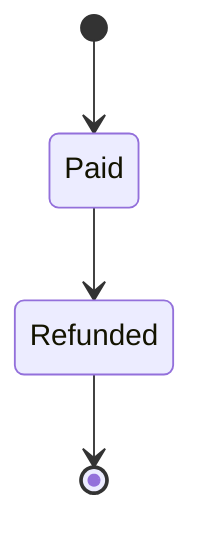

# Order

## Purpose

An Order is the purchase record of one source, a won LotteryEntry or a Committed Checkout: the payment provider's ID for its captured payment, the amount paid and its own status. One Order covers all tickets of its source, and an Order exists only after the payment has been captured.

| attribute | meaning | constraint |
|-----------|---------|------------|
| id | the order's identity | required, assigned on creation |
| user | the account that bought the tickets | required |
| source | what it was created from: a won LotteryEntry or a Committed Checkout | required, exactly one; one Order per source |
| payment provider | which of the platform's payment providers holds the payment | required |
| provider payment ID | the payment provider's ID for the captured payment | required, 1-255 characters, opaque |
| provider payment method ID | the payment provider's ID for the payment method used | optional, at most 255 characters, opaque |
| card brand | card brand shown to the user | optional, at most 40 characters |
| card last four | last four card digits shown to the user | optional, exactly 4 digits or empty |
| status | lifecycle | Paid or Refunded |
| amount | total paid, in the currency's smallest unit (whole yen) | required, greater than 0 |
| currency | ISO 4217 currency of the amount | required, 3 uppercase letters |
| pay time | when the Order was created from the captured payment | required |
| provider refund ID | the payment provider's ID for the refund issued to the user | empty unless refunded for a cancellation |
| confirmation send time | when the purchase confirmation email was sent to the user | empty until sent; set once |

## Requirements

### Requirement: An Order is created Paid

An Order SHALL start in status Paid, because it is created from an already captured payment; there is no pending Order.

#### Scenario: New order

- **WHEN** an Order is created
- **THEN** its status is Paid and its provider refund ID is empty

### Requirement: No card data is stored

An Order SHALL hold only the payment provider's IDs for the payment and the display facets card brand and card last four; it SHALL NOT hold the card number, security code or expiry. Card last four SHALL be exactly 4 digits or empty.

#### Scenario: Display facets only

- **WHEN** an Order is created from a card payment
- **THEN** it records the card brand and the last four digits, and no card number, security code or expiry

#### Scenario: Malformed last four

- **WHEN** card last four is "12a4" or "123"
- **THEN** the Order is invalid

### Requirement: Amount and currency

The amount SHALL be greater than 0 and the currency SHALL be a 3-letter uppercase ISO 4217 code.

#### Scenario: Non-positive amount

- **WHEN** the amount is 0
- **THEN** the Order is invalid

#### Scenario: Yen order

- **WHEN** the amount is 16000 and the currency is JPY
- **THEN** the amount and currency are valid

### Requirement: Refundable only while Paid

An Order SHALL be refundable only while its status is Paid.

#### Scenario: Paid order

- **WHEN** the status is Paid
- **THEN** the Order is refundable

#### Scenario: Refunded order

- **WHEN** the status is Refunded
- **THEN** the Order is not refundable

### Requirement: An Order has exactly one source

An Order SHALL come from exactly one source: a Won LotteryEntry, or a Checkout that was Committed and charged and is Completed by the Order's issuance. An Order that names both, or neither, SHALL be invalid. At most one Order SHALL exist per source.

#### Scenario: Order from a checkout

- **WHEN** an Order names a Checkout and no LotteryEntry
- **THEN** its source is valid

#### Scenario: Order from a won lottery entry

- **WHEN** an Order names a LotteryEntry and no Checkout
- **THEN** its source is valid

#### Scenario: Two sources

- **WHEN** an Order names both a LotteryEntry and a Checkout
- **THEN** the Order is invalid
