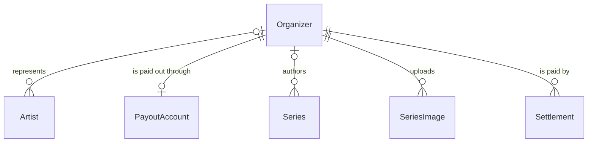
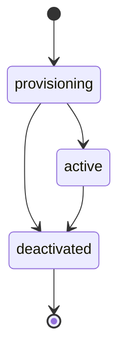

# Organizer

## Purpose

An Organizer is a vetted seller - a record label, management agency, promoter or self-publishing artist - that an admin creates to sell tickets for the Artists it represents. Being created by an admin is the vetting; an Organizer is an entity separate from any Artist, and its operators sign in to the Organizer's own isolated tenant.

| attribute | meaning | constraint |
|-----------|---------|------------|
| id | unique identity of the Organizer | required; UUID; assigned at creation; never the same value as an ArtistId |
| name | public display name, such as the label or promoter name | required; 1 to 200 characters |
| operator email | email of the initial operator, captured at creation to seed the operator's sign-in | required; an email address; never shown to the organizer or fan audiences |
| provider organizer ID | the identity provider's ID for the Organizer: its isolated sign-in tenant | optional; empty until provisioning links the tenant; once set, no other Organizer has the same one |
| status | lifecycle | provisioning, active or deactivated |
| legal name | 販売業者の名称 (the seller of record) shown in the 特商法 (Specified Commercial Transactions Act) disclosure | optional until entered by an admin at vetting; 1 to 200 characters |
| representative name | 代表者 of the Organizer | optional until entered; 1 to 100 characters |
| business address | the Organizer's business address | optional until entered; 1 to 300 characters |
| business phone number | the Organizer's business phone number | optional until entered; E.164 |
| contact email | the Organizer's contact email | optional until entered; an email address |
| platform fee rate | the platform fee applied to the Organizer's future Orders, in hundredths of a percent | required; 0 to 3000; 800 for a new Organizer; never shown to the fan audience |

## Requirements

### Requirement: Name and operator email are well-formed

An Organizer's name SHALL be 1 to 200 characters long, and its operator email SHALL be an email address.

#### Scenario: Empty name

- **WHEN** the name is empty
- **THEN** the Organizer is invalid

#### Scenario: Name too long

- **WHEN** the name is 201 characters long
- **THEN** the Organizer is invalid

#### Scenario: Malformed operator email

- **WHEN** the operator email is not an email address
- **THEN** the Organizer is invalid

### Requirement: A new Organizer starts provisioning with its own identity

A new Organizer SHALL start in status provisioning with no provider organizer ID, and SHALL receive a new id of its own. An Organizer made for a self-publishing artist SHALL still have an id different from that Artist's ArtistId; there is no separate verified flag, because existence is the vetting.

#### Scenario: New Organizer

- **WHEN** an Organizer is created
- **THEN** its status is provisioning and it has no provider organizer ID

#### Scenario: Organizer identity is separate from artist identity

- **WHEN** an Organizer is created for a self-publishing artist
- **THEN** the Organizer's id differs from the Artist's ArtistId

### Requirement: Only an active Organizer serves its operators

An Organizer SHALL serve requests from its own operators only while its status is active.

#### Scenario: Active Organizer

- **WHEN** the status is active
- **THEN** the Organizer serves its operators

#### Scenario: Provisioning Organizer

- **WHEN** the status is provisioning
- **THEN** the Organizer does not serve its operators

#### Scenario: Deactivated Organizer

- **WHEN** the status is deactivated
- **THEN** the Organizer does not serve its operators

### Requirement: The roster is fixed once deactivated

The Artists an Organizer represents SHALL be changeable while its status is provisioning or active, and SHALL NOT be changeable once it is deactivated.

#### Scenario: Roster of a provisioning or active Organizer

- **WHEN** the status is provisioning or active
- **THEN** Artists can be associated with and disassociated from the Organizer

#### Scenario: Roster of a deactivated Organizer

- **WHEN** the status is deactivated
- **THEN** Artists can be neither associated with nor disassociated from the Organizer

### Requirement: Deactivation is final

An Organizer SHALL become active only from provisioning, and a deactivated Organizer SHALL never leave deactivated.

#### Scenario: Deactivated Organizer cannot be activated

- **WHEN** the status is deactivated
- **THEN** the Organizer cannot become active or provisioning again

#### Scenario: Active Organizer cannot return to provisioning

- **WHEN** the status is active
- **THEN** the Organizer cannot become provisioning again

### Requirement: Business details

An Organizer's business details, shown to fans as the 特商法 (Specified Commercial Transactions Act) 販売業者 disclosure, SHALL consist of its legal name of 1 to 200 characters, its representative name of 1 to 100 characters, its business address of 1 to 300 characters, its business phone number in E.164 form and its contact email, an email address. An Organizer SHALL have complete business details only when all five are present and valid.

#### Scenario: Corporation with all details

- **WHEN** an Organizer has a legal name, a representative name, a business address, the business phone number `+81312345678` and a contact email
- **THEN** its business details are complete

#### Scenario: Address missing

- **WHEN** an Organizer has no business address
- **THEN** its business details are not complete

### Requirement: Platform fee rate

An Organizer's platform fee rate SHALL be 0 to 30% in hundredths of a percent, and a new Organizer's rate SHALL be 8%.

#### Scenario: New Organizer

- **WHEN** an Organizer is created
- **THEN** its platform fee rate is 8%

#### Scenario: Rate over the bound

- **WHEN** an Organizer's rate is set to 31%
- **THEN** the rate is invalid
