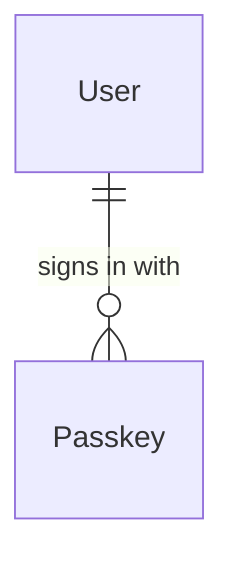

# components/entity/passkey Specification

## Purpose
A Passkey is the platform's record of one passkey registered for a User at the identity provider: which passkey it is, which passkey provider made it and when it was registered. The identity provider remains the authority on which passkeys exist and sign in; the record only adds what the identity provider does not report.

| attribute | meaning | constraint |
|-----------|---------|------------|
| provider_passkey_id | the identity provider's id for the passkey | required; at most one Passkey per value |
| user_id | the User the passkey signs in to | required |
| aaguid | the identifier of the passkey provider model that made the passkey | required; a UUID, all zeros when the provider does not reveal itself |
| create_time | when the passkey finished registration | required |

## Requirements

### Requirement: The provider name comes from the AAGUID

A Passkey's provider name SHALL be the name the passkey provider list gives its AAGUID (for example `Google Password Manager`, `Windows Hello`, `1Password`). A Passkey whose AAGUID is all zeros, or is not in the list, SHALL have no provider name.

#### Scenario: Known provider

- **WHEN** a Passkey's AAGUID is the one the list names `Google Password Manager`
- **THEN** its provider name is `Google Password Manager`

#### Scenario: Provider not revealed or not listed

- **WHEN** a Passkey's AAGUID is all zeros, or is a UUID the list does not contain
- **THEN** it has no provider name
