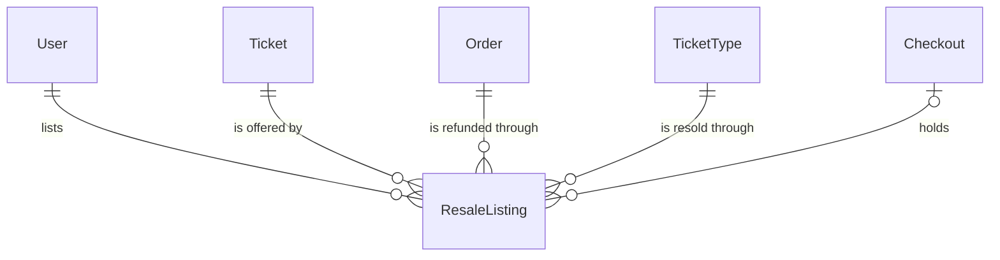
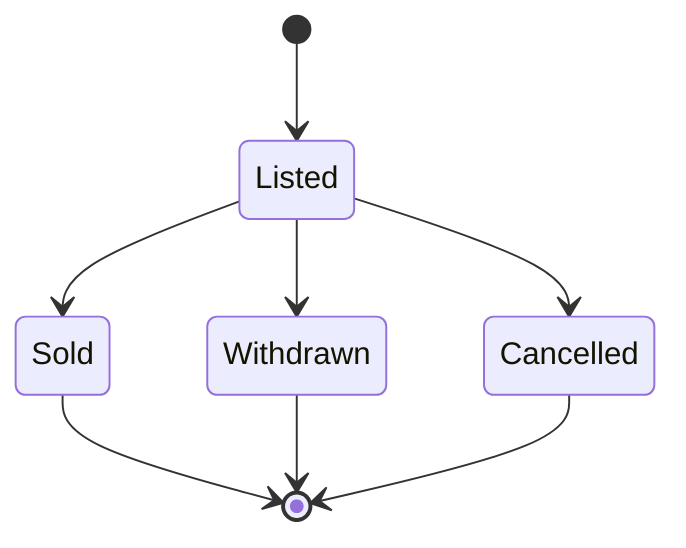

# components/entity/resale-listing Specification

## Purpose
A ResaleListing is a fan's offer of one of their Tickets for official resale (公式リセール) at face value, after the Ticket's first-come TicketType sold out. Another fan buys it through a Checkout of the same TicketType; the listing's Ticket is then Voided, the other fan receives a new Ticket, and the listing's user is refunded the price minus the resale fee.

| attribute | meaning | constraint |
|-----------|---------|------------|
| id | the listing's identity | required, assigned on creation |
| ticket | the Ticket offered | required; Issued and not admitted when listed |
| order | the Order that issued the Ticket, whose charge the user is refunded from | required |
| user | the fan offering it, the Ticket's user | required |
| ticket type | the FirstCome TicketType the Ticket was bought from | required |
| price | face value of the Ticket (券面価格), in whole yen 税込 (tax-inclusive) | required; the ticket type's price when listed |
| status | lifecycle | Listed, Sold, Withdrawn or Cancelled |
| checkout | the Checkout that last held the listing | absent until a Checkout holds it |
| create time | when the fan listed the Ticket | required |
| sold time | when another fan's Order bought it | absent unless Sold |
| withdraw time | when the fan withdrew it | absent unless Withdrawn |
| provider refund ID | the payment provider's ID for the refund to the listing's user | absent until refunded; set once |
| refund time | when the listing's user was refunded | absent until refunded; set once |
| sold email send time | when the email telling the user the Ticket sold was sent | absent until sent; set once |

## Requirements

### Requirement: Resale fee and refund amount

A listing's resale fee SHALL be 10% of its price, rounded down to the yen, and its refund amount SHALL be its price minus the resale fee.

#### Scenario: Round price
- **WHEN** a listing's price is 5000 yen
- **THEN** its resale fee is 500 yen and its refund amount is 4500 yen

#### Scenario: Price that does not divide evenly
- **WHEN** a listing's price is 3333 yen
- **THEN** its resale fee is 333 yen and its refund amount is 3000 yen

#### Scenario: Smallest price
- **WHEN** a listing's price is 9 yen
- **THEN** its resale fee is 0 yen and its refund amount is 9 yen

### Requirement: Resale deadline

A listing's deadline SHALL be 3 hours before its Ticket's event's current start time, which is when the event's admission window opens.

#### Scenario: Event with an open time
- **WHEN** the event opens its doors at 18:00 and starts at 19:00
- **THEN** the deadline is 16:00 that day

#### Scenario: Event without an open time
- **WHEN** the event has no open time and starts at 19:00
- **THEN** the deadline is 16:00 that day

### Requirement: Open and expired

A listing SHALL be open at a time when it is Listed and the time is before its deadline. A Listed listing at or after its deadline SHALL be expired: it can no longer be held, bought or withdrawn, and its Ticket stays the user's.

#### Scenario: Before the deadline
- **WHEN** a Listed listing with the deadline 16:00 is checked at 15:59
- **THEN** it is open

#### Scenario: At the deadline
- **WHEN** the same listing is checked at 16:00
- **THEN** it is expired and not open

#### Scenario: Sold listing
- **WHEN** a Sold listing is checked before its deadline
- **THEN** it is not open

### Requirement: Free to hold

A listing SHALL be free at a time when it is open at that time and it has no Checkout, or its Checkout is neither holding at that time nor Committed. Only a free listing can be held by a new Checkout or withdrawn.

#### Scenario: Never held
- **WHEN** an open listing has no Checkout
- **THEN** it is free

#### Scenario: Held by another fan
- **WHEN** an open listing's Checkout is holding
- **THEN** it is not free

#### Scenario: Hold lapsed
- **WHEN** an open listing's Checkout is Expired
- **THEN** it is free

#### Scenario: Being charged
- **WHEN** an open listing's Checkout is Committed
- **THEN** it is not free
