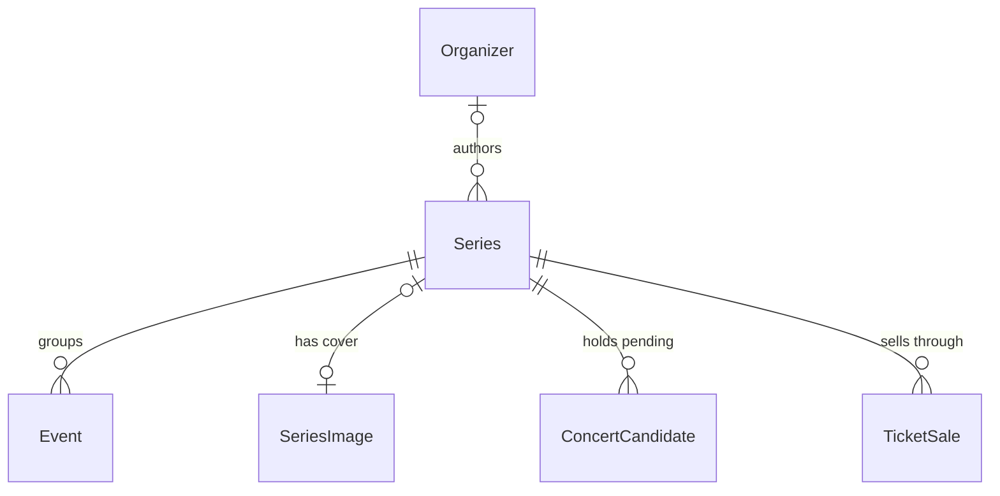

# Series

## Purpose

A Series groups the Events of one engagement — a tour, a single-venue run, or a festival — and owns what they share: title, type and source page. A Series authored by an organizer (first-party) also carries a description, a cover image and a visibility; a Series found by discovery has none of these. A first-party Series stores no publish state of its own: its publish state is derived from its Events (PUBLISHED when one is PUBLISHED, else CANCELLED when one is CANCELLED, else DRAFT), and each Event is published or cancelled on its own.

| attribute | meaning | constraint |
|-----------|---------|------------|
| id | series identifier | required |
| title | shared title (tour, show or festival name) | required, 1–255 characters |
| type | TOUR, SINGLE or FESTIVAL | required |
| source page | official page for the engagement | optional; a URI of at most 2048 characters |
| organizer | owning Organizer | optional; present exactly when the Series is first-party |
| description | organizer-written body text | optional, 1–10000 characters; first-party only |
| cover image | current cover SeriesImage | optional; first-party only |
| visibility | PUBLIC or UNLISTED | first-party only |
| share token | token that opens an UNLISTED Series | present only on a published UNLISTED Series; never shown on reads |

## Requirements

### Requirement: Series type

A Series' type SHALL be TOUR (events at several venues by the same performers under one name), SINGLE (one venue over one or more consecutive days) or FESTIVAL (a multi-performer event). A Series found by discovery SHALL be TOUR or SINGLE; FESTIVAL is set only by an organizer.

#### Scenario: Unspecified type is invalid
- **WHEN** a Series has no type
- **THEN** it is invalid

#### Scenario: Discovered standalone show
- **WHEN** discovery finds a standalone show spanning two days at one venue
- **THEN** its Series type is SINGLE

### Requirement: Every event belongs to one series

Every Event SHALL belong to exactly one Series, and a Series' title and source page SHALL be shared by all its Events.

#### Scenario: Tour with three stops
- **WHEN** a tour has three stops on different dates and venues
- **THEN** one Series holds the title and source page, and each stop is an Event of that Series

### Requirement: Share token only on an unlisted series

A share token SHALL exist only on a published first-party Series whose visibility is UNLISTED, and it SHALL never be part of what a Series read returns.

#### Scenario: Public series has no token
- **WHEN** a first-party Series is PUBLISHED with visibility PUBLIC
- **THEN** it has no share token

### Requirement: Which series' events have an event page

An Event of a Series SHALL have an event page exactly when the Series is first-party, its visibility is PUBLIC, and the Event is PUBLISHED or CANCELLED. A Series SHALL have an event page when at least one of its Events has one. An Event of a discovered Series, a DRAFT Event and an Event of an UNLISTED Series SHALL have no event page. Unlike public visibility, a CANCELLED Event keeps its event page, so a shared link still explains that the concert is 中止 (cancelled).

#### Scenario: Published public series

- **WHEN** an Event of a first-party Series with visibility PUBLIC is PUBLISHED
- **THEN** the Event has an event page

#### Scenario: Cancelled public series

- **WHEN** an Event of a first-party Series with visibility PUBLIC is CANCELLED
- **THEN** the Event has an event page, while it is not publicly visible

#### Scenario: Unlisted series

- **WHEN** an Event of a first-party Series with visibility UNLISTED is PUBLISHED
- **THEN** the Event has no event page

#### Scenario: Draft series

- **WHEN** an Event of a first-party Series is DRAFT, even while another Event of the Series is PUBLISHED
- **THEN** the DRAFT Event has no event page

#### Scenario: Discovered series

- **WHEN** a Series has no organizer
- **THEN** its Events have no event page

### Requirement: Publish state is derived from the events

A first-party Series SHALL have no publish state of its own. Its publish state SHALL be derived from its Events: PUBLISHED when at least one Event is PUBLISHED; CANCELLED when no Event is PUBLISHED and at least one is CANCELLED; DRAFT when every Event is DRAFT. A discovered Series SHALL have no publish state.

#### Scenario: Published tour with a draft date
- **WHEN** a first-party Series has two PUBLISHED Events and one DRAFT Event
- **THEN** its publish state is PUBLISHED

#### Scenario: One date cancelled
- **WHEN** a first-party Series has one PUBLISHED Event and one CANCELLED Event
- **THEN** its publish state is PUBLISHED

#### Scenario: Every published date cancelled
- **WHEN** a first-party Series has two CANCELLED Events and one DRAFT Event
- **THEN** its publish state is CANCELLED

#### Scenario: Only drafts
- **WHEN** every Event of a first-party Series is DRAFT
- **THEN** its publish state is DRAFT

#### Scenario: Discovered series has no publish state
- **WHEN** a Series has no organizer
- **THEN** it has no publish state

### Requirement: What can change after publish

While every Event of a first-party Series is DRAFT, all of its authored attributes and its performers SHALL be changeable. Once the Series has a PUBLISHED or CANCELLED Event, its title, description, cover image and performers SHALL remain changeable, and its type, source page and visibility SHALL NOT change.

#### Scenario: Title corrected after publish
- **WHEN** a Series has a PUBLISHED Event
- **THEN** its title, description, cover image and performers can change

#### Scenario: Visibility fixed after publish
- **WHEN** a Series has a PUBLISHED Event
- **THEN** its type, source page and visibility cannot change

#### Scenario: Draft series is fully editable
- **WHEN** every Event of a Series is DRAFT
- **THEN** its type, visibility and performers can change
