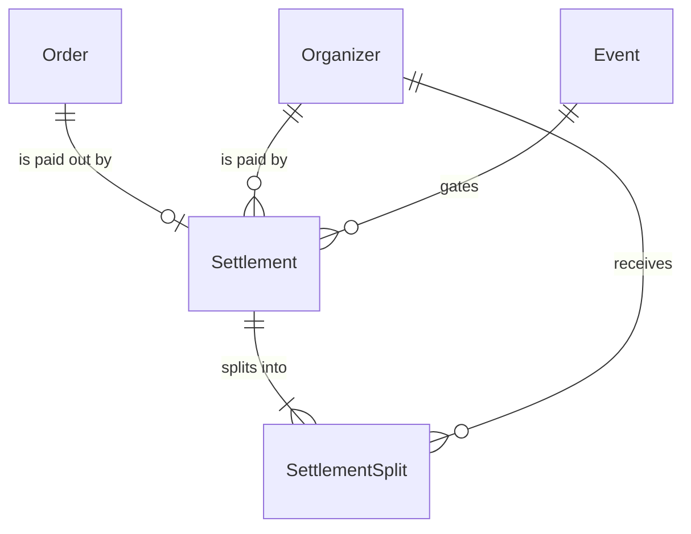
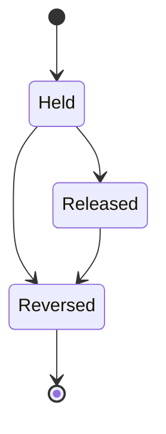

# Settlement

## Purpose

A Settlement is the payout record for one Order's captured money under the 収納代行 (collection agency) scheme, with the Organizer as the 販売業者 (the business that sells the tickets in law): the money stays with the platform while the Settlement is Held, each payee's split is paid out to the payee's payout account when it is Released, the platform keeps the remainder as its fee, and payouts are clawed back when it is Reversed. The platform bears any negative balance on an Organizer's payout account.

| attribute | meaning | constraint |
|-----------|---------|------------|
| id | the settlement's identity | required, assigned on creation |
| order | the Order whose money it pays out | required, one Settlement per Order |
| organizer | the Organizer receiving the payout | required |
| event | the event whose start gates the release | required |
| provider charge ID | the payment provider's ID for the captured charge the payouts are tied to | empty until resolved at release |
| splits | the payees' shares | at least one |
| split payee | the Organizer receiving the split | required |
| split amount | the payee's net share, in whole yen | required, greater than 0 |
| split provider payout ID | the payment provider's ID for the payout of the split | empty until released |
| split provider payout reversal ID | the payment provider's ID for the claw-back of the split | empty unless reversed |
| status | lifecycle | Held, Released or Reversed |
| release time | when the splits were paid out | empty while Held |
| create time | when the Settlement was recorded | required |

## Requirements

### Requirement: Money is held until release

While a Settlement is Held, none of its Order's money SHALL have been paid to any payee; all of it stays with the platform.

#### Scenario: Held settlement

- **WHEN** a Settlement is Held
- **THEN** no split has a provider payout ID

### Requirement: Splits and platform fee

A Settlement SHALL have at least one split, every split amount SHALL be greater than 0, and the sum of the split amounts SHALL NOT exceed its Order's amount. The platform fee is the Order's amount minus the sum of the split amounts. The venue is the Organizer's own cost and is never a payee.

#### Scenario: Single Organizer split

- **WHEN** the Order's amount is 16000 yen and the only split pays the Organizer 15200 yen
- **THEN** the splits are valid and the platform fee is 800 yen

#### Scenario: No split

- **WHEN** a Settlement has no split
- **THEN** its splits are invalid

#### Scenario: Non-positive split

- **WHEN** a split amount is 0 or less
- **THEN** its splits are invalid

#### Scenario: Splits exceed the order

- **WHEN** the split amounts add up to more than the Order's amount
- **THEN** its splits are invalid

### Requirement: Release eligibility

A Settlement SHALL be eligible for release at an instant, given its event's current start time and a dispute buffer, only when the start time is known and the instant is after the start time plus the buffer.

#### Scenario: Start time unknown

- **WHEN** the event has no start time
- **THEN** the Settlement is not eligible for release

#### Scenario: Buffer not yet elapsed

- **WHEN** the instant is before the start time plus the buffer
- **THEN** the Settlement is not eligible for release

#### Scenario: Buffer elapsed

- **WHEN** the instant is after the start time plus the buffer
- **THEN** the Settlement is eligible for release

### Requirement: Released only from Held

A Settlement SHALL be releasable only while Held; a Released or Reversed Settlement is never released again.

#### Scenario: Reversed settlement

- **WHEN** the status is Reversed
- **THEN** the Settlement is not releasable

### Requirement: Platform fee rate

The platform fee SHALL be the Order's amount times the Organizer's platform fee rate at the time the Settlement is created, rounded down to the nearest whole yen (`floor(amount × rate ÷ 10000)` with the rate in hundredths of a percent, computed with integer arithmetic). The Organizer's split SHALL be the Order's amount minus this fee, so rounding favours the Organizer, and SHALL be fixed when the Settlement is created, so a later change to the Organizer's rate never changes it.

#### Scenario: Round order amount

- **WHEN** the Order's amount is 10000 yen and the Organizer's rate is 8%
- **THEN** the platform fee is 800 yen and the Organizer's split is 9200 yen

#### Scenario: Pilot rate

- **WHEN** the Order's amount is 10000 yen and the Organizer's rate is 5%
- **THEN** the platform fee is 500 yen and the Organizer's split is 9500 yen

#### Scenario: Amount that does not divide evenly

- **WHEN** the Order's amount is 3333 yen and the rate is 8%
- **THEN** the platform fee is 266 yen and the Organizer's split is 3067 yen

#### Scenario: Fee rounds down to zero

- **WHEN** the Order's amount is 12 yen and the rate is 8%
- **THEN** the platform fee is 0 yen and the Organizer's split is the full amount

#### Scenario: Rate changed after issuance

- **WHEN** the Organizer's rate changes from 5% to 8% after a Settlement was created at 5%
- **THEN** that Settlement keeps its split at the 5% fee

### Requirement: Share of resold tickets

When k of the m Tickets of a Held Settlement's Order that are still Issued are resold, the Settlement SHALL give up the share of those tickets: its Organizer split falls by the split times k divided by m, rounded down to the yen, so rounding favours the Organizer. When k equals m, nothing is left to pay out for the Order and the Settlement SHALL become Reversed instead.

#### Scenario: One of two tickets resold
- **WHEN** a Held Settlement with a split of 9500 yen belongs to an Order with 2 Issued Tickets and 1 is resold
- **THEN** its split is 4750 yen

#### Scenario: One of three tickets resold
- **WHEN** a Held Settlement with a split of 9200 yen belongs to an Order with 3 Issued Tickets and 1 is resold
- **THEN** its split falls by 3066 yen to 6134 yen

#### Scenario: Last ticket resold
- **WHEN** a Held Settlement's Order has 1 Issued Ticket left and it is resold
- **THEN** the Settlement is Reversed
