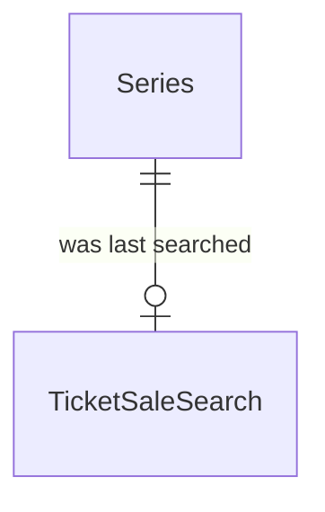

# components/entity/ticket-sale-search Specification

## Purpose
A Ticket Sale Search records when a Series was last searched for published ticket sales, so that discovery searches each series at most once in a given interval, whether or not that search found anything.

| attribute | meaning | constraint |
|---|---|---|
| series | The series that was searched | required; one per series |
| search time | When the series was last searched successfully | required, an absolute instant |

## Requirements

### Requirement: Search time is not in the future

A ticket sale search's search time SHALL NOT be after the current time.

#### Scenario: Future search time
- **WHEN** a ticket sale search carries a search time one hour from now
- **THEN** the ticket sale search is invalid
