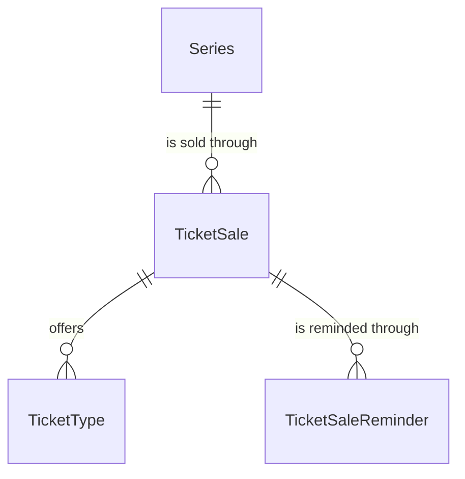

# components/entity/ticket-sale Specification

## Purpose
A TicketSale is one sale opportunity (受付) for some or all events of a Series, such as a fan-club presale or a general sale: how tickets are allocated and the window in which fans take part. It is of one of two kinds. An Organizer's sale is sold on the platform for a Series an Organizer owns: it has a name, says whether fans must hold an Active IdentityVerification, and offers a TicketType for each event it sells, with price, quantity, per-account limit and, first come, first served, the stock. A discovered sale is a sale announced on the artist's official pages for a Series without an Organizer: the platform only reports it to fans, so it has no name and offers no TicketType. The Series tells the kind; nothing on the sale marks it.

| attribute | meaning | constraint |
|-----------|---------|------------|
| id | the sale's identity | required, assigned on creation |
| series | the Series whose events the sale offers | required |
| name | the label fans and operators see, for example ファンクラブ先行 | an Organizer's sale: required, 1-100 characters; a discovered sale: absent |
| method | how tickets are allocated | Lottery or FirstCome |
| start time | when the sale opens, an instant entered and shown in Japan time | required, before the end time |
| end time | when the sale closes, an instant entered and shown in Japan time | required, except on a discovered FirstCome sale, where absent means until sold out; for an Organizer's Lottery sale, 1 to 14 days after the start time inclusive |
| verification requirement | whether fans must hold an Active IdentityVerification to take part | None (the default), Verified-any or JPKI-only; None on a discovered sale |
| draw time | when the lottery draw ran | absent until the draw runs; an Organizer's Lottery sale only |
| lottery result time | when the result of a lottery is announced (当落発表) | optional; a discovered Lottery sale only; not before the end time |
| discovered time | when discovery first stored the sale | a discovered sale only, required; set once and never changed |

## Requirements

### Requirement: A lottery window lasts 1 to 14 days

A TicketSale's end time SHALL be after its start time. When its method is Lottery, the window SHALL last at least 1 day and at most 14 days.

#### Scenario: Lottery window within bounds
- **WHEN** a Lottery sale runs for 10 days
- **THEN** the window is valid

#### Scenario: Lottery window shorter than 1 day
- **WHEN** a Lottery sale runs for 23 hours
- **THEN** the window is invalid

#### Scenario: Lottery window longer than 14 days
- **WHEN** a Lottery sale runs for 14 days and 1 hour
- **THEN** the window is invalid

#### Scenario: End not after start
- **WHEN** the end time equals or precedes the start time
- **THEN** the window is invalid

#### Scenario: First-come window longer than 14 days
- **WHEN** a FirstCome sale runs from 2026-11-01 10:00 to 2026-11-20 18:00
- **THEN** the window is valid

### Requirement: A sale has a name

A TicketSale's name SHALL be 1 to 100 characters.

#### Scenario: Named sale
- **WHEN** a sale is named ファンクラブ先行
- **THEN** the name is valid

#### Scenario: Empty name
- **WHEN** a sale has an empty name
- **THEN** the sale is invalid

### Requirement: Verification requirement

A sale SHALL require verification when its verification requirement is Verified-any or JPKI-only; both require the fan to hold an Active IdentityVerification. A sale created without a requirement SHALL have the requirement None.

#### Scenario: No requirement given
- **WHEN** a sale is created without a verification requirement
- **THEN** its requirement is None and it does not require verification

#### Scenario: Verified-any or JPKI-only
- **WHEN** the requirement is Verified-any or JPKI-only
- **THEN** the sale requires an Active IdentityVerification

### Requirement: Window open at an instant

A sale's window SHALL be open at an instant when the instant is at or after the start time and before the end time.

#### Scenario: Before start
- **WHEN** the instant precedes the start time
- **THEN** the window is not open

#### Scenario: Between start and end
- **WHEN** the instant is at the start time or later and before the end time
- **THEN** the window is open

#### Scenario: At end
- **WHEN** the instant is the end time or later
- **THEN** the window is not open

### Requirement: Two windows overlap

Two sales' windows SHALL overlap when each one starts before the other ends.

#### Scenario: Back to back
- **WHEN** one sale ends at 2026-11-10 23:59 and the other starts at 2026-11-10 23:59
- **THEN** the windows do not overlap

#### Scenario: Overlapping
- **WHEN** one sale runs from 1 to 10 November and the other from 8 to 20 November
- **THEN** the windows overlap

### Requirement: Drawn sale

A Lottery sale SHALL count as drawn once its draw time is set.

#### Scenario: Draw time set
- **WHEN** the draw time is set
- **THEN** the sale is drawn

#### Scenario: Draw time absent
- **WHEN** the draw time is absent
- **THEN** the sale is not drawn
