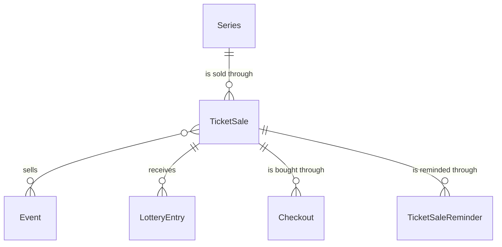

# components/entity/ticket-sale Specification

## Purpose
A TicketSale is one sale opportunity (受付) for some or all events of a Series, such as a fan-club presale or a general sale: how tickets are allocated and the window in which fans take part. It is of one of two kinds. An Organizer's sale is sold on the platform for a Series an Organizer owns: it has a name, says whether fans must hold an Active IdentityVerification, and names the events it sells; it sells every TicketStock of those events, and every sale of an event sells from the same stocks. A discovered sale is a sale announced on the artist's official pages for a Series without an Organizer: the platform only reports it to fans under the name its page gives it, and it names no event. The Series tells the kind; nothing on the sale marks it.

| attribute | meaning | constraint |
|-----------|---------|------------|
| id | the sale's identity | required, assigned on creation |
| series | the Series whose events the sale offers | required |
| name | the label fans and members see, for example ファンクラブ先行 | required, 1-100 characters |
| method | how tickets are allocated | Lottery or FirstCome |
| start time | when the sale opens, an instant entered and shown in Japan time | required, before the end time |
| end time | when the sale closes, an instant entered and shown in Japan time | required; for an Organizer's Lottery sale, 1 to 14 days after the start time inclusive |
| verification requirement | whether fans must hold an Active IdentityVerification to take part | None (the default), Verified-any or JPKI-only; None on a discovered sale |
| events | the events of its Series it sells | an Organizer's sale: at least one; a discovered sale: none |
| discovered time | when discovery first stored the sale | a discovered sale only, required; set once and never changed |

## Requirements

### Requirement: A lottery window lasts 1 to 14 days

A TicketSale's end time, when it has one, SHALL be after its start time. When an Organizer's sale has the method Lottery, its window SHALL last at least 1 day and at most 14 days. A discovered sale's window SHALL have no limit on its length.

#### Scenario: Lottery window within bounds
- **WHEN** an Organizer's Lottery sale runs for 10 days
- **THEN** the window is valid

#### Scenario: Lottery window shorter than 1 day
- **WHEN** an Organizer's Lottery sale runs for 23 hours
- **THEN** the window is invalid

#### Scenario: Lottery window longer than 14 days
- **WHEN** an Organizer's Lottery sale runs for 14 days and 1 hour
- **THEN** the window is invalid

#### Scenario: End not after start
- **WHEN** the end time equals or precedes the start time
- **THEN** the window is invalid

#### Scenario: Discovered lottery longer than 14 days
- **WHEN** a discovered Lottery sale runs from 1 October to 31 October
- **THEN** the window is valid

#### Scenario: First-come window longer than 14 days
- **WHEN** a FirstCome sale runs from 2026-11-01 10:00 to 2026-11-20 18:00
- **THEN** the window is valid

### Requirement: A sale has a name

An Organizer's sale SHALL have a name of 1 to 100 characters. A discovered sale SHALL have no name.

#### Scenario: Named sale
- **WHEN** an Organizer's sale is named ファンクラブ先行
- **THEN** the name is valid

#### Scenario: Empty name
- **WHEN** an Organizer's sale has an empty name
- **THEN** the sale is invalid

#### Scenario: Discovered sale without a name
- **WHEN** a discovered sale has no name
- **THEN** the sale is valid

### Requirement: Verification requirement

A sale SHALL require verification when its verification requirement is Verified-any or JPKI-only; both require the fan to hold an Active IdentityVerification. A sale created without a requirement SHALL have the requirement None.

#### Scenario: No requirement given
- **WHEN** a sale is created without a verification requirement
- **THEN** its requirement is None and it does not require verification

#### Scenario: Verified-any or JPKI-only
- **WHEN** the requirement is Verified-any or JPKI-only
- **THEN** the sale requires an Active IdentityVerification

### Requirement: Window open at an instant

A sale's window SHALL be open at an instant when the instant is at or after the start time and before the end time.

#### Scenario: Before start
- **WHEN** the instant precedes the start time
- **THEN** the window is not open

#### Scenario: Between start and end
- **WHEN** the instant is at the start time or later and before the end time
- **THEN** the window is open

#### Scenario: At end
- **WHEN** the instant is the end time or later
- **THEN** the window is not open

### Requirement: Two windows overlap

Two sales' windows SHALL overlap when each one starts before the other ends.

#### Scenario: Back to back
- **WHEN** one sale ends at 2026-11-10 23:59 and the other starts at 2026-11-10 23:59
- **THEN** the windows do not overlap

#### Scenario: Overlapping
- **WHEN** one sale runs from 1 to 10 November and the other from 8 to 20 November
- **THEN** the windows overlap

### Requirement: Drawn sale

A Lottery sale SHALL count as drawn once its draw time is set.

#### Scenario: Draw time set
- **WHEN** the draw time is set
- **THEN** the sale is drawn

#### Scenario: Draw time absent
- **WHEN** the draw time is absent
- **THEN** the sale is not drawn

### Requirement: An Organizer's sale or a discovered sale

A TicketSale of a Series that has an Organizer SHALL be that Organizer's sale. It SHALL offer at least one TicketType and SHALL have no discovered time. A TicketSale of a Series without an Organizer SHALL be a discovered sale. It SHALL offer no TicketType, SHALL have a discovered time, SHALL have the verification requirement None, and SHALL never be drawn.

#### Scenario: Organizer's presale
- **WHEN** a sale belongs to a Series owned by an Organizer and offers TicketTypes for two of its events
- **THEN** it is the Organizer's sale

#### Scenario: Sale found by discovery
- **WHEN** a sale belongs to a Series that has no Organizer
- **THEN** it is a discovered sale and offers no TicketType

#### Scenario: Discovered sale with a TicketType
- **WHEN** a sale of a Series without an Organizer offers a TicketType
- **THEN** the sale is invalid

#### Scenario: Organizer's sale without a TicketType
- **WHEN** a sale of a Series with an Organizer offers no TicketType
- **THEN** the sale is invalid

### Requirement: Required times depend on the method and the kind of sale

Every TicketSale SHALL have a start time. A Lottery sale SHALL have an end time. An Organizer's sale SHALL have an end time. A discovered FirstCome sale's end time SHALL be optional, and an absent end time SHALL mean the sale ends when tickets run out. A lottery result time (当落発表, the announced result time) SHALL be optional. It SHALL appear only on a discovered Lottery sale and SHALL NOT be before the end time.

#### Scenario: First-come sale until sold out
- **WHEN** a discovered FirstCome sale has a start time and no end time
- **THEN** the sale is valid

#### Scenario: Lottery without a close
- **WHEN** a Lottery sale has no end time
- **THEN** the sale is invalid

#### Scenario: Organizer's first-come sale without a close
- **WHEN** an Organizer's FirstCome sale has no end time
- **THEN** the sale is invalid

#### Scenario: Result before close
- **WHEN** a discovered Lottery sale's lottery result time is before its end time
- **THEN** the sale is invalid

#### Scenario: Result on a first-come sale
- **WHEN** a discovered FirstCome sale has a lottery result time
- **THEN** the sale is invalid

#### Scenario: Result time on an Organizer's lottery
- **WHEN** an Organizer's Lottery sale has a lottery result time
- **THEN** the sale is invalid

### Requirement: Result time of a lottery

A Lottery sale's result time SHALL be its lottery result time when it has one. An Organizer's Lottery sale's result time SHALL be its end time, because its draw runs within 1 minute after the end time. A discovered Lottery sale without a lottery result time SHALL have no result time. A FirstCome sale SHALL have no result time.

#### Scenario: Discovered lottery with an announced result
- **WHEN** a discovered Lottery sale closes on 22 October 23:59 and has the lottery result time 3 November 15:00
- **THEN** its result time is 3 November 15:00

#### Scenario: Organizer's lottery
- **WHEN** an Organizer's Lottery sale ends on 22 October 23:59
- **THEN** its result time is 22 October 23:59

#### Scenario: Discovered lottery without an announced result
- **WHEN** a discovered Lottery sale has no lottery result time
- **THEN** it has no result time

### Requirement: The discovered time is set once

A discovered sale's discovered time SHALL be set when the sale is first stored and SHALL never change afterwards, however often the sale is discovered again.

#### Scenario: Re-discovery keeps the discovered time
- **WHEN** a sale first stored on 1 June is discovered again on 5 June with new details
- **THEN** its discovered time stays 1 June

### Requirement: A sale not yet over

A TicketSale SHALL be not yet over at an instant that is before its end time. A sale without an end time SHALL be not yet over only before its start time, because nothing tells when its tickets run out.

#### Scenario: Lottery before its close
- **WHEN** a Lottery sale closes on 22 October 23:59 and the instant is 20 October
- **THEN** the sale is not yet over

#### Scenario: First-come sale until sold out has opened
- **WHEN** a FirstCome sale without an end time opened at 18:30 today and the instant is 18:31
- **THEN** the sale is over
