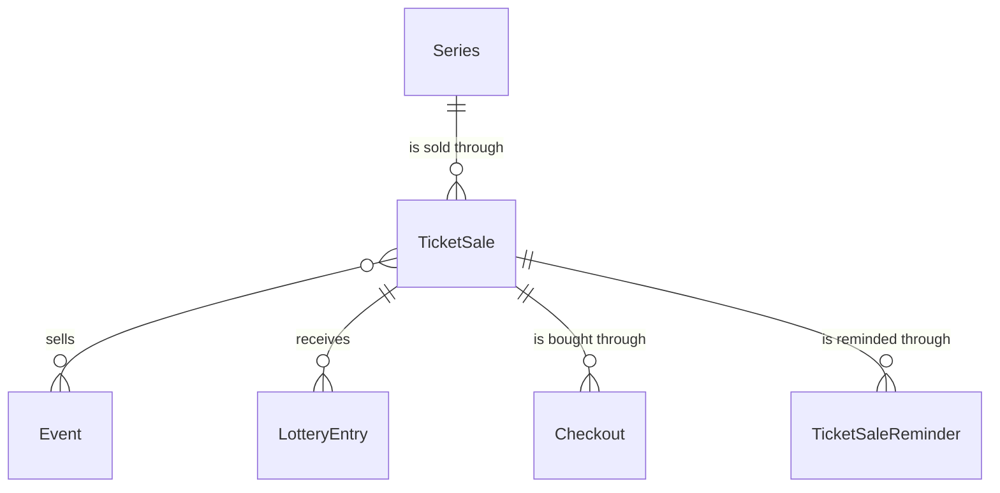

# components/entity/ticket-sale Specification

## Purpose
A TicketSale is one sale opportunity (受付) for some or all events of a Series, such as a fan-club presale or a general sale: how tickets are allocated and the window in which fans take part. It is of one of two kinds. An Organizer's sale is sold on the platform for a Series an Organizer owns: it has a name, says whether fans must hold an Active IdentityVerification, and names the events it sells; it sells every TicketStock of those events, and every sale of an event sells from the same stocks. A discovered sale is a sale announced on the artist's official pages for a Series without an Organizer: the platform only reports it to fans under the name its page gives it, and it names no event. The Series tells the kind; nothing on the sale marks it.

| attribute | meaning | constraint |
|-----------|---------|------------|
| id | the sale's identity | required, assigned on creation |
| series | the Series whose events the sale offers | required |
| name | the label fans and members see, for example ファンクラブ先行 | required, 1-100 characters |
| method | how tickets are allocated | Lottery or FirstCome |
| start time | when the sale opens, an instant entered and shown in Japan time | required, before the end time |
| end time | when the sale closes, an instant entered and shown in Japan time | required; for an Organizer's Lottery sale, 1 to 14 days after the start time inclusive |
| verification requirement | whether fans must hold an Active IdentityVerification to take part | None (the default), Verified-any or JPKI-only; None on a discovered sale |
| events | the events of its Series it sells | an Organizer's sale: at least one; a discovered sale: none |
| discovered time | when discovery first stored the sale | a discovered sale only, required; set once and never changed |

## Requirements

### Requirement: A lottery window lasts 1 to 14 days

A TicketSale's end time SHALL be after its start time. When an Organizer's sale has the method Lottery, its window SHALL last at least 1 day and at most 14 days. A discovered sale's window SHALL have no limit on its length.

#### Scenario: Lottery window within bounds
- **WHEN** an Organizer's Lottery sale runs for 10 days
- **THEN** the window is valid

#### Scenario: Lottery window shorter than 1 day
- **WHEN** an Organizer's Lottery sale runs for 23 hours
- **THEN** the window is invalid

#### Scenario: Lottery window longer than 14 days
- **WHEN** an Organizer's Lottery sale runs for 14 days and 1 hour
- **THEN** the window is invalid

#### Scenario: End not after start
- **WHEN** the end time equals or precedes the start time
- **THEN** the window is invalid

#### Scenario: Discovered lottery longer than 14 days
- **WHEN** a discovered Lottery sale runs from 1 October to 31 October
- **THEN** the window is valid

#### Scenario: First-come window longer than 14 days
- **WHEN** a FirstCome sale runs from 2026-11-01 10:00 to 2026-11-20 18:00
- **THEN** the window is valid

### Requirement: Verification requirement

A sale SHALL require verification when its verification requirement is Verified-any or JPKI-only; both require the fan to hold an Active IdentityVerification. A sale created without a requirement SHALL have the requirement None.

#### Scenario: No requirement given
- **WHEN** a sale is created without a verification requirement
- **THEN** its requirement is None and it does not require verification

#### Scenario: Verified-any or JPKI-only
- **WHEN** the requirement is Verified-any or JPKI-only
- **THEN** the sale requires an Active IdentityVerification

### Requirement: Window open at an instant

A sale's window SHALL be open at an instant when the instant is at or after the start time and before the end time.

#### Scenario: Before start
- **WHEN** the instant precedes the start time
- **THEN** the window is not open

#### Scenario: Between start and end
- **WHEN** the instant is at the start time or later and before the end time
- **THEN** the window is open

#### Scenario: At end
- **WHEN** the instant is the end time or later
- **THEN** the window is not open

### Requirement: Two windows overlap

Two sales' windows SHALL overlap when each one starts before the other ends.

#### Scenario: Back to back
- **WHEN** one sale ends at 2026-11-10 23:59 and the other starts at 2026-11-10 23:59
- **THEN** the windows do not overlap

#### Scenario: Overlapping
- **WHEN** one sale runs from 1 to 10 November and the other from 8 to 20 November
- **THEN** the windows overlap

### Requirement: The discovered time is set once

A discovered sale's discovered time SHALL be set when the sale is first stored and SHALL never change afterwards, however often the sale is discovered again.

#### Scenario: Re-discovery keeps the discovered time
- **WHEN** a sale first stored on 1 June is discovered again on 5 June with new details
- **THEN** its discovered time stays 1 June

### Requirement: An Organizer's sale names events, a discovered sale none

A TicketSale of a Series that has an Organizer SHALL be that Organizer's sale. It SHALL name at least one event, each an event of its Series, SHALL sell every TicketStock of the events it names, and SHALL have no discovered time. A TicketSale of a Series without an Organizer SHALL be a discovered sale. It SHALL name no event, SHALL have a discovered time and SHALL have the verification requirement None.

#### Scenario: Organizer's presale
- **WHEN** a sale belongs to a Series owned by an Organizer and names two of its events
- **THEN** it is the Organizer's sale and sells every TicketStock of those two events

#### Scenario: Sale found by discovery
- **WHEN** a sale belongs to a Series that has no Organizer
- **THEN** it is a discovered sale and names no event

#### Scenario: Discovered sale naming an event
- **WHEN** a sale of a Series without an Organizer names an event
- **THEN** the sale is invalid

#### Scenario: Organizer's sale without an event
- **WHEN** a sale of a Series with an Organizer names no event
- **THEN** the sale is invalid

#### Scenario: Event of another Series
- **WHEN** an Organizer's sale names an event of another Series
- **THEN** the sale is invalid

### Requirement: Every sale has a name

Every TicketSale, an Organizer's or a discovered one, SHALL have a name of 1 to 100 characters, the label fans see, such as ファンクラブ先行.

#### Scenario: Named sale
- **WHEN** a sale is named ファンクラブ先行
- **THEN** the name is valid

#### Scenario: Empty name
- **WHEN** a sale has an empty name
- **THEN** the sale is invalid

#### Scenario: Discovered sale with a name
- **WHEN** a discovered sale is named オフィシャル先行
- **THEN** the sale is valid

### Requirement: Every sale has a start and an end time

Every TicketSale SHALL have a start time and an end time.

#### Scenario: Both times
- **WHEN** a sale has a start time and an end time
- **THEN** the sale is valid

#### Scenario: Lottery without a close
- **WHEN** a Lottery sale has no end time
- **THEN** the sale is invalid

#### Scenario: First-come sale without a close
- **WHEN** a FirstCome sale, an Organizer's or a discovered one, has no end time
- **THEN** the sale is invalid

### Requirement: Drawn lottery

An Organizer's Lottery sale SHALL count as drawn at an instant, given its LotteryEntries, when the instant is at or after its end time and none of its entries is Entered. A closed sale with no entries SHALL count as drawn.

#### Scenario: Closed with entries still Entered
- **WHEN** a Lottery sale has closed and one of its entries is Entered
- **THEN** the sale is not drawn

#### Scenario: Every entry decided
- **WHEN** a Lottery sale has closed and every one of its entries is Won or Lost
- **THEN** the sale is drawn

#### Scenario: Closed without entries
- **WHEN** a Lottery sale has closed and has no entries
- **THEN** the sale is drawn

#### Scenario: Still open
- **WHEN** a Lottery sale's end time is after the instant
- **THEN** the sale is not drawn

### Requirement: A sale is not yet over before its end time

A TicketSale SHALL be not yet over at an instant that is before its end time.

#### Scenario: Lottery before its close
- **WHEN** a Lottery sale closes on 22 October 23:59 and the instant is 20 October
- **THEN** the sale is not yet over

#### Scenario: First-come sale after its close
- **WHEN** a FirstCome sale closes at 20:00 and the instant is 20:00
- **THEN** the sale is over
