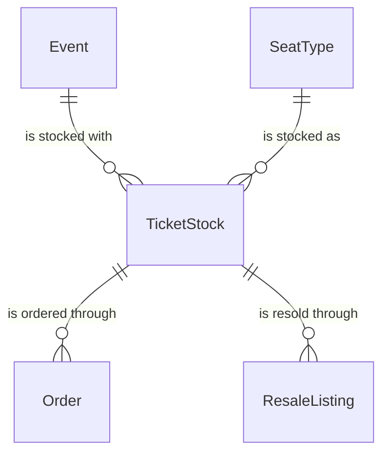

# components/entity/ticket-stock Specification

## Purpose
A TicketStock is the tickets of one SeatType for one event: how many there are, and how many are sold or held at a time. Every TicketSale of the event sells from it, a fan's Order names it, and its official resale (公式リセール) opens, for listing tickets, when it sells out. Its event, seat type and quantity never change once it is created.

| attribute | meaning | constraint |
|-----------|---------|------------|
| id | the stock's identity | required, assigned on creation |
| event | the event its tickets admit to | required; an event of the seat type's Series; one TicketStock per event and seat type; never changes |
| seat type | the SeatType of its tickets | required; never changes |
| quantity | tickets in the stock | required, at least 1; never changes |

## Requirements

### Requirement: Quantity

A TicketStock's quantity SHALL be at least 1.

#### Scenario: Valid stock
- **WHEN** a TicketStock has a quantity of 150
- **THEN** it is valid

#### Scenario: Empty stock
- **WHEN** a TicketStock has a quantity of 0
- **THEN** it is invalid

### Requirement: Sold, held and remaining tickets at a time

At a time, a TicketStock's sold count SHALL be the ticket counts of its Orders bought through a LotteryEntry or a Checkout that are Paid or Refunded, or Pending with a Committed Checkout or a Won LotteryEntry. Its held count SHALL be the ticket counts of its Pending Orders whose Checkout is holding at that time. Tickets bought from other fans through official resale SHALL count in neither. Its remaining count SHALL be its quantity minus the sold count minus the held count, and never below 0.

#### Scenario: Some sold, some held
- **WHEN** a TicketStock of 150 has sold 100 and Checkouts holding 6 tickets
- **THEN** 44 tickets remain

#### Scenario: Presale winners count as sold
- **WHEN** a TicketStock of 150 has lottery entries that won 120 tickets in a presale and nothing else
- **THEN** its sold count is 120 and 30 tickets remain for the general sale

#### Scenario: Resold tickets do not count again
- **WHEN** 2 tickets of a sold-out TicketStock of 150 are resold to another fan through official resale
- **THEN** its sold count stays 150

### Requirement: Stock state at a time

A TicketStock SHALL be, at a time: SoldOut when its sold count equals its quantity; AllHeld when its remaining count is 0 and its sold count is below its quantity; Available otherwise. An Available TicketStock SHALL be LowStock when its remaining count is at most one tenth of its quantity, rounded up.

#### Scenario: Sold out
- **WHEN** a TicketStock of 150 has sold 150
- **THEN** it is SoldOut

#### Scenario: Last tickets held by others
- **WHEN** a TicketStock of 150 has sold 147 and Checkouts hold the other 3
- **THEN** it is AllHeld

#### Scenario: Few left
- **WHEN** a TicketStock of 150 has 15 tickets remaining
- **THEN** it is Available and LowStock

#### Scenario: Small stock, last ticket
- **WHEN** a TicketStock of 9 has 1 ticket remaining
- **THEN** it is Available and LowStock

### Requirement: Resale open at a time

A TicketStock's resale SHALL be open at a time, given its event's resale deadline, when it is SoldOut at that time and the time is before the deadline.

#### Scenario: Sold out a week before the event
- **WHEN** a SoldOut TicketStock is checked a week before its event's resale deadline
- **THEN** its resale is open

#### Scenario: After the deadline
- **WHEN** a SoldOut TicketStock is checked at its event's resale deadline
- **THEN** its resale is not open

#### Scenario: A ticket came back
- **WHEN** a TicketStock that sold out has one ticket back after a commit was reverted
- **THEN** it is Available and its resale is not open
