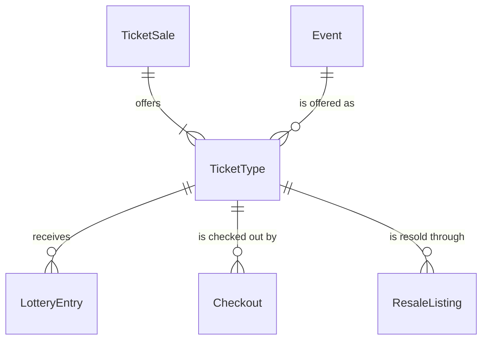

# components/entity/ticket-type Specification

## Purpose
A TicketType is what one TicketSale offers for one event: the price of one ticket, how many tickets are offered and how many tickets one account may hold for the event. For a FirstCome sale it also carries that event's stock: the tickets sold and the tickets held in checkouts.

| attribute | meaning | constraint |
|-----------|---------|------------|
| id | the ticket type's identity | required, assigned on creation |
| sale | the TicketSale that offers it | required |
| event | the event it admits to | required; an event of the sale's Series; one TicketType per event in a sale |
| price | price of one ticket, 税込 (tax-inclusive), in whole yen | required, 1 to 1,000,000 |
| quantity | tickets offered | required, at least 1 |
| per-account limit | most tickets one account may hold for the event once this sale is done, counting tickets it already holds | required, 1 to 10 and at most the quantity; 4 when not given |
| sold count | tickets on the TicketType's Committed and Completed Checkouts | FirstCome only; 0 to the quantity; starts at 0 |
| held count | tickets on the TicketType's Checkouts that are holding when it is read | FirstCome only; derived when read; 0 to the quantity |
| state | where a FirstCome TicketType stands when it is read: NotYetOnSale, OnSale, AllHeld, SoldOut or Ended | FirstCome only; derived when read ("Sale state at a time") |
| low stock | whether an OnSale TicketType has few tickets left when it is read | FirstCome only; derived when read ("Sale state at a time") |
| resale open time | when its sold count first equalled its quantity, so official resale opened | FirstCome only; absent until then; set once |
| free resale count | its ResaleListings that are free when it is read | FirstCome only; derived when read |

## Requirements

### Requirement: Price, quantity and per-account limit

A TicketType's price SHALL be 1 to 1,000,000 yen and its quantity SHALL be at least 1. Its per-account limit SHALL be at least 1, at most the quantity and at most 10, because one admission code presents at most 10 tickets and a companion group enters together with one code. A TicketType created without a per-account limit SHALL have a limit of 4.

#### Scenario: Valid sizing
- **WHEN** the quantity is 100, the per-account limit is 4 and the price is 8000 yen
- **THEN** the TicketType is valid

#### Scenario: No limit given
- **WHEN** a TicketType with a quantity of 100 is created without a per-account limit
- **THEN** its per-account limit is 4

#### Scenario: Limit larger than the quantity
- **WHEN** the quantity is 3 and the per-account limit is 4
- **THEN** the TicketType is invalid

#### Scenario: Limit larger than one admission code
- **WHEN** the quantity is 100 and the per-account limit is 11
- **THEN** the TicketType is invalid

#### Scenario: Price out of range
- **WHEN** the price is 0 yen or 1,000,001 yen
- **THEN** the TicketType is invalid

### Requirement: Amount for a requested count

The amount for a ticket count SHALL be the price multiplied by the count, in yen.

#### Scenario: Two tickets
- **WHEN** the price is 8000 yen and 2 tickets are requested
- **THEN** the amount is 16000 yen

### Requirement: Room under the per-account limit

A ticket count SHALL fit the per-account limit for an account when the tickets the account already holds for the event plus the ticket count are at most the limit.

#### Scenario: Presale winner in a general sale with the same limit
- **WHEN** the per-account limit is 4, the account holds 4 tickets for the event and requests 1 more
- **THEN** the count does not fit

#### Scenario: Topping up to a higher limit
- **WHEN** the per-account limit is 4, the account holds 2 tickets for the event and requests 2
- **THEN** the count fits

### Requirement: Remaining tickets

A FirstCome TicketType's remaining count at a time SHALL be its quantity minus its sold count minus the counts of its Checkouts that are holding at that time, and never below 0.

#### Scenario: Some sold, some held

- **WHEN** a TicketType of 150 has sold 100 and Checkouts holding 6 tickets
- **THEN** 44 tickets remain

### Requirement: Sale state at a time

A FirstCome TicketType's state at a time SHALL be:
- NotYetOnSale before its sale's start time;
- Ended at or after its sale's end time;
- SoldOut when the sold count equals the quantity;
- AllHeld when the remaining count is 0 and the sold count is below the quantity;
- OnSale otherwise.

Ended takes precedence over SoldOut and AllHeld. An OnSale TicketType SHALL be LowStock when its remaining count is at most one tenth of its quantity, rounded up, so a TicketType of 9 tickets is LowStock with 1 left.

#### Scenario: Before opening

- **WHEN** a TicketType whose sale opens at 10:00 is checked at 09:59
- **THEN** it is NotYetOnSale

#### Scenario: Last tickets held by others

- **WHEN** a TicketType of 150 has sold 147 and Checkouts hold the other 3
- **THEN** it is AllHeld

#### Scenario: Sold out

- **WHEN** a TicketType of 150 has sold 150
- **THEN** it is SoldOut

#### Scenario: Few left

- **WHEN** a TicketType of 150 has 15 tickets remaining
- **THEN** it is OnSale and LowStock

#### Scenario: Small sale, last ticket

- **WHEN** a TicketType of 9 has 1 ticket remaining
- **THEN** it is OnSale and LowStock

#### Scenario: Closed

- **WHEN** a TicketType is checked at its sale's end time
- **THEN** it is Ended

### Requirement: Price fixed while tickets are held or sold

A FirstCome TicketType's price SHALL be changeable only while its sold count and its held count are both 0, so every fan who pays for its tickets pays the same price.

#### Scenario: Price change before any ticket is held

- **WHEN** a TicketType with nothing sold or held changes its price from 3000 to 3500 yen
- **THEN** the change is allowed

#### Scenario: Price change while tickets are held

- **WHEN** a TicketType with nothing sold and Checkouts holding 2 tickets changes its price
- **THEN** the change is not allowed

#### Scenario: Price change after tickets sold

- **WHEN** a TicketType with 1 ticket sold changes its price
- **THEN** the change is not allowed

#### Scenario: Price change after every checkout lapsed

- **WHEN** a TicketType whose only Checkout expired without a commit changes its price
- **THEN** the change is allowed

### Requirement: Resale opens when the ticket type sells out

A FirstCome TicketType SHALL have a resale open time once its sold count has equalled its quantity: the time of the commit that sold its last ticket. Once set, the resale open time SHALL never change or be cleared, even when the quantity is raised or a commit is reverted afterwards. A TicketType whose sold count has never equalled its quantity SHALL have no resale open time.

#### Scenario: Last ticket sold
- **WHEN** a TicketType of 150 has sold 149 and a Checkout for 1 ticket is committed at 20:15
- **THEN** its resale open time is 20:15

#### Scenario: Quantity raised after selling out
- **WHEN** a TicketType that sold out at 20:15 has its quantity raised from 150 to 160
- **THEN** it is OnSale again and its resale open time stays 20:15

#### Scenario: Never sold out
- **WHEN** a TicketType of 150 has sold 149
- **THEN** it has no resale open time

### Requirement: Resale open at a time

A FirstCome TicketType's resale SHALL be open at a time, given its event's resale deadline, when it has a resale open time and the time is before the deadline.

#### Scenario: A week before the event
- **WHEN** a TicketType with a resale open time is checked a week before its event's resale deadline
- **THEN** its resale is open

#### Scenario: After the deadline
- **WHEN** it is checked at its event's resale deadline
- **THEN** its resale is not open

#### Scenario: Sale ended after selling out
- **WHEN** a TicketType that sold out is checked after its sale's end time and before the resale deadline
- **THEN** its state is Ended and its resale is open

### Requirement: Resale available at a time

A FirstCome TicketType SHALL have resale available at a time when its resale is open at that time and at least one of its ResaleListings is free at that time. The number of free listings is its free resale count.

#### Scenario: One listing free
- **WHEN** a TicketType whose resale is open has one free listing
- **THEN** resale is available

#### Scenario: Every listing held
- **WHEN** a TicketType whose resale is open has two listings, both held by holding Checkouts
- **THEN** resale is not available
