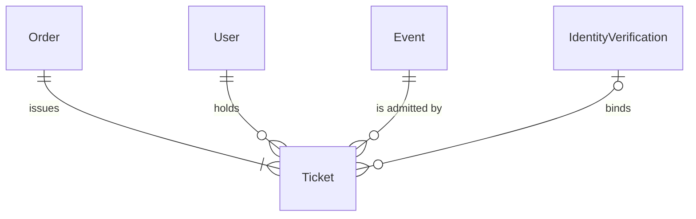
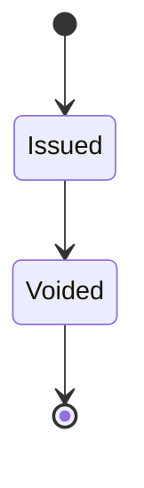

# Ticket

## Purpose

A Ticket is one account-bound admission right to an event, issued from an Order. Every Ticket is a 特定興行入場券 (covered ticket): it names the event and its user and states that resale without the organizer's consent is prohibited.

| attribute | meaning | constraint |
|-----------|---------|------------|
| id | the ticket's identity | required, assigned on issuance |
| order | the Order that issued it | required |
| user | the account the ticket is bound to | required; never changes (official resale voids the ticket and issues a new one) |
| event | the event it admits to, which gives the date and venue on its face | required |
| identity verification | the identity verification the ticket is bound to | optional; set only when the sale required verification |
| resale without consent prohibited | the face states that resale without the organizer's consent is prohibited | always true |
| status | lifecycle; a Voided ticket is no longer valid for entry | Issued or Voided |
| issue time | when the ticket was issued | required |
| admit time | when the ticket was let in at the venue | optional; absent until admitted, set once and kept when the ticket is later Voided |

## Requirements

### Requirement: Every ticket is a covered ticket

Every Ticket SHALL carry the three conditions of a 特定興行入場券 (covered ticket): its face states that resale without the organizer's consent is prohibited; it names the event (date and venue) and the eligible person, who is the Ticket's user, with no seat assigned; and it shows the user's full name and phone number as the User currently records them (本人確認, identity check).

#### Scenario: Issued ticket face
- **WHEN** a Ticket is issued
- **THEN** it states that resale without consent is prohibited, names its event and its user, shows the user's full name and phone number, and has no seat

#### Scenario: User corrects their details
- **WHEN** the Ticket's user changes their phone number
- **THEN** the Ticket's face shows the new phone number

#### Scenario: Resale flag cannot be false
- **WHEN** a Ticket states resale without consent is not prohibited
- **THEN** the Ticket is invalid

### Requirement: A new ticket starts Issued

A Ticket SHALL start in status Issued.

#### Scenario: New ticket

- **WHEN** a Ticket is issued
- **THEN** its status is Issued

### Requirement: A ticket is admissible only once and only while Issued

A Ticket SHALL be admissible exactly when its status is Issued and it has no admit time. A Voided Ticket SHALL NOT be admissible, and a Ticket that has an admit time SHALL NOT be admissible again. Voiding a Ticket SHALL keep its admit time, so a refund after entry does not erase that the user was admitted.

#### Scenario: Issued and not yet admitted

- **WHEN** a Ticket is Issued and has no admit time
- **THEN** it is admissible

#### Scenario: Already admitted

- **WHEN** a Ticket is Issued and was admitted at 18:32
- **THEN** it is not admissible

#### Scenario: Voided

- **WHEN** a Ticket is Voided and has no admit time
- **THEN** it is not admissible

#### Scenario: Voided after entry

- **WHEN** a Ticket admitted at 18:32 is Voided by a dispute refund
- **THEN** its status is Voided and its admit time is still 18:32
