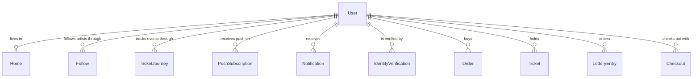

# User

## Purpose

A User is a person registered on Liverty Music, linked to exactly one identity at the identity provider; it carries the contact address, display name, preferred display language and optional home area used to personalize concert notifications and proximity. A Home is a value owned by one User: the geographic area where the user regularly attends live events without considering it a trip (遠征).

User

| attribute | meaning | constraint |
|-----------|---------|------------|
| id | the user's platform identifier | required; assigned when the User is created and never changes |
| provider user ID | the identity provider's ID for the User | required; non-empty; no two Users share it |
| email | primary contact and account address | required; an email address of at most 165 characters; no two Users share it, letter case ignored |
| name | display name taken from the identity provider | required; may be empty text |
| preferred language | display language for the UI and notifications | required; exactly two lowercase letters (ISO 639-1, e.g. `ja`, `en`); given when the User is created |
| time zone | the time zone in which the User's notifications show times | optional; an IANA time zone name (e.g. `Asia/Tokyo`); absent or unknown means Asia/Tokyo |
| home | the user's home area | optional; absent until the user selects an area |
| full name | the 本人確認 (identity check) name shown on the user's tickets and prefilled at lottery entry and checkout | optional; absent until the user first gives it; 1 to 200 characters |
| phone number | the 本人確認 contact phone shown on the user's tickets | optional; absent until the user first gives it; E.164: `+` then 2-15 digits, first digit not 0 |
| last login time | when the user last signed in, as the identity provider reported it | optional; absent until the first reported sign-in; never moves back |

Home

| attribute | meaning | constraint |
|-----------|---------|------------|
| country code | home country or territory | required; ISO 3166-1 alpha-2, two uppercase letters (e.g. `JP`); the country of the level 1 Area |
| level 1 | the home area: a prefecture, state, Land or a territory without subdivisions | required; the code of a first-level Area of that country (e.g. `JP-13`, `HK`) |
| reference point | the Coordinates NEARBY distances are measured from | the level 1 Area's current reference point, not kept by the Home itself; absent when the Area has none |

Events announced about it:

| event | announced by | carries |
|-------|--------------|---------|
| User.Created | User.Create | the User's id, provider user ID and email address |
| User.SignedIn | User.RecordLogin | the User with its new last login time |

## Requirements

### Requirement: A new User gets a fresh identifier

A new User SHALL receive a fresh id when it is created, distinct from every other User's id, and SHALL keep the provider user ID, email, name and preferred language it was created with.

#### Scenario: New User

- **WHEN** a User is created for provider user ID `abc`, email `fan@example.com` and preferred language `ja`
- **THEN** it has a fresh id, provider user ID `abc`, email `fan@example.com` and preferred language `ja`

### Requirement: Preferred language format

A preferred language value SHALL be valid only when it is exactly two lowercase Latin letters (ISO 639-1).

#### Scenario: Two lowercase letters

- **WHEN** the value is `ja` or `en`
- **THEN** it is a valid preferred language

#### Scenario: Any other shape

- **WHEN** the value is empty, `jpn`, `JA` or `ja-JP`
- **THEN** it is not a valid preferred language

### Requirement: Personal details

A User's full name, when present, SHALL be 1 to 200 characters. A User's phone number, when present, SHALL be in E.164 form: a `+` followed by 2 to 15 digits whose first digit is not 0, with no spaces or separators. Both are absent until the User first gives them.

#### Scenario: Details complete
- **WHEN** a User's full name is 山田 花子 and their phone number is `+819012345678`
- **THEN** the details are valid

#### Scenario: Domestic-format phone number
- **WHEN** a User's phone number is `090-1234-5678` or `09012345678`
- **THEN** the details are invalid

#### Scenario: Phone number too long
- **WHEN** a User's phone number is a `+` followed by 16 digits
- **THEN** the details are invalid

#### Scenario: Not given yet
- **WHEN** a User has never given a full name or phone number
- **THEN** both are absent and the User is valid

### Requirement: A Home names a first-level Area

A Home SHALL be valid only when its country code is two uppercase letters and its level 1 is the code of a first-level Area of that country. A Home SHALL have no other area than level 1. Any other Home SHALL be invalid.

#### Scenario: Prefecture

- **WHEN** a Home has country code `JP` and level 1 `JP-13`
- **THEN** it is valid

#### Scenario: Territory without subdivisions

- **WHEN** a Home has country code `HK` and level 1 `HK`
- **THEN** it is valid

#### Scenario: Malformed country code

- **WHEN** a Home has country code `j` or `jp`
- **THEN** it is invalid

#### Scenario: Not an Area code

- **WHEN** a Home has level 1 `INVALID`
- **THEN** it is invalid

#### Scenario: Level 1 in another country

- **WHEN** a Home has country code `JP` and level 1 `US-CA`
- **THEN** it is invalid

#### Scenario: Well-formed code that is no Area

- **WHEN** a Home has country code `JP` and level 1 `JP-99`
- **THEN** it is invalid

#### Scenario: Lower-level Area

- **WHEN** a Home has country code `FR` and level 1 `FR-33`, whose parent is `FR-NAQ`
- **THEN** it is invalid

#### Scenario: Region

- **WHEN** a Home has country code `JP` and level 1 `JP-KANTO`
- **THEN** it is invalid

### Requirement: A Home's reference point is its Area's

A Home's reference point, the home area's centroid from which NEARBY distances are measured, SHALL be the current reference point of the Area its level 1 names, and the Home SHALL have none when that Area has none. A Home SHALL keep no reference point of its own: when the Area's reference point changes, every Home of that Area SHALL have the new one.

#### Scenario: Prefecture with a reference point

- **WHEN** a Home has level 1 `JP-40`
- **THEN** its reference point is the reference point of the Area `JP-40` (Fukuoka)

#### Scenario: Area without a reference point

- **WHEN** a Home's Area has no reference point
- **THEN** the Home has no reference point

#### Scenario: Area's reference point changed

- **WHEN** the reference point of the Area `KR-11` changes after a User set a Home of `KR-11`
- **THEN** that User's Home has the new reference point
