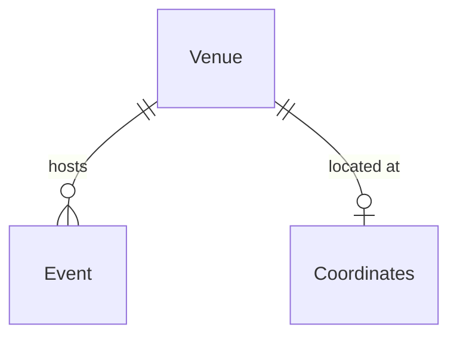

# Venue

## Purpose

A Venue is a physical place where Events are held, known by a canonical name, the administrative area it lies in, its location and, when resolved, its map place identity. The name a source used for it is kept so the same place is recognised again.

| attribute | meaning | constraint |
|-----------|---------|------------|
| id | venue identifier | required |
| name | canonical name; the listed venue name when the place was not resolved | required, non-empty |
| admin area | ISO 3166-2 subdivision the venue lies in | optional, matches `^[A-Z]{2}-[A-Z0-9]{1,3}$`; absent means unknown |
| place id | map place identity | optional; at most one Venue per place id |
| coordinates | location | optional Coordinates |
| listed venue name | the name as first listed by a source or Organizer, normalized | optional; with the admin area, identifies the Venue |

## Requirements

### Requirement: Admin area format

A Venue's admin area, when present, SHALL be an ISO 3166-2 subdivision code: two uppercase letters, a hyphen and 1–3 uppercase letters or digits.

#### Scenario: Valid admin area
- **WHEN** the admin area is JP-13
- **THEN** it is valid

#### Scenario: Free-text admin area is invalid
- **WHEN** the admin area is "東京都"
- **THEN** it is invalid

### Requirement: Listed venue name normalization

A listed venue name SHALL be normalized by folding full-width and half-width forms to one form, collapsing runs of whitespace to a single space and trimming the ends, removing a leading "〈city〉公演 ＠" prefix, and then removing a leading "〈prefecture〉・" prefix where the prefecture is one of Japan's 47 prefectures, with or without its 都/道/府/県 suffix. A name that is blank after normalization SHALL be treated as missing. A name that only says the venue is not yet announced SHALL normalize to an empty name, and so is also treated as missing: compared ignoring whitespace, punctuation and Latin letter case, it is one of "TBA", "TBD", "to be announced", "coming soon", "stay tuned", "未定" or "後日発表", or it contains "某所" (an undisclosed place, as in "横浜某所"). Normalizing an already-normalized name SHALL leave it unchanged. This is the only normalization of a venue name: every comparison of venue names (an Event's listed venue name, a ConcertCandidate's, and the events Concert.Search returns) starts from it.

#### Scenario: Prefecture prefix removed
- **WHEN** the listed venue name is "大阪・フェスティバルホール"
- **THEN** the normalized name is "フェスティバルホール"

#### Scenario: Performance-city prefix removed
- **WHEN** the listed venue name is "大阪公演 ＠フェスティバルホール"
- **THEN** the normalized name is "フェスティバルホール"

#### Scenario: Middle dot after a non-prefecture word is kept
- **WHEN** the listed venue name is "東京文化会館・大ホール"
- **THEN** the normalized name is "東京文化会館・大ホール"

#### Scenario: Whitespace-only name is missing
- **WHEN** the listed venue name is "　 "
- **THEN** the normalized name is empty and the name is treated as missing

#### Scenario: Venue not yet announced is missing
- **WHEN** the listed venue name is "TBA", "-STAY TUNED-", "未定" or "横浜某所"
- **THEN** the normalized name is empty and the name is treated as missing

#### Scenario: A real name containing a marker word is kept
- **WHEN** the listed venue name is "TBA Hall Osaka"
- **THEN** the normalized name is "TBA Hall Osaka"

#### Scenario: Already normalized name is unchanged
- **WHEN** the listed venue name is "日本武道館"
- **THEN** the normalized name is "日本武道館"

### Requirement: Canonical name falls back to the listed name

When a Venue is made without a resolved place, its name SHALL be its listed venue name and it SHALL have no place id and no coordinates.

#### Scenario: Unresolved venue
- **WHEN** a Venue is made for listed name "ライブハウスX" with no resolved place
- **THEN** its name is "ライブハウスX" and it has no place id and no coordinates

### Requirement: Current date at a venue

The current date at a Venue SHALL be the calendar day that the given instant falls on in the Venue's time zone. A Venue carries no time zone of its own, and every Venue's time zone SHALL be Asia/Tokyo. Wherever an operation compares an Event's local date with the current date, today or a date given as an instant, it SHALL use the current date at that Event's Venue, never the calendar day of the clock of the server or the database.

#### Scenario: Early morning counts as the new day
- **WHEN** the instant is 2026-11-10 23:30 UTC, which is 2026-11-11 08:30 in Asia/Tokyo
- **THEN** the current date at a Venue is 2026-11-11, and an Event dated 2026-11-10 is in the past

#### Scenario: Event day still today
- **WHEN** the instant is 2026-11-11 14:59 UTC, which is 2026-11-11 23:59 in Asia/Tokyo
- **THEN** the current date at a Venue is 2026-11-11, and an Event dated 2026-11-11 is not in the past
