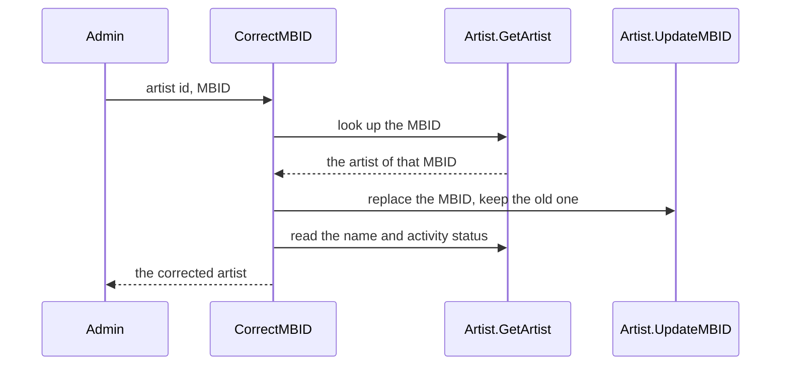

# components/usecase/artist/correct-mbid Specification

## Purpose
ArtistUseCase.CorrectMBID lets an admin fix an artist registered with a namesake's MBID. The artist keeps its id, its followers and its concerts; its name and activity status come from the right person, and a later search for the name finds the corrected artist.

## Requirements

### Requirement: CorrectMBID gives the artist the right person's identity
ArtistUseCase.CorrectMBID SHALL take an artist id and an MBID, read the artist, look the MBID up with Artist.GetArtist, replace the artist's MBID with the MBID the catalog returned for it (the canonical MBID, which differs from the given one when the catalog redirects a merged MBID) with Artist.UpdateMBID, and then adopt the catalog's name and activity status as Refresh does. It SHALL return the corrected artist. It SHALL look the MBID up before changing anything, so an MBID the catalog does not know stores nothing.

#### Scenario: Namesake corrected
- **WHEN** an artist registered with a namesake's MBID is corrected with the MBID of the right person
- **THEN** the artist has the new MBID and the catalog's name and activity status, its replaced MBID is among its other_mbids, and it keeps its id

#### Scenario: Redirected MBID
- **WHEN** the catalog answers the given MBID with another, canonical MBID
- **THEN** the artist's MBID becomes the canonical one, and another artist having the canonical MBID fails the correction with AlreadyExists

#### Scenario: Catalog does not know the MBID
- **WHEN** Artist.GetArtist fails with NotFound for the given MBID
- **THEN** CorrectMBID fails with NotFound and the artist is unchanged

#### Scenario: Same MBID again
- **WHEN** CorrectMBID is called with the artist's current MBID
- **THEN** the artist keeps its details and the catalog's name and activity status are adopted again

### Requirement: CorrectMBID reports failures
ArtistUseCase.CorrectMBID SHALL fail with InvalidArgument for an MBID that is not 36 characters, with NotFound when no artist has the id, with AlreadyExists when another artist has the MBID, and with the error of Artist.GetArtist, other than NotFound, or of the adoption of the catalog's details, without undoing a stored MBID.

#### Scenario: Malformed MBID
- **WHEN** the MBID is not 36 characters long
- **THEN** CorrectMBID fails with InvalidArgument and looks nothing up

#### Scenario: Unknown artist
- **WHEN** no artist has the id
- **THEN** CorrectMBID fails with NotFound

#### Scenario: MBID of another artist
- **WHEN** another artist has the MBID
- **THEN** CorrectMBID fails with AlreadyExists and the artist is unchanged

#### Scenario: Catalog unavailable after the change
- **WHEN** the MBID is stored and the catalog then fails with Unavailable
- **THEN** CorrectMBID fails with Unavailable, the new MBID stays, and calling it again with the same MBID adopts the name and activity status
