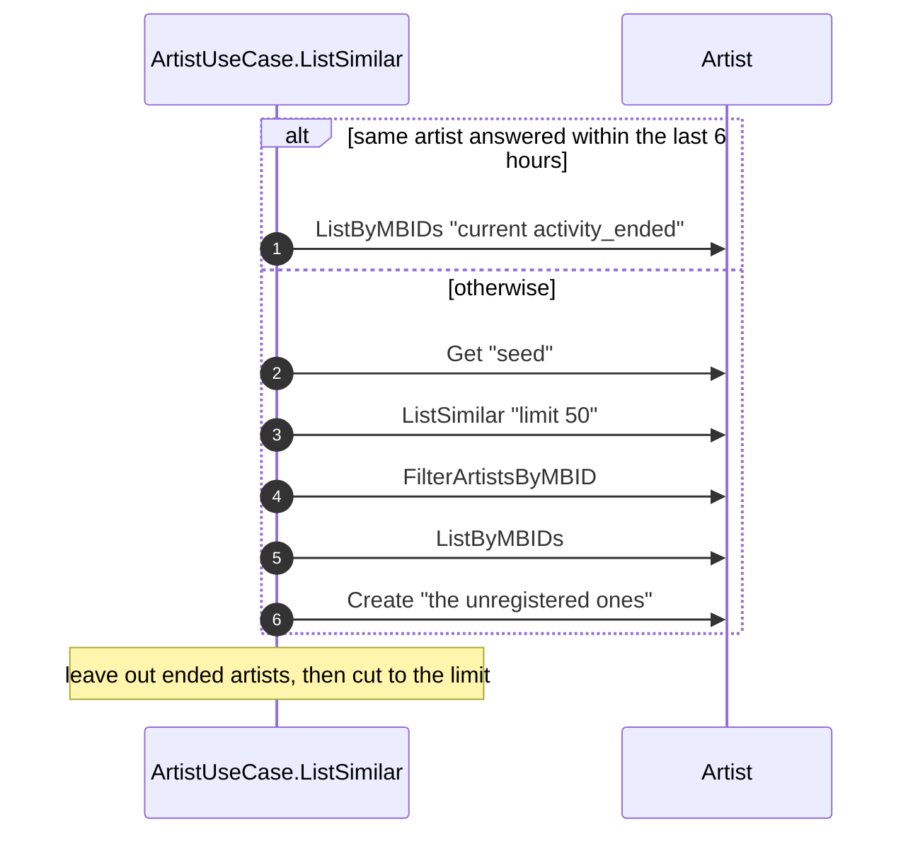

# ArtistUseCase.ListSimilar

## Purpose

ArtistUseCase.ListSimilar returns artists musically similar to a given artist, each registered as an artist so it can be followed, up to a caller-chosen number.

## Requirements

### Requirement: ListSimilar returns the catalog's similar artists as registered artists
ArtistUseCase.ListSimilar SHALL take an artist id and a limit from 0 to 50, get the seed artist with Artist.Get, look up similar artists with Artist.ListSimilar and a limit of 50 regardless of the requested limit, reduce them with Artist.FilterArtistsByMBID, find the ones already registered with Artist.ListByMBIDs, register the rest with Artist.Create, and return the first `limit` registered artists in the catalog's order among those whose activity has not ended. A limit of 0 returns every remaining result of the 50-artist lookup whose activity has not ended.

#### Scenario: Known and new similar artists
- **WHEN** the catalog lists a registered artist and an unregistered artist as similar
- **THEN** ListSimilar registers only the unregistered one and returns both in the catalog's order

#### Scenario: Result without MBID
- **WHEN** the catalog lists a similar artist without an MBID
- **THEN** that result is neither registered nor returned

#### Scenario: Limit given
- **WHEN** ListSimilar is called with a limit of 10
- **THEN** Artist.ListSimilar is asked for 50 artists
- **AND** at most 10 artists are returned, the first 10 in the catalog's order

#### Scenario: Limit of zero
- **WHEN** ListSimilar is called with a limit of 0 and the catalog lists 42 similar artists with an MBID
- **THEN** all 42 artists are returned

#### Scenario: No similar artists
- **WHEN** the catalog lists no similar artist
- **THEN** ListSimilar returns an empty list

### Requirement: ListSimilar reuses a recent result
ArtistUseCase.ListSimilar SHALL return the earlier result, without the artists whose activity has ended by the time of this call and then cut to the requested limit, without looking up the seed or consulting the catalog, when the same artist id was answered within the last 6 hours, whatever limit either call used.

#### Scenario: Repeated call
- **WHEN** ListSimilar is called twice with the same artist id and limit 10 minutes apart
- **THEN** the second call returns the first call's result without a catalog lookup

#### Scenario: Repeated call with a different limit
- **WHEN** ListSimilar is called for an artist with a limit of 30 and, 1 hour later, for the same artist with a limit of 10
- **THEN** the second call returns the first 10 artists of the first call's result without a catalog lookup

#### Scenario: Result older than 6 hours
- **WHEN** ListSimilar is called for an artist more than 6 hours after the last call for that artist
- **THEN** the catalog is consulted again

### Requirement: ListSimilar reports failures
ArtistUseCase.ListSimilar SHALL return the errors of Artist.Get, Artist.ListSimilar, Artist.ListByMBIDs and Artist.Create unchanged.

#### Scenario: Unknown seed artist
- **WHEN** no artist has the given id
- **THEN** ListSimilar fails with NotFound

#### Scenario: Seed unknown to the catalog
- **WHEN** Artist.ListSimilar fails with NotFound
- **THEN** ListSimilar fails with NotFound

#### Scenario: Catalog unavailable
- **WHEN** Artist.ListSimilar fails with Unavailable
- **THEN** ListSimilar fails with Unavailable

### Requirement: ListSimilar leaves out artists whose activity has ended
ArtistUseCase.ListSimilar SHALL leave out every similar artist whose activity_ended is true at the time of the call, before it cuts the result to the requested limit. The seed artist's own activity_ended SHALL NOT matter: an ended seed still gets its similar artists. When it consults the catalog, it SHALL take activity_ended from the artists Artist.ListByMBIDs returns for the registration step, and an artist it registers has activity_ended false. When it reuses an earlier result for the same artist id, it SHALL read the current activity_ended of that result's artists with one Artist.ListByMBIDs call.

#### Scenario: Ended artist within the limit
- **WHEN** ListSimilar is called with a limit of 10 and the third of the catalog's similar artists has activity_ended true
- **THEN** 10 artists are returned: the first, the second, and the fourth to the eleventh

#### Scenario: Artist marked ended after the result was reused
- **WHEN** ListSimilar answered an artist 1 hour ago, and a similar artist in that answer has had activity_ended true since then
- **THEN** a second call for the same artist returns the earlier result without that artist and without a catalog lookup

#### Scenario: Seed artist whose activity has ended
- **WHEN** ListSimilar is called for an artist whose own activity_ended is true
- **THEN** it returns that artist's similar artists as for any other artist
