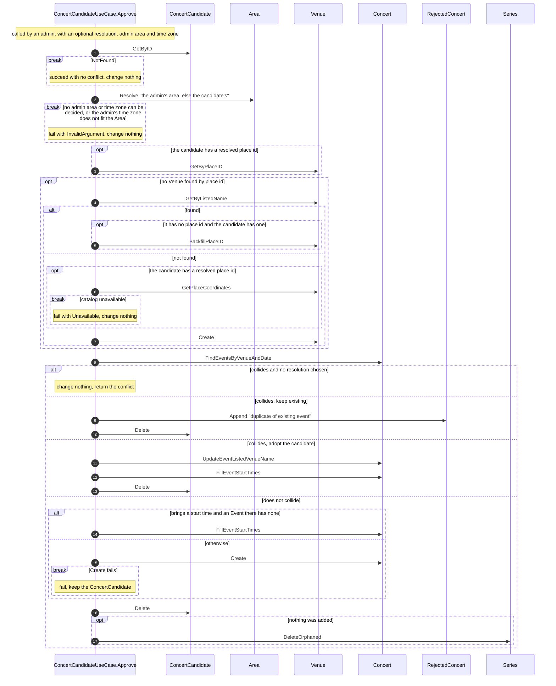

# Approve

## Purpose

Approve lets an admin publish a ConcertCandidate under the Series it was proposed with, or, when it collides with an Event already in the catalog, resolve the collision by keeping the existing Event or adopting the candidate's details onto it.

## Requirements

### Requirement: Approve of a missing concert candidate succeeds

When the ConcertCandidate does not exist (ConcertCandidate.GetByID NotFound) — already approved or rejected — Approve SHALL succeed with no conflict and change nothing.

#### Scenario: Double approval
- **WHEN** an admin approves a ConcertCandidate that a previous approval already removed
- **THEN** Approve succeeds and no Event is added

### Requirement: The venue is found or created

Approve SHALL take an optional admin area (a code or a name) and an optional time zone from the admin, and decide the Venue's admin area and time zone before any change:

- the admin area SHALL be the first-level Area that the admin's area resolves to (Area.Resolve) when the admin gives one, and the one the ConcertCandidate's admin area resolves to otherwise;
- the time zone SHALL be the admin's when the admin gives one; otherwise the time zone of that Area when it has one; otherwise the ConcertCandidate's time zone when it is one of the time zones of the Area's country.

Approve SHALL fail with InvalidArgument and change nothing when no admin area can be decided (the admin's area does not resolve, or the admin gives none and the ConcertCandidate's is absent or does not resolve), when no time zone can be decided, or when the admin's time zone is not one a Venue in that Area may have (see Venue, "Time zone of a venue").

Approve SHALL then find or create the Venue for the ConcertCandidate in this order: by resolved place id (Venue.GetByPlaceID); by listed venue name and that admin area (Venue.GetByListedName), giving that Venue the resolved place id when it has none (Venue.BackfillPlaceID); otherwise by creating it (Venue.Create) named by the listed venue name, with the listed venue name, that admin area and that time zone, and, when the ConcertCandidate has a resolved place id, that place id and the place's coordinates read from the map catalog by it (Venue.GetPlaceCoordinates) with the time they were read. A Venue that is found keeps its own name, admin area and time zone. When reading the coordinates fails with Unavailable, Approve SHALL fail with Unavailable and change nothing; when the map catalog has no such place or no coordinates for it, the Venue SHALL be created with the place id and without coordinates. A start or open time of the ConcertCandidate that does not exist on its date in the Venue's time zone, because the clocks skip it, SHALL be published as unknown.

#### Scenario: Time skipped at the venue
- **WHEN** a ConcertCandidate on 2027-03-14 that starts at 02:30 is approved at a Venue in America/New_York
- **THEN** the Event is published without a start time

#### Scenario: Unresolved concert candidate
- **WHEN** a ConcertCandidate with no resolved place id, admin area JP-13 and no time zone is approved and no Venue lists its name in JP-13
- **THEN** a Venue named after the listed venue name, in JP-13 with time zone Asia/Tokyo, with no place id and no coordinates, is created

#### Scenario: New venue at a resolved place
- **WHEN** a ConcertCandidate listing "Zepp Haneda(TOKYO)" in JP-13 with resolved place id P, which no Venue holds, is approved
- **THEN** a Venue named "Zepp Haneda(TOKYO)" is created with place id P and the coordinates just read for P with their fetch time

#### Scenario: Different place id for a stored venue
- **WHEN** the resolved place id matches no Venue but a Venue holds the listed venue name and admin area with no place id
- **THEN** that Venue is used and takes the resolved place id

#### Scenario: Admin gives the area and the time zone
- **WHEN** a ConcertCandidate without an admin area or a time zone is approved with the area "California" and the time zone America/Los_Angeles
- **THEN** its Venue is found or created in US-CA, and a created Venue has the time zone America/Los_Angeles

#### Scenario: Area still unknown
- **WHEN** a ConcertCandidate without an admin area is approved without an area
- **THEN** Approve fails with InvalidArgument and nothing changes

#### Scenario: Area the admin gives does not resolve
- **WHEN** an admin approves with the area JP-99
- **THEN** Approve fails with InvalidArgument and nothing changes

#### Scenario: Candidate staged with a lower-level code
- **WHEN** a ConcertCandidate staged with admin area FR-33 is approved without an area or a time zone
- **THEN** its Venue is found or created in FR-NAQ, and a created Venue has the time zone Europe/Paris

#### Scenario: Time zone still unknown
- **WHEN** a ConcertCandidate in US-TX, which has no time zone of its own, and without a time zone is approved without a time zone
- **THEN** Approve fails with InvalidArgument and nothing changes

#### Scenario: Time zone of another country
- **WHEN** an admin approves a ConcertCandidate in US-TX with the time zone Asia/Tokyo
- **THEN** Approve fails with InvalidArgument and nothing changes

#### Scenario: Time zone other than the Area's own
- **WHEN** an admin approves a ConcertCandidate in US-CA, whose time zone is America/Los_Angeles, with the time zone America/New_York
- **THEN** Approve fails with InvalidArgument and nothing changes

#### Scenario: Catalog down while creating the venue
- **WHEN** a new Venue must be created for a resolved place id and reading its coordinates fails with Unavailable
- **THEN** Approve fails with Unavailable and the ConcertCandidate is kept

### Requirement: Collision is detected before any change

After resolving the Venue, Approve SHALL look up the Events at that Venue and date (Concert.FindEventsByVenueAndDate). The ConcertCandidate collides with an Event there that has the same start time (or both have none), or, when the ConcertCandidate has no start time, with any Event there that has one. Detection SHALL be repeated on every call.

#### Scenario: Same slot
- **WHEN** an Event exists at the Venue, date and start time of the ConcertCandidate
- **THEN** the ConcertCandidate collides with it

#### Scenario: Unknown start next to a known start
- **WHEN** the ConcertCandidate has no start time and an Event there starts at 18:00
- **THEN** the ConcertCandidate collides with it

### Requirement: Conflict without a choice changes nothing

When the ConcertCandidate collides and no resolution is chosen, Approve SHALL change nothing and return a conflict carrying the existing Event's id, its Series title, listed venue name, date, start and open time, together with the ConcertCandidate and its Artist.

#### Scenario: First approval of a duplicate
- **WHEN** an admin approves a colliding ConcertCandidate without a resolution
- **THEN** a conflict is returned and neither the Event nor the ConcertCandidate changes

### Requirement: Keep existing

When the ConcertCandidate collides and the resolution is keep existing, Approve SHALL record it in the RejectedConcert (RejectedConcert.Append) with the reason "duplicate of existing event" followed by the Event id and the reviewing admin's identity when known, remove the ConcertCandidate (ConcertCandidate.Delete), leave the Event unchanged, and return no conflict.

#### Scenario: Admin keeps the existing event
- **WHEN** an admin approves a colliding ConcertCandidate choosing keep existing
- **THEN** the ConcertCandidate is logged as rejected and removed, and the Event is unchanged

### Requirement: Adopt the candidate

When the ConcertCandidate collides and the resolution is adopt the candidate, Approve SHALL replace the Event's listed venue name with the ConcertCandidate's (Concert.UpdateEventListedVenueName), fill the Event's unknown start and open time from it (Concert.FillEventStartTimes), leave its Venue, place id and Series title unchanged, remove the ConcertCandidate, and return no conflict.

#### Scenario: Admin adopts the candidate's details
- **WHEN** an admin approves a colliding ConcertCandidate choosing adopt the candidate
- **THEN** the Event lists the ConcertCandidate's venue name, gains any unknown time, and the ConcertCandidate is removed

#### Scenario: Known start time kept
- **WHEN** the Event starts at 18:00 and the ConcertCandidate has no start time and adopt the candidate is chosen
- **THEN** the Event still starts at 18:00 and lists the ConcertCandidate's venue name

### Requirement: Publish a non-colliding concert candidate

When the ConcertCandidate does not collide, Approve SHALL ignore any resolution and:
- when it brings a start time and an Event at the Venue and date has none, fill that Event's times (Concert.FillEventStartTimes) and add nothing;
- otherwise add it as a Concert under the ConcertCandidate's Series with its Artist as performer (Concert.Create), never creating a Series. Concert.Create announces the new concert to the Artist's followers; when it fails, Approve SHALL fail with its error and keep the ConcertCandidate.

It SHALL then remove the ConcertCandidate, and, when nothing was added, remove the ConcertCandidate's Series if it is left with no Event and no ConcertCandidate (Series.DeleteOrphaned; a failure here does not fail Approve).

#### Scenario: New concert
- **WHEN** a non-colliding ConcertCandidate is approved
- **THEN** an Event is added under its Series and the ConcertCandidate is removed

#### Scenario: Tour stop joins its tour
- **WHEN** a ConcertCandidate staged from a TOUR series is approved
- **THEN** its Event belongs to that TOUR Series and no Series is created

#### Scenario: Fill only
- **WHEN** the ConcertCandidate starts at 18:00 and the only Event at its Venue and date has no start time
- **THEN** that Event now starts at 18:00, no Event is added, and the ConcertCandidate is removed

#### Scenario: Concert cannot be added
- **WHEN** Concert.Create fails with Unavailable
- **THEN** Approve fails with Unavailable and the ConcertCandidate is kept, so the admin can approve it again

#### Scenario: Last staged row of an empty series
- **WHEN** a fill-only approval removes the last ConcertCandidate of a Series with no Event
- **THEN** that Series is removed
