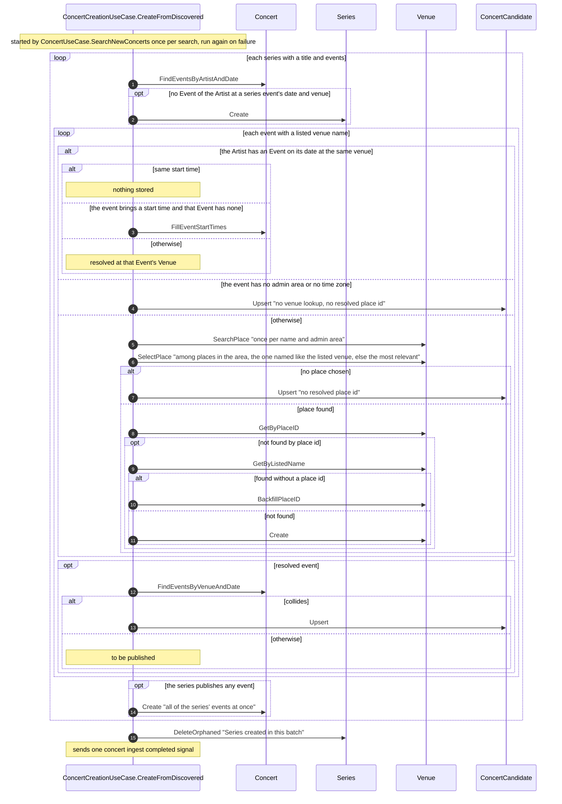

# Create From Discovered

## Purpose

CreateFromDiscovered takes one Artist's batch of newly discovered series, started by ConcertUseCase.SearchNewConcerts once per search. For each event it does one of three things: publishes it under its Series through Concert.Create, which tells the Artist's followers; stages it for admin review when its venue is unresolved (including when its admin area or time zone is unknown) or its slot collides with an Event already in the catalog; or fills an announced start time onto the Artist's existing Event.

## Requirements

### Requirement: Unusable input is skipped

CreateFromDiscovered SHALL skip a series with no title or no events, and an event whose listed venue name is blank after normalization, and continue with the rest. It SHALL normalize every listed venue name before using or storing it.

#### Scenario: Untitled series
- **WHEN** a discovered series has an empty title
- **THEN** none of its events is published or staged and the other series are processed

#### Scenario: Venue to be announced
- **WHEN** an event's listed venue name is blank
- **THEN** that event is skipped

#### Scenario: Prefixed venue name stored normalized
- **WHEN** an event lists "大阪・フェスティバルホール"
- **THEN** whatever is stored for it lists "フェスティバルホール"

### Requirement: One Series per discovered series

For each discovered series, CreateFromDiscovered SHALL look up the Artist's Events on the series' dates (Concert.FindEventsByArtistAndDate). When any of them has the same date and the same listed venue (see Venue, "Same listed venue") as one of the series' events, the series SHALL join that Event's Series — the one with the smallest id when several match. Otherwise a new Series SHALL be created with the discovered title, type and source page (Series.Create) before any of its events is stored or staged. The Series type SHALL come from the discovery, never from the number of events.

#### Scenario: Re-discovered tour joins its series
- **WHEN** a tour is discovered again and one of its dates matches an Event of the Artist at the same venue
- **THEN** all its events go under that Event's Series and no Series is created

#### Scenario: New tour
- **WHEN** none of a tour's events matches an Event of the Artist
- **THEN** one TOUR Series is created and all its events go under it

#### Scenario: Same-day show at another venue does not join
- **WHEN** the Artist has an Event on one of the tour's dates at a different venue
- **THEN** the tour does not join that Event's Series

### Requirement: Re-discovery of the artist's own event

When the Artist already has an Event on an event's date at the same listed venue (see Venue, "Same listed venue"), CreateFromDiscovered SHALL NOT look up the venue. When that Event has the same start time (or both have none), nothing is stored. When the event brings a start time and that Event has none, the time SHALL be filled onto it (Concert.FillEventStartTimes) and nothing else stored; one unknown-start Event SHALL be filled by at most one event of the batch. Otherwise the event SHALL be handled as a resolved event at that Event's Venue.

#### Scenario: Exact re-discovery
- **WHEN** the event matches the Artist's Event at the same venue, date and start time
- **THEN** nothing is stored and no venue is looked up

#### Scenario: Start time announced
- **WHEN** the Artist's Event at that venue and date has no start time and the event starts at 18:00
- **THEN** the Event now starts at 18:00 and no new Event is stored

#### Scenario: Two new start times for one unknown-start event
- **WHEN** the Artist's Event has no start time and the batch brings 13:00 and 18:00 at that venue and date
- **THEN** the Event is filled with 13:00 and 18:00 is handled as a new event

### Requirement: Venue resolution

For any other event that has an admin area and a time zone, CreateFromDiscovered SHALL look up the places for the venue's listed name and admin area (Venue.SearchPlace), at most once per name and admin area within the batch, and choose one with Venue.SelectPlace, which counts only the places that can be inside the event's admin area and picks the first whose canonical name is the same listed venue as the listed name, otherwise the most relevant. When a place is chosen, the Venue SHALL be found or created in this order: by place id (Venue.GetByPlaceID); by listed venue name and admin area (Venue.GetByListedName), giving that Venue the place id when it has none (Venue.BackfillPlaceID); otherwise created (Venue.Create) named by the listed venue name, with the place id, the place's coordinates with the time they were read, the listed venue name, the discovered admin area and the discovered time zone. The place's canonical name SHALL be used only to choose the place and SHALL NOT be stored. Any lookup failure other than no match SHALL fail the whole batch.

#### Scenario: Known place
- **WHEN** the place is found and a Venue holds its place id
- **THEN** that Venue is used and no Venue is created

#### Scenario: Place id differs from the stored venue
- **WHEN** the place's id matches no Venue but a Venue holds the listed venue name and admin area without a place id
- **THEN** that Venue is used and takes the place id

#### Scenario: New venue takes the listed name
- **WHEN** an event lists "Zepp Haneda(TOKYO)" in JP-13 with time zone Asia/Tokyo, the chosen place is named "Zepp Haneda (TOKYO)" and no Venue holds it
- **THEN** a Venue named "Zepp Haneda(TOKYO)" is created with the place id, the place's coordinates and their fetch time, JP-13 and Asia/Tokyo

#### Scenario: New overseas venue
- **WHEN** an event in Bordeaux comes with the admin area FR-NAQ and the time zone Europe/Paris, and no Venue holds the place found for it
- **THEN** a Venue is created with the admin area FR-NAQ and the time zone Europe/Paris

#### Scenario: Catalog unavailable
- **WHEN** the venue lookup fails with Unavailable
- **THEN** CreateFromDiscovered fails and the discovery is processed again later

### Requirement: Unresolved venue is staged

When the event has no admin area or no time zone, CreateFromDiscovered SHALL stage it (ConcertCandidate.Upsert) without looking up the venue. When the venue lookup chooses no place (the search finds none, or none inside the event's admin area, see Venue.SelectPlace), it SHALL stage the event without a resolved place id. In both cases it SHALL NOT create a Venue and SHALL NOT publish the event.

#### Scenario: Venue not found
- **WHEN** no place is chosen
- **THEN** a ConcertCandidate without a resolved place id is stored and nothing is published

#### Scenario: Only places elsewhere
- **WHEN** an event's admin area is US-CA and every place found for its venue lies in another country or admin area
- **THEN** a ConcertCandidate without a resolved place id is stored, no Venue is created and nothing is published

#### Scenario: Area unknown
- **WHEN** an event comes without an admin area
- **THEN** the venue is not looked up, a ConcertCandidate without an admin area and without a resolved place id is stored, and nothing is published

#### Scenario: Time zone unknown
- **WHEN** an event comes with the admin area US-TX and no time zone
- **THEN** the venue is not looked up, a ConcertCandidate with US-TX, without a time zone and without a resolved place id is stored, and nothing is published

### Requirement: Collision is staged, anything else is published

For a resolved event, CreateFromDiscovered SHALL look up the Events at its Venue and date (Concert.FindEventsByVenueAndDate). The event collides when an Event there has the same start time (or both have none), or when the event has no start time and an Event there has one. A colliding event SHALL be staged (ConcertCandidate.Upsert) and not published; it carries the resolved place id when its venue was looked up, and none when it reused the Artist's existing Event's Venue. Any other event SHALL be published under the series' Series with the Artist as performer, together with the series' other published events (see "The published events of a series are created together"). The RejectedConcert SHALL NOT be consulted.

#### Scenario: Same slot as an existing event
- **WHEN** an Event at the resolved Venue, date and start time exists
- **THEN** the event is staged with its resolved place id and not published

#### Scenario: Unknown start next to a known start
- **WHEN** the event has no start time and an Event at that Venue and date starts at 18:00
- **THEN** the event is staged

#### Scenario: Known start next to an unknown-start event
- **WHEN** the event starts at 18:00 and the only Event at that Venue and date has no start time
- **THEN** a new Event starting at 18:00 is published

#### Scenario: Genuinely new
- **WHEN** no Event is at the resolved Venue and date
- **THEN** the event is published under the series' Series

### Requirement: Empty new series are removed

At the end of the batch, CreateFromDiscovered SHALL remove the Series it created in this batch that have no Event and no ConcertCandidate (Series.DeleteOrphaned); it SHALL NOT touch other Series. A failure here SHALL NOT fail the batch.

#### Scenario: Created series left empty
- **WHEN** a Series created in this batch ended up with no Event and no ConcertCandidate
- **THEN** it is removed

### Requirement: Each batch reports what it did

At the end of a batch, whether it completed or failed, CreateFromDiscovered SHALL send one "concert ingest completed" signal for product analytics, under the trace of the discovery it handles, carrying the Artist, whether the batch completed or failed, and the numbers of events it published, staged for review, filled in on an existing Event and kept as conflicts. A failed batch reports what it had done before failing; each redelivery of a failed batch is a batch of its own. A failure to send it SHALL NOT change the batch.

#### Scenario: Mixed batch
- **WHEN** a batch publishes 3 events and stages 1 for review
- **THEN** one signal is sent with 3 published and 1 staged, in the same trace as the search that found them

#### Scenario: Batch fails part way
- **WHEN** a batch publishes 2 events and then fails on the next series
- **THEN** one signal is sent stating the batch failed, with 2 published, and the batch still fails

### Requirement: Runs when a search starts it

CreateFromDiscovered SHALL run when ConcertUseCase.SearchNewConcerts starts it for an Artist's search, with that Artist and the DiscoveredSeries the search kept. It SHALL be named after the Artist and the search time of the Artist's ConcertSearch, so one search starts it once. When it fails, the same DiscoveredSeries SHALL be processed again; every step SHALL be safe to repeat.

#### Scenario: Search keeps new concerts
- **WHEN** SearchNewConcerts keeps a tour and a standalone show for an Artist
- **THEN** CreateFromDiscovered runs once for that Artist with both series

#### Scenario: Processed again after a failure
- **WHEN** a batch that was already fully processed is processed again
- **THEN** no Event, Series or ConcertCandidate is added a second time

### Requirement: The published events of a series are created together

For each series, CreateFromDiscovered SHALL publish every event it decides to publish in one Concert.Create call under the series' Series with the Artist as performer, after deciding for each event of the series whether to publish, stage, fill or skip it. Concert.Create then tells the Artist's followers about them once. A series that publishes nothing SHALL NOT call Concert.Create. When Concert.Create fails, the batch SHALL fail.

#### Scenario: Three-stop tour
- **WHEN** three events of a tour are to be published
- **THEN** Concert.Create is called once with the three events

#### Scenario: Everything staged
- **WHEN** every event of a series is staged
- **THEN** Concert.Create is not called for that series

#### Scenario: Concerts cannot be created
- **WHEN** Concert.Create fails with Unavailable for a series
- **THEN** CreateFromDiscovered fails and the batch is processed again later

### Requirement: What a staged event carries

A ConcertCandidate staged by CreateFromDiscovered SHALL carry the event's listed venue name, its admin area and time zone when discovery found them, its start and open times as times of day at the venue as the source stated them, and the resolved place id when a place was chosen. It SHALL NOT carry a venue name or coordinates read from the map catalog.

#### Scenario: Staged collision with a resolved place
- **WHEN** an event in JP-13 with time zone Asia/Tokyo, starting at 18:00, collides after its venue was resolved to place P named "Zepp Haneda (TOKYO)" by the map catalog
- **THEN** the ConcertCandidate carries the listed venue name, JP-13, Asia/Tokyo, the start time 18:00 and the resolved place id P, and no name or coordinates from the map catalog
