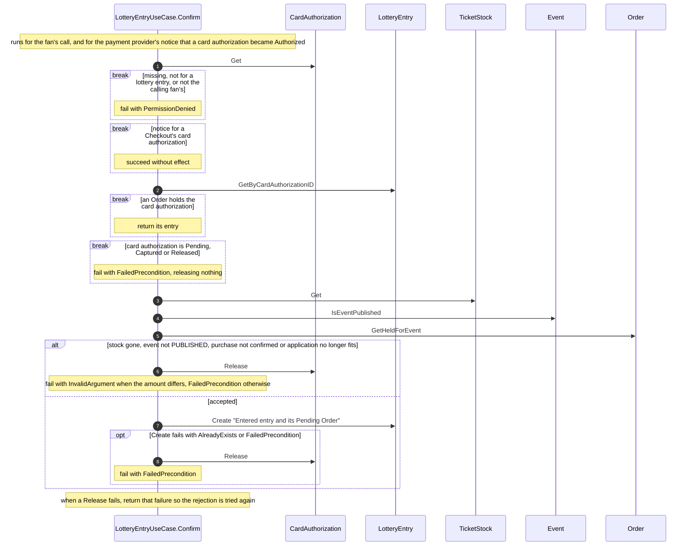

# components/usecase/lottery-entry/confirm Specification

## Purpose
LotteryEntryUseCase.Confirm makes a fan's Entered LotteryEntry from their authenticated card authorization, or releases a card authorization it rejects. It runs for the fan's call and for the payment provider's notice that card authentication completed.

## Requirements

### Requirement: Card authentication completed without the fan

Confirm SHALL also run, without a calling fan, when the payment provider reports that a card authorization became Authorized, so a fan who closed the browser after card authentication still has their entry. A card authorization for a Checkout SHALL then be left as it is, and Confirm SHALL succeed without effect.

#### Scenario: Browser closed after card authentication
- **WHEN** a fan completes card authentication and closes the browser before their Confirm call, and the payment provider reports the card authorization Authorized
- **THEN** the entry is made with that card authorization

#### Scenario: Checkout's card authorization reported
- **WHEN** the payment provider reports a Checkout's card authorization Authorized
- **THEN** nothing changes

### Requirement: An entry and its Order are made from an authorized card authorization

Confirm SHALL take a card authorization and, when the fan calls it, the calling fan. It SHALL:
- read the card authorization with CardAuthorization.Get and fail with PermissionDenied, without revealing whether it exists, when it does not exist, is not for a lottery entry, or is not the calling fan's; other failures are returned unchanged;
- return the entry whose Order holds the card authorization, when one exists (LotteryEntry.GetByCardAuthorizationID), so a repeated Confirm changes nothing;
- fail with FailedPrecondition when the card authorization is Pending, Captured or Released, releasing nothing;
- read its TicketStock with TicketStock.Get, check with Event.IsEventPublished that the stock's event is PUBLISHED, and check that the card authorization confirms the purchase for the stock's SeatType amount for its ticket count;
- read what the fan holds for the event with Order.GetHeldForEvent and check that the application still fits the event;
- make the Entered entry and its Pending Order with LotteryEntry.Create from the card authorization's sale, TicketStock, user, ticket count and referral code, and return the entry; when an Order already holds the card authorization, Create returns its entry.

A card authorization that an Order holds SHALL never be released by Confirm. Confirm SHALL release an Authorized card authorization with CardAuthorization.Release, and then fail, only when it rejects it: when its TicketStock no longer exists, when the stock's event is not PUBLISHED, as for a 中止 (cancelled) concert, when it does not confirm the purchase, when the application no longer fits the event, or when LotteryEntry.Create fails with AlreadyExists (another entry of the fan in the sale for the event) or FailedPrecondition (the application no longer fits the event, or the sale's end time passed). It fails with InvalidArgument when the amount differs, and with FailedPrecondition otherwise. When the release fails, Confirm SHALL return that failure instead, so the rejection is tried again. No money is captured at entry.

#### Scenario: Fan confirms
- **WHEN** a fan confirms their Authorized 16000 yen card authorization for 2 S席 tickets at 8000 yen
- **THEN** a Pending Order for 2 tickets with that card authorization and its Entered entry are made, the entry is returned, and nothing is charged

#### Scenario: Confirmed twice
- **WHEN** Confirm runs again for a card authorization that an Order already holds
- **THEN** that Order's entry is returned unchanged

#### Scenario: Fan and notice at the same time
- **WHEN** the fan's Confirm and the payment provider's notice run at the same time for one card authorization, just before the end time
- **THEN** one Order and entry are made, both return the entry, and the card authorization is not released

#### Scenario: Card authentication not completed
- **WHEN** the card authorization is still Pending
- **THEN** Confirm fails with FailedPrecondition, no entry is made and nothing is released

#### Scenario: American Express card
- **WHEN** the Authorized card authorization is on an American Express card
- **THEN** it is released, Confirm fails with FailedPrecondition and no entry is made

#### Scenario: Amount differs
- **WHEN** the Authorized card authorization is for 8000 yen and the stock's price times its count is 16000 yen
- **THEN** it is released, Confirm fails with InvalidArgument and no entry is made

#### Scenario: Second entry in the sale
- **WHEN** the fan already has an entry in the sale for the same event with another card authorization, for any stock of the event
- **THEN** this card authorization is released, Confirm fails with FailedPrecondition and the first entry is unchanged

#### Scenario: No longer fits
- **WHEN** the fan bought A席 tickets for the event in another tab after authorizing their card for S席
- **THEN** the card authorization is released, Confirm fails with FailedPrecondition and no entry is made

#### Scenario: After the end time
- **WHEN** Confirm runs for an Authorized card authorization that no Order holds, after the sale's end time
- **THEN** the card authorization is released, Confirm fails with FailedPrecondition and no entry is made

#### Scenario: Concert cancelled during card authentication
- **WHEN** the event was cancelled after the fan authorized their card, and Confirm runs for the Authorized card authorization that no Order holds
- **THEN** the card authorization is released, Confirm fails with FailedPrecondition and no entry is made

#### Scenario: TicketStock gone
- **WHEN** the card authorization's TicketStock was deleted with its event
- **THEN** the card authorization is released, Confirm fails with FailedPrecondition and no entry is made

#### Scenario: Release fails
- **WHEN** Confirm rejects an Authorized card authorization and CardAuthorization.Release fails with Unavailable
- **THEN** Confirm fails with Unavailable and no entry is made

#### Scenario: Someone else's card authorization
- **WHEN** a fan confirms a card authorization opened for another fan, whose Order holds it
- **THEN** Confirm fails with PermissionDenied and returns no entry
