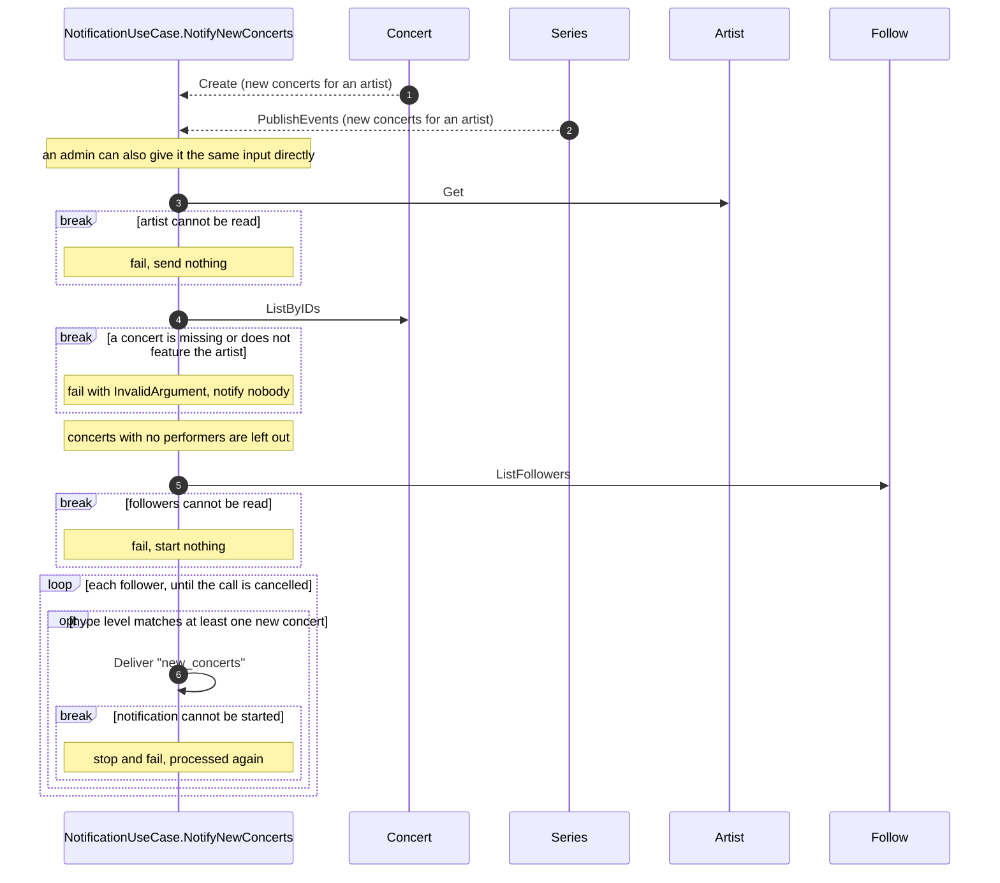

# Notify New Concerts

## Purpose

NotificationUseCase.NotifyNewConcerts tells each follower of an artist about concerts just added for that artist, when the follower's hype level matches at least one of them, with a message in the fan's language that counts the matching concerts and links to the earliest one.

## Requirements

### Requirement: Triggered by concerts added for an artist

NotifyNewConcerts SHALL run for each announcement of new concerts for an artist (Concert.Create, Series.PublishEvents), with the artist and the concerts the announcement carries; an admin can also give it the same input directly. It SHALL read the artist (Artist.Get) and use its current name, and read the concerts (Concert.ListByIDs). When the artist cannot be read, NotifyNewConcerts SHALL fail with that error and send nothing. Only the given concerts SHALL be considered; the artist's other upcoming concerts never count.

#### Scenario: Two concerts added for an artist with ten upcoming

- **WHEN** 2 concerts are added for an artist that already has 10 upcoming concerts, and a follower's hype level is Away
- **THEN** that follower's message counts 2

#### Scenario: Unknown artist

- **WHEN** the artist does not exist
- **THEN** NotifyNewConcerts fails with NotFound and nothing is sent

### Requirement: Every given concert must feature the artist

Before notifying anyone, NotifyNewConcerts SHALL check that every given concert exists and has the artist among its performers. When a concert does not exist, or its performers do not include the artist, NotifyNewConcerts SHALL fail with InvalidArgument and notify nobody. A concert with no performers at all SHALL be left out instead of failing the batch; when every concert is left out, nothing is sent and NotifyNewConcerts succeeds.

#### Scenario: Concert of another artist

- **WHEN** one of the given concerts does not feature the artist
- **THEN** NotifyNewConcerts fails with InvalidArgument and nobody is notified

#### Scenario: Unknown concert

- **WHEN** one of the given concert ids matches no concert
- **THEN** NotifyNewConcerts fails with InvalidArgument and nobody is notified

#### Scenario: Concert without performers

- **WHEN** one of three given concerts has no performers
- **THEN** it is left out and followers are notified about the other two

### Requirement: Each follower is matched against the new concerts

NotifyNewConcerts SHALL read the artist's followers (Follow.ListFollowers) and, for each, take the concerts that the follower's hype level matches among the new concerts, given the follower's home. A follower whose matched set is empty SHALL NOT be notified. The message count and the link SHALL come from the follower's matched set only. When the artist has no followers, or no follower matches, nothing is sent and NotifyNewConcerts succeeds.

#### Scenario: Home follower and a new concert elsewhere

- **WHEN** a concert is added in JP-40, the artist has an older upcoming concert in JP-13, and a follower's hype level is Home with home area JP-13
- **THEN** that follower is not notified

#### Scenario: Nearby follower and a distant new concert

- **WHEN** a concert is added 300 km from a Nearby follower's home centre, and the artist has an older upcoming concert 50 km from it
- **THEN** that follower is not notified

#### Scenario: Nearby follower and a new concert in range

- **WHEN** a concert is added 150 km from a Nearby follower's home centre, outside the follower's home area
- **THEN** that follower is notified about 1 concert

#### Scenario: Home follower counts only in-area concerts

- **WHEN** 3 concerts are added, 1 in JP-13 and 2 in JP-40, and a follower's hype level is Home with home area JP-13
- **THEN** that follower is notified and the message counts 1

#### Scenario: Watch follower

- **WHEN** a follower's hype level is Watch
- **THEN** that follower is not notified

#### Scenario: Nobody follows the artist

- **WHEN** the artist has no followers
- **THEN** nothing is sent and NotifyNewConcerts succeeds

### Requirement: The message names the artist, counts the concerts in the fan's language and links to the earliest

For each matched follower, the requested notification's subject SHALL be the artist and the follower's matched concerts, so the message the Notification entity renders from it is titled with that artist, counts the matched concerts and links to the earliest of them. The earliest concert is the earliest of the set as Concert defines it.

#### Scenario: Japanese

- **WHEN** a follower whose language is `ja` is matched with 3 concerts of Vaundy
- **THEN** the title reads [Vaundy] 新着ライブ発表!! and the body starts with 新しいライブが3件見つかりました

#### Scenario: One concert in English

- **WHEN** a follower whose language is `en` is matched with 1 concert
- **THEN** the body starts with "1 new concert found"

#### Scenario: Several concerts in English

- **WHEN** a follower whose language is `en` is matched with 3 concerts
- **THEN** the body starts with "3 new concerts found"

#### Scenario: Unsupported or missing language

- **WHEN** a follower's preferred language has no copy, such as `fr`
- **THEN** the message is in English

#### Scenario: Link to the earliest matched concert

- **WHEN** a follower's matched concerts are on 2026-09-10 and 2026-09-03
- **THEN** the link is `/concerts/<id of the 2026-09-03 concert>`

#### Scenario: Same day, earlier start

- **WHEN** a follower's matched concerts are both on 2026-09-03, at 18:00 and 19:30
- **THEN** the link points to the 18:00 concert

#### Scenario: Home follower links to their in-area concert

- **WHEN** concerts are added in JP-40 on 2026-09-01 and in JP-13 on 2026-09-05, and a follower's hype level is Home with home area JP-13
- **THEN** that follower's link points to the JP-13 concert

#### Scenario: First-party concert links to its event page

- **WHEN** the earliest matched concert belongs to a Series published by an Organizer
- **THEN** the link is `/events/<id of that concert>`

### Requirement: One new_concerts notification requested per matched follower

For each matched follower, NotifyNewConcerts SHALL start NotificationUseCase.Deliver with one notification of type new_concerts whose subject is the artist and that follower's matched concerts, named after the follower and what NotifyNewConcerts runs for: the announcement of the new concerts, or one direct call by an admin. A repeated delivery of the same announcement SHALL start nothing new for a follower already started; each direct call notifies again. Deliver records and delivers each notification on its own; a follower whose Notification cannot be recorded, or whose delivery fails, SHALL NOT affect the other followers or fail NotifyNewConcerts. The story stories/get-notified-of-new-concerts covers the whole flow from the added concerts to the fan's browsers. When a follower's notification cannot be started, NotifyNewConcerts SHALL stop and fail so the announcement is processed again; the followers already started are not started again. When the followers cannot be read, NotifyNewConcerts SHALL fail and start nothing. When the call is cancelled, no further follower's notification SHALL be started.

#### Scenario: Every matched follower is requested

- **WHEN** three followers are matched
- **THEN** one new_concerts notification is started for each of the three, naming the artist and that follower's matched concerts

#### Scenario: Request fails for one follower

- **WHEN** the notification for the second of three matched followers cannot be started
- **THEN** the third follower's notification is not started and NotifyNewConcerts fails so the announcement is processed again, without notifying the first follower again

#### Scenario: Same concerts notified twice

- **WHEN** NotifyNewConcerts runs twice for the same announcement of the same concerts and matches the same follower
- **THEN** the follower is notified once

#### Scenario: Admin sends again

- **WHEN** an admin gives NotifyNewConcerts an artist and concerts that were already announced
- **THEN** each matched follower is notified again, and the new message replaces the earlier one on the follower's devices
