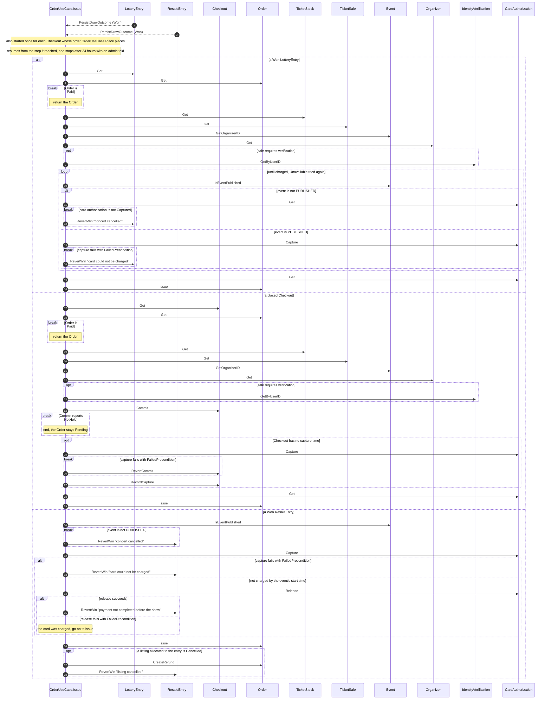

# components/usecase/order/issue Specification

## Purpose
OrderUseCase.Issue charges the card authorization of a Won LotteryEntry's or a placed Checkout's Pending Order, committing the Checkout's tickets first, and makes the Order Paid, with its account-bound covered tickets and its Settlement, exactly once.

## Requirements

### Requirement: Every Won entry is issued

Issue SHALL run once for each entry that LotteryEntry.PersistDrawOutcome records Won, once for each entry that ResaleEntry.PersistDrawOutcome records Won, and once for each Checkout whose order OrderUseCase.Place places. When Issue stops before it ends, it SHALL resume from the step it reached, without charging the card again. When it has not ended 24 hours after it started, it SHALL stop, leaving the entry or the Checkout and its Order as they are, and an admin SHALL be told.

#### Scenario: Won entry
- **WHEN** a draw records an entry Won
- **THEN** Issue runs for it

#### Scenario: Won resale entry
- **WHEN** a resale draw records an entry Won
- **THEN** Issue runs for its Order once

#### Scenario: Stopped after the charge
- **WHEN** Issue stops after the card was charged and before the Order was made Paid
- **THEN** it resumes, the card is charged once, and the Order becomes Paid once

#### Scenario: Placed checkout
- **WHEN** a fan places the order for their Checkout twice
- **THEN** Issue runs once for the Checkout

### Requirement: Charge, then issue

Issue SHALL take a LotteryEntry. It SHALL read the entry with LotteryEntry.Get, failing with NotFound when it does not exist, and its Order with Order.Get. When the Order is Paid, it SHALL return that Order and do nothing else. Otherwise, before it charges anything, it SHALL:
- fail with FailedPrecondition when the entry is not Won or its Order is not Pending;
- read the Order's TicketStock with TicketStock.Get and the entry's sale with TicketSale.Get;
- resolve the stock's event's Organizer with Event.GetOrganizerID and read it with Organizer.Get for its platform fee rate.

Any of these failures SHALL be returned unchanged, with nothing charged or changed. It SHALL then charge the Order's card authorization with CardAuthorization.Capture, first checking with Event.IsEventPublished, before every attempt, that the stock's event is PUBLISHED:
- When it is not, as for a 中止 (cancelled) concert, it SHALL read the card authorization with CardAuthorization.Get, since an earlier attempt that failed with Unavailable may have charged it; a failure of that read with Unavailable SHALL be tried again. When it is Captured, Issue SHALL go on as after a successful charge, so the Order is Paid and a cancellation refund reaches it. Otherwise it SHALL charge nothing, make the entry Lost and its Order Void with LotteryEntry.RevertWin and the lost reason "concert cancelled", and end without a Paid Order; the card authorization is then released and the fan told from that announcement. Issue SHALL never make the entry Lost while a charge of its Order stands, so no fan is charged without tickets.
- When the capture fails with Unavailable, it SHALL try again.
- When the capture fails with FailedPrecondition, meaning the card authorization can no longer be charged, it SHALL make the entry Lost and its Order Void with LotteryEntry.RevertWin and the lost reason "card could not be charged", which announces the entry Lost with that reason, and end without a Paid Order. No loser is promoted (no 繰上げ, promotion of a loser).

After the capture it SHALL read the captured payment with CardAuthorization.Get and, with Order.Issue:
- make the Pending Order Paid, with the payment provider, provider payment ID and card facets of the captured payment, and a pay time of the time of issuance;
- issue exactly as many Tickets as the Order's ticket count, each bound to the Order's user, for the stock's event, and Issued at the same time; the Tickets carry no copy of the user's full name or phone number;
- create a Held Settlement for the event and its Organizer, with one split paying that Organizer the Order's amount minus the platform fee at the Organizer's rate.

When Order.Issue fails with AlreadyExists it SHALL return the Order, Paid by the other run. A failure of a read or of Order.Issue after the charge with Unavailable SHALL be tried again. Order.Issue announces the Order as paid together with making it Paid (components/entity/order/issue), so Issue announces nothing itself and an Issue run again after a stop announces nothing twice.

#### Scenario: Won entry issued
- **WHEN** Issue runs for a Won entry whose Order for 2 tickets has a 16000 yen card authorization, for an Organizer at 5%
- **THEN** the card is charged 16000 yen, the Order becomes Paid, and 2 Issued Tickets bound to the Order's user for the stock's event and a Held Settlement with one 15200 yen split for the event's Organizer are created

#### Scenario: Replayed issuance
- **WHEN** Issue runs again for an entry whose Order is Paid
- **THEN** the Order is returned, the card is not charged again, and no Ticket or Settlement is added

#### Scenario: Concurrent issuance
- **WHEN** Order.Issue fails with AlreadyExists because another run issued the Order first
- **THEN** the Order Paid by the other run is returned

#### Scenario: Entry not won
- **WHEN** the entry is Entered or Lost
- **THEN** Issue fails with FailedPrecondition, charges nothing and changes nothing

#### Scenario: Payment provider unavailable
- **WHEN** CardAuthorization.Capture fails with Unavailable and succeeds 10 minutes later
- **THEN** the card is charged once and the Order becomes Paid

#### Scenario: Payment provider unavailable for a day
- **WHEN** CardAuthorization.Capture fails with Unavailable for 24 hours
- **THEN** Issue stops, the entry stays Won with its Order Pending, nothing is charged, and an admin is told

#### Scenario: Card authorization no longer chargeable
- **WHEN** CardAuthorization.Capture fails with FailedPrecondition
- **THEN** the entry is Lost with the lost reason "card could not be charged", its Order is Void, nothing is charged, and the entry is announced Lost

#### Scenario: Lottery concert cancelled before the charge
- **WHEN** a Won lottery entry is issued after its concert was cancelled
- **THEN** nothing is charged, the entry is Lost with the lost reason "concert cancelled", its Order is Void and its card authorization is released

#### Scenario: Concert cancelled while the payment provider is unavailable
- **WHEN** CardAuthorization.Capture fails with Unavailable, charging nothing, and the concert is cancelled before the next attempt
- **THEN** nothing is charged and the entry is Lost with the lost reason "concert cancelled"

#### Scenario: Earlier attempt charged, then concert cancelled
- **WHEN** CardAuthorization.Capture fails with Unavailable although the card was charged, and the concert is cancelled before the next attempt
- **THEN** the card is not charged again, the Order becomes Paid with its Tickets, and the entry stays Won

#### Scenario: Organizer unresolved
- **WHEN** Event.GetOrganizerID fails with NotFound
- **THEN** Issue fails with NotFound, nothing is charged and nothing changes

### Requirement: Identity verification binding

When the entry's sale requires verification, Issue SHALL bind every Ticket to the user's IdentityVerification, read with IdentityVerification.GetByUserID whatever its status, before the charge; the name on the Ticket's face stays the user's own full name. When the user has no IdentityVerification, it SHALL fail with that error, charge nothing and change nothing.

#### Scenario: Sale required verification
- **WHEN** the sale requires JPKI-only and the user has an IdentityVerification
- **THEN** every Ticket is bound to that IdentityVerification and its face shows the user's full name

#### Scenario: Identity verification missing
- **WHEN** the sale requires verification and IdentityVerification.GetByUserID fails with NotFound
- **THEN** Issue fails with NotFound, charges nothing and changes nothing

#### Scenario: No requirement
- **WHEN** the sale's requirement is None
- **THEN** the Tickets have no IdentityVerification

### Requirement: Commit a Checkout, charge it once, then issue

Issue SHALL also take a Checkout. It SHALL read the Checkout with Checkout.Get and its Order with Order.Get; when the Order is Paid it SHALL return it and do nothing else. Otherwise, before it commits anything, it SHALL read the Order's TicketStock with TicketStock.Get, the Checkout's sale with TicketSale.Get, and the stock's event's Organizer with Event.GetOrganizerID and Organizer.Get for its platform fee rate, returning their failures unchanged with nothing committed or charged. It SHALL then:
1. commit the tickets with Checkout.Commit at the time it commits, never an earlier time, so a hold that lapsed meanwhile is not committed after its tickets went to another fan; when Commit reports NotHeld, Issue SHALL end without a Paid Order, the Order staying Pending until the Checkout's expiry makes it Void;
2. for a Committed Checkout without a capture time, charge the Order's card authorization with CardAuthorization.Capture and record the charge with Checkout.RecordCapture. When the capture fails with FailedPrecondition, meaning the card authorization can no longer be charged, it SHALL give the tickets back with Checkout.RevertCommit, which makes the Order Void, and end. When it fails with Unavailable, it SHALL leave the Checkout Committed and try again. A Checkout that already has a capture time SHALL never be charged again;
3. read the captured payment with CardAuthorization.Get and, with Order.Issue:
   - make the Pending Order Paid, with the captured payment's ID as its provider payment ID, the captured payment's card brand and last four digits, and a pay time of the time of issuance;
   - issue exactly as many Tickets as the Order's ticket count, each bound to the Order's user, for the stock's event, and Issued at the same time; the Tickets carry no copy of the user's name or phone number;
   - create a Held Settlement for the event and its Organizer, with one split paying that Organizer the Order's amount minus the platform fee at the Organizer's rate;
   When Order.Issue fails with AlreadyExists, it SHALL return the Order, Paid by an earlier step. A failure of a read or of Order.Issue after the charge with Unavailable SHALL be tried again.

Order.Issue announces the Order as paid together with making it Paid, as for a Won entry, so Issue announces nothing itself.

#### Scenario: Checkout issued
- **WHEN** Issue runs for a holding Checkout whose Order is for 2 tickets of a SeatType priced 3000 yen, of an Organizer at 8%
- **THEN** the tickets are committed, 6000 yen is charged, the 6000 yen Order becomes Paid, 2 Issued Tickets bound to the fan and a Held Settlement with one 5520 yen split are created, and the Checkout is Completed

#### Scenario: Hold already over
- **WHEN** the hold lapsed while Issue waited in the queue, so Checkout.Commit reports NotHeld
- **THEN** Issue ends, nothing is charged and the Order is not Paid

#### Scenario: Card no longer chargeable
- **WHEN** the capture fails with FailedPrecondition
- **THEN** the Checkout is Released, its Order is Void, its tickets go back on sale, nothing is charged and Issue ends

#### Scenario: Payment provider unavailable during capture
- **WHEN** the capture fails with Unavailable for 5 minutes
- **THEN** the Checkout stays Committed, and once the provider answers the card is charged once and the Order becomes Paid

#### Scenario: Charged but never issued
- **WHEN** the card was charged and Order.Issue keeps failing with Unavailable for 24 hours
- **THEN** Issue stops, the Checkout stays Committed with its capture time and the Order stays Pending

### Requirement: IdentityVerification binding for a Checkout

When the Checkout's sale requires verification, Issue SHALL bind every Ticket to the user's IdentityVerification, read with IdentityVerification.GetByUserID whatever its status before the tickets are committed; the name on the Ticket's face stays the user's own full name. When the user has no IdentityVerification, it SHALL fail with that error, commit nothing and charge nothing. When the requirement is None, the Tickets carry no IdentityVerification.

#### Scenario: Verified sale issued
- **WHEN** a Checkout of a sale that requires verification is placed and the user has an IdentityVerification
- **THEN** every Ticket is bound to that IdentityVerification

#### Scenario: No requirement on a first-come sale
- **WHEN** the sale's requirement is None
- **THEN** the Tickets have no IdentityVerification

### Requirement: Issue a won resale entry

When the Order's source is a Won ResaleEntry, Issue SHALL first check that the entry's event is still PUBLISHED; when it is not, as for a 中止 (cancelled) concert, Issue SHALL charge nothing and make the entry Lost and its Order Void with ResaleEntry.RevertWin, with the lost reason "concert cancelled", and the card authorization is then released and the fan told from that announcement. Otherwise Issue SHALL charge the Order's card authorization once and then, in one indivisible step: make the Order Paid; void the Ticket of each listing allocated to the entry and make each listing Sold; issue a new Ticket for the fan for each listing; and record the Settlements as for a resale purchase today, so the Organizer is paid once per seat. The listing fans' refunds then follow as for any Sold listing. When the card authorization can no longer be charged, Issue SHALL make the entry Lost and its Order Void with ResaleEntry.RevertWin, with the lost reason "card could not be charged", which announces the entry, so its listings are free again, and charge nothing; the card authorization is then released and the fan told from that announcement, as for an entry Lost at a draw. When the charge has not succeeded by the event's start time because the payment provider stayed unreachable, Issue SHALL stop charging and cancel the card authorization with CardAuthorization.Release:
- when the release succeeds, nothing was charged, and Issue SHALL make the entry Lost with ResaleEntry.RevertWin, with the lost reason "payment not completed before the show"; the fan is told from that announcement, and the card authorization is not released a second time;
- when the release fails with FailedPrecondition because the card authorization was charged, an earlier attempt did charge the card, and Issue SHALL read the captured payment and issue the Order as after a successful charge;
- while the payment provider cannot be reached, Issue SHALL keep the entry Won, try the release again, and an admin SHALL be told.
When that indivisible step finds a listing allocated to the entry Cancelled, because the Order of the fan who listed it was refunded after the draw (an admin's refund for a cancelled concert, or a dispute), it SHALL change nothing, and Issue SHALL refund the whole charge with Order.CreateRefund for the Order's own refund and then make the entry Lost and its Order Void with ResaleEntry.RevertWin, with the lost reason "listing cancelled"; the fan is told from that announcement, and no card authorization is released for it. When the refund fails with Unavailable, Issue SHALL try it again, keeping the entry Won, and an admin SHALL be told when it has not succeeded in 24 hours. Issue SHALL never make the entry Lost while the outcome of a charge is unknown, or while a charge it made is not refunded, so no fan is charged without tickets.

#### Scenario: Won entry issued
- **WHEN** a Won entry for 2 tickets of 5000 yen, allocated two listings of two fans, is issued
- **THEN** the fan is charged 10000 yen and holds 2 new Issued Tickets, both listed Tickets are Voided and both listings Sold

#### Scenario: Card can no longer be charged
- **WHEN** the Won entry's card authorization was cancelled by the card issuer
- **THEN** the entry is Lost, its Order Void, nothing is charged and both listings are free for the next draw

#### Scenario: Provider unreachable until the show
- **WHEN** a Won entry's charge keeps failing with Unavailable until the event's start time
- **THEN** Issue stops charging, releases the card authorization, and once the payment provider confirms the release the entry is Lost with the lost reason "payment not completed before the show", its Order Void and nothing is charged

#### Scenario: Outcome unknown at the show
- **WHEN** at the event's start time the last charge attempt ended with Unavailable and the payment provider still cannot be reached
- **THEN** the entry stays Won, Issue keeps trying the release, an admin is told, and the entry is made Lost only after the provider confirms nothing was charged

#### Scenario: Charged before the show after all
- **WHEN** at the event's start time the release fails with FailedPrecondition because a capture that ended with Unavailable did charge the card
- **THEN** Issue reads the captured payment and issues the Order, and the fan holds the tickets they paid for

#### Scenario: Concert cancelled before the charge
- **WHEN** a Won entry is issued after its concert was cancelled
- **THEN** nothing is charged, the entry is Lost with the lost reason "concert cancelled", its Order Void, and its card authorization is released

#### Scenario: Listing cancelled after the charge
- **WHEN** a Won entry for 1 ticket of 5000 yen was charged and, before its tickets were issued, the Order of the fan who listed its ticket was refunded
- **THEN** 5000 yen is refunded to the fan, the entry is Lost with the lost reason "listing cancelled", its Order Void, no Ticket is issued and the listed Ticket stays Voided
